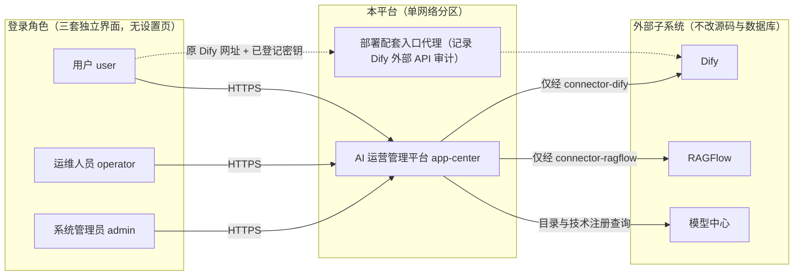
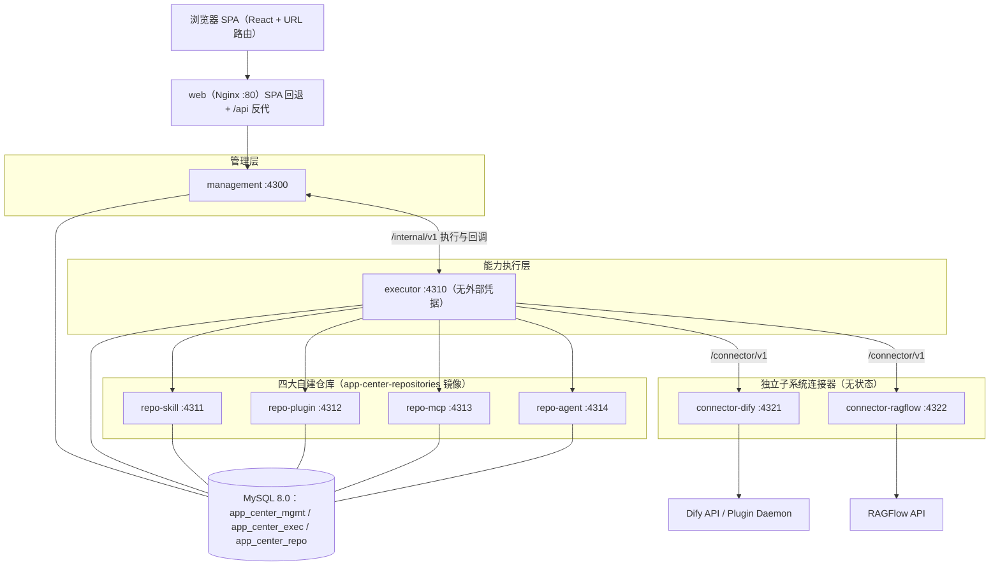
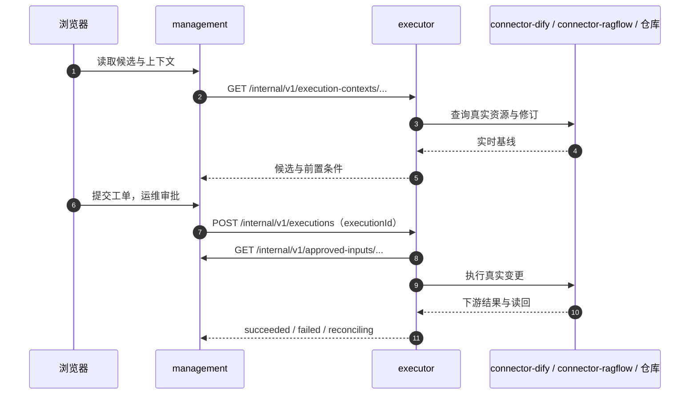

# AI 运营管理平台（app-center）软件架构总览

> 更新日期：2026-11-21。本文基于当前代码与契约编写，采用「精简 C4 分层 + 核心时序 + 代码目录映射 + 部署拓扑 + 实现水位」方法。

---

## 0. 一分钟速览

- **定位**：部署在**单一网络分区内**的 AI 资产**旁路治理平台**。不修改 Dify、RAGFlow 源码与数据库；所有改变资源、授权、目录或凭证的操作一律由**工单驱动**，经审批或自动校验后由能力执行服务通过独立连接器调用外部产品公开 API 或自建仓库。
- **技术栈**：
  - 前端：React 19 + TypeScript + Vite 8 + Recharts；三套按角色独立渲染的界面，**全站 URL 路由**（History API，支持深链、前进/后退、F5 刷新恢复会话）。
  - 后端：零框架 Node.js 22 原生 `node:http`；存储层 `runtime/http.mjs` 的 `ledger()` 双驱动——**生产 MySQL 8.0**（`STORAGE_DRIVER=mysql` / `MYSQL_URL`），本地测试默认 SQLite（WAL）。两者均保留事务、`SELECT … FOR UPDATE` 行锁与 `AUDIT_HISTORY_IMMUTABLE` 审计不可篡改守卫。
  - 服务通信：内网 HTTP `/internal/v1` + `Bearer INTERNAL_TOKEN`；连接器对外 `/connector/v1/*`；所有服务提供免鉴权 `GET /healthz`。正式部署要求服务身份与双向 TLS。
  - 部署：**6 个业务镜像 + 1 个 MySQL 8.0，共 10 个容器**（见 §6）。
  - 架构门禁：`npm run check:boundaries` 同时检查管理端、能力端与连接器边界。

### 工作区根目录

| 根目录项 | 定位 |
| --- | --- |
| `app-center/` | **本项目唯一代码仓库** |
| `dify-1.7.1/`、`dify-1.14.0/`、`ragflow-0.22.1/` | 外部产品参考源码，只读对照与本地联调，**严禁修改** |
| `开发交接包/` | `dev/export-handoff.py` 导出的源码快照 |
| `app-center-design.md`、`AI运营管理平台.docx` | 上层业务需求与详细设计 |
| `进度记录文档.md` | 项目推进流水账（仓库外） |

---

## 1. 系统边界（C4-L1）

关键约束：网络分区隔离（用户域、数据域各部署一套）；旁路零侵入、不建 SSO；工单驱动一切变更；三类角色严格分权（账号类工单 `ACC-*` 仅系统管理员办理，业务工单由运维办理）。

---

## 2. 服务拓扑（C4-L2）

| 服务 | 端口 | 生产入口 | 数据归属 |
| --- | :---: | --- | --- |
| `web` | 80 | `docker/Dockerfile.web`（Nginx + `dist/`） | 无状态 |
| `management` | 4300 | `server/start-management.mjs` | `app_center_mgmt`：身份/会话、27 类工单、草稿、类型、事件、审计 |
| `executor` | 4310 | `server/start-executor.mjs` | `app_center_exec`：执行与幂等、各模块 `mod_*` 台账、账号基线、观测快照 |
| `repo-skill/plugin/mcp/agent` | 4311–4314 | `server/start-repository.mjs`（`REPO_SERVICE`） | `app_center_repo` + 各自对象卷（Skill 文件、插件包） |
| `connector-dify` | 4321 | `server/start-connector-dify.mjs` | 无状态；**唯一持有** `DIFY_*` 凭据，负责 401 令牌续签、Plugin Daemon 转发、版本适配 |
| `connector-ragflow` | 4322 | `server/start-connector-ragflow.mjs` | 无状态；**唯一持有** `RAGFLOW_*` 凭据，负责鉴权转发、外部知识库端点、版本适配 |

本地开发：`npm run dev` 由 `dev/vite-api.mjs` 挂载管理 API 并通过 `localStack()` 拉起 executor 与四仓库（SQLite 落在 `.local-data/`）；`npm run dev:live` 接入本地真实 Dify/RAGFlow。未设置 `DIFY_CONNECTOR_URL` / `RAGFLOW_CONNECTOR_URL` 时 executor 走直连兼容模式，设置后全部经连接器。

### 跨层通信铁律

- 浏览器只访问 `management`；`vite.config.ts` 禁止前端读取服务端、能力层与连接器代码。
- `management` 只与 `executor` 通信，不导入 `capability/` 或 `connectors/`。
- `capability/modules` 只经注入的 `clients.{skill,plugin,mcp,agent,management}` HTTP 调用仓库，只经 `platform/dify`、`platform/ragflow` 调用连接器，不导入连接器源码。
- `connectors/dify` 与 `connectors/ragflow` 互相独立，不导入管理端或能力端。
- 四个仓库只做资产与目录持久化，不重复审批，不承担运行时。

---

## 3. 代码目录（C4-L3）

| 目录 | 归属 | 说明 |
| --- | --- | --- |
| `management/app/` | 管理端装配 | 后端总路由 `server/service.mjs`、公共工单引擎；前端壳层 `web/App.tsx`、`Shell.tsx`、路由表 `web/routes.ts` |
| `management/platform/` | 管理端底座 | identity、workflow、packages、evidence、delivery、access、capability-client |
| `management/modules/` | 管理端 11 业务域 | 仅经 `public.server.mjs` / `public.web.ts` 暴露 |
| `management/shared-ui/` | 前端公共 UI | 组件、`RecordDetails`、样式（`consistency.css` 统一 4px 间距/8px 卡片/6px 控件规范） |
| `capability/app/` | 能力端装配 | `service.mjs` 启动时拉取连接器元数据；`modules.mjs` 唯一组合表 |
| `capability/platform/` | 能力端底座 | registry、execution、catalog、`dify`/`ragflow`（连接器客户端，兼容直连） |
| `capability/modules/` | 能力端 11 业务域 | handlers / adapters / queries / tests |
| `capability/repositories/` | 四大仓库服务 | skill、plugin、mcp、agent |
| `connectors/dify/`、`connectors/ragflow/` | 子系统连接器 | 独立镜像，按 `DIFY_ADAPTER_VERSION` / `RAGFLOW_ADAPTER_VERSION` 路由版本 |
| `runtime/` | 共享运行时 | `http.mjs`（服务、客户端、`ledger`、`/healthz`）、`mysql-ledger.mjs` + `mysql-worker.mjs`（同步接口桥接 mysql2 连接池） |
| `server/` | 生产启动入口 | `lifecycle.mjs`（必需环境变量、SIGTERM 优雅停机）、6 个 `start-*.mjs`，`package.json` 仅含服务端依赖 |
| `docker/` | 容器化部署 | 6 份 Dockerfile、`docker-compose.yml`、`nginx.conf`、`mysql/init.sql`、`.env.example`、部署说明 |
| `contracts/` | 跨层契约 | 能力 API、管理 API、仓库 API、管理端模块矩阵 |
| `dev/`、`tests/` | 门禁与测试 | 边界检查、分模块测试、浏览器回归、`review-ui.mjs` 视觉巡检、验收脚本 |

边界门禁（`check:boundaries`）：禁止跨服务直导、前后端混导、底座反向依赖、绕过门面私有访问、循环依赖；连接器纳入同一检查。

---

## 4. 核心链路

### A. 工单驱动执行

### B. SKL-03 Skill 领取与回执

管理端校验即办 → executor 向 repo-skill 预约交付 → 用户领取时 management 二次核验身份与授权、流式转发并校验 SHA-256 与长度 → 发送完成后提交回执 → 工单完成并写入不可篡改审计。

---

## 5. 前端架构要点

- 路由表 `management/app/web/routes.ts`：`/login`、仓库 4 页、监控 9 页、工单页及 `/manual/:工单编码` 深链；角色守卫（普通用户访问监控/待办回落 `/agents`，运维访问 `/types` 回落 `/overview`）。
- 会话恢复：`GET /api/demo-session` 基于 HttpOnly Cookie 返回当前身份，刷新或新开标签页不丢失登录态；退出后回到 `/login`。
- Nginx `try_files $uri /index.html` 支持任意深链直达；`/api/` 反代透传 `Host`、`X-Forwarded-*`，关闭缓冲以保证 Skill 流式交付。
- 视觉规范：统一 `consistency.css`；`dev/review-ui.mjs` 在 1440/1180/1024/768 四档视口巡检 127 页，要求零溢出、零截断。

---

## 6. 部署拓扑（Docker）

| 镜像 | 容器 | 网络 | 体积（实测） | 升级场景 |
| --- | --- | --- | :---: | --- |
| `app-center-web` | web | edge_net（唯一对外端口） | 75 MB | 前端改版 |
| `app-center-management` | management | edge_net + internal_net | 251 MB | 管理流程 |
| `app-center-repositories` | repo-skill / plugin / mcp / agent | internal_net（断外网） | 249 MB | 仓库模型，**不随外部子系统重启** |
| `app-center-executor` | executor | internal_net + connector_net（断外网） | 250 MB | 工单编排逻辑 |
| `app-center-connector-dify` | connector-dify | connector_net + outbound_net | 239 MB | **随 Dify 版本独立发版** |
| `app-center-connector-ragflow` | connector-ragflow | connector_net + outbound_net | 239 MB | **随 RAGFlow 版本独立发版** |
| `mysql:8.0.39` | mysql | internal_net（断外网） | — | 1 实例 3 逻辑库 + 3 最小权限账号 |

> Node 后端镜像共享 `node:22-alpine` 基础层（约 239 MB），各自增量约 10 MB；离线 `docker save` 时基础层自动去重。

**多版本兼容策略**：同一个 `app-center-connector-dify` 镜像内置多个版本适配分支，按 `DIFY_ADAPTER_VERSION`（如 `1.7.1` / `1.14.0`）切换；不同分区复用同一套镜像，仅修改 `docker/.env`。升级 Dify 时只需 `docker compose up -d --no-deps connector-dify`。

部署命令与离线导出见 [docker/README.md](../docker/README.md)。

---

## 7. 当前实现水位（2026-11-21）

| 维度 | 状态 | 依据 |
| --- | --- | --- |
| 架构与门禁 | 已完成 | 管理端 270 文件 / 11 模块，能力端 + 连接器 151 文件 / 11 模块；`oxlint` 0 警告 |
| 管理端 | 开发闭环 | 4 仓库 + 9 监控 + 对话/手工申请 + 审批审计；51 项浏览器回归通过；127 页视觉巡检 0 问题 |
| 能力端 | 52/59 原子任务 | 33/33 动作接线；`test:capability` 83/83；集成测试 245/245 |
| 真实产品联调 | 23/35 分支 verified，20/27 整单 | 剩余 KB-03、PLG-04、MCP-01~03、ACC-01~02 受外部依赖或社区版接口边界阻塞 |
| 容器化 | 已完成本机实测 | 10/10 容器 healthy；MySQL 三库落盘；连接器读回 6 个 Dify 应用、4 个 RAGFlow 知识库；executor 内零外部凭据 |
| 生产安全配套 | 待上线加固 | 替换演示会话为正式身份源/SSO、演示口令、HTTPS 证书与服务间 mTLS |

`GET /internal/v1/capabilities` 将「代码已实现」与「目标工作区已核验」严格解耦，缺少 `CAPABILITY_EVIDENCE_FILE` 证据时返回 `unverified`，不伪造 `verified`。

---

## 8. 常用命令

| 场景 | 命令 |
| --- | --- |
| 本地全栈开发 | `npm run dev` |
| 接入本地真实 Dify/RAGFlow | `npm run dev:live` |
| 全量门禁 | `npm run check` |
| 能力端测试 | `npm run test:capability [-- 模块]` |
| 浏览器回归（并行） | `node dev/check-ui-browser.mjs` |
| 视觉巡检 | `node dev/review-ui.mjs` |
| 容器构建与启动 | `cd docker && docker compose build && docker compose up -d` |

延伸阅读：[README](../README.md)、[契约索引](../contracts/README.md)、[能力组件结构与分工](../分工文档/能力组件结构与分工.md)、[总设计](../分工文档/总设计.md)、[详细设计](app-center-design.md)、[容器部署](../docker/README.md)。
