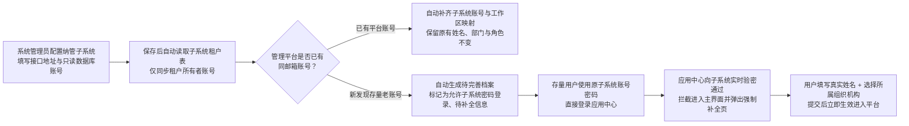
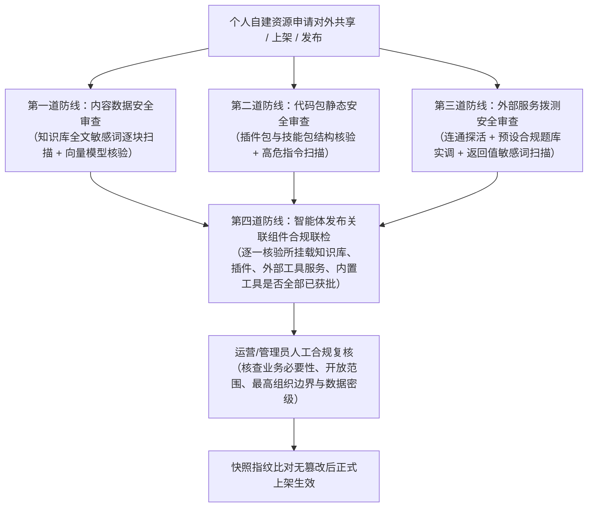
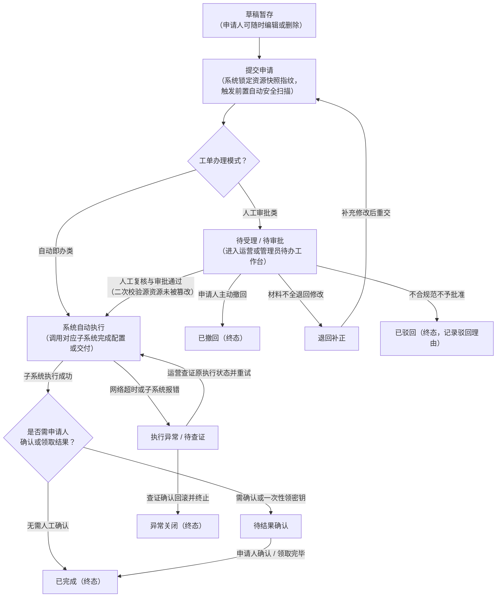

# 智能体应用中心业务流程与运行管理规范

**文档密级**：内部公开  
**适用范围**：智能体应用中心建设、运营审核、安全监管与日常使用各参与方  
**文档定位**：本规范为智能体应用中心（以下简称“应用中心”）的总体业务逻辑与运行管理纲领性文件，用于明确平台管理定位、职责边界、组织与账号纳管机制、安全合规审查流程、各类人工智能资源的准入与全生命周期管控规则、工单审批流转标准以及运行监控指标与图表体系。本文档聚焦业务流程、管理规则与审定标准，不涉及底层软件编码与具体技术实现细节。

---

## 目录

- **第一章 总则**
  - 一、建设背景与总体目标
  - 二、平台核心定位
  - 三、管理范围与职责边界
  - 四、总体管控原则
- **第二章 组织架构、角色权责与账号纳管规范**
  - 一、多级组织机构管理规范
  - 二、平台角色划分与权责矩阵
  - 三、子系统接入与存量账号纳管流程
  - 四、跨平台账号全生命周期管理流程
- **第三章 安全合规审查与准入防线规范**
  - 一、安全合规总体防线设计
  - 二、知识文档敏感词审查流程
  - 三、插件与技能包安全检查流程
  - 四、外部工具服务连通与题库拨测流程
  - 五、智能体发布前依赖组件合规联检流程
  - 六、权限边界控制与版本防篡改机制
- **第四章 纳管资源全生命周期管控规则**
  - 一、纳管资源总体分类
  - 二、知识库资源管控规则
  - 三、智能体应用管控规则
  - 四、插件资源管控规则
  - 五、技能包资源管控规则
  - 六、外部工具服务与内置工具管控规则
  - 七、应用访问密钥管控规则
- **第五章 共享资源仓库与申领使用规范**
- **第六章 工单体系与审批流转规范**
- **第七章 运行监控指标、可视化图表与异常处置闭环规范**
- **第八章 系统基础设置与运行保障规范**

---

## 第一章 总则

### 一、建设背景与总体目标

随着各业务部门广泛开展大模型应用建设，智能体开发平台、向量知识库平台及各类扩展工具已在日常业务中大量投入使用。但在多团队并行开发与使用过程中，普遍面临以下管理痛点：
1. **存量资产底数不清**：各业务团队在底层开发平台自建了大量账号、应用、知识库与工具，缺乏统一的跨部门资产台账与组织归属关系。
2. **对外共享缺乏安全把关**：知识文档是否含违规敏感内容、插件与外部工具服务是否存在越权访问或高危操作、智能体发布时所引用的组件是否经过合规审批，缺乏统一的前置审查防线。
3. **权限边界难以约束**：跨部门共享知识库、调用智能体或发放访问密钥时，缺少按组织机构、业务条线与数据密级进行精细化授权和到期回收的手段。
4. **运行态势缺乏统一监控与应急止损**：应用调用突增、插件频繁报错、外部服务超时或出现违规内容时，缺乏集中监测大盘、自动预警阻断及闭环处置留痕机制。

为此，建设统一的**智能体应用中心**，旨在不推翻、不改造原有底层开发子系统的前提下，建立一套覆盖**“账号实名归属、前置安全审查、工单授权准入、共享目录复用、运行态势监控、异常自动阻断、全链路审计追溯”**的规范化运营管理体系。

---

### 二、平台核心定位

应用中心定位于单位内部人工智能应用生态的**“统一运营管控与安全治理中枢”**。其核心职能概括为四句话：
1. **不管日常编排，专管准入与共享**：研发人员在底层开发子系统中自由开展日常提示词调试、工作流编排与个人知识库搭建；一旦涉及跨人共享、上架仓库、对外发布、安装扩展组件或申领访问密钥，必须统一纳入应用中心履行安全审查与审批程序。
2. **统一身份归属，打通组织视图**：将分散在各业务子系统中的独立租户与个人账号，统一映射归属到标准多级组织架构之下，实现按部门管人、按部门管资产、按部门看统计。
3. **集中目录服务，促进合规复用**：经过安全审查与审批通过的优质智能体、知识库、插件、技能包与外部工具服务，统一进入应用中心共享仓库，供授权范围内的业务人员按权限检索、申领与复用，避免重复建设。
4. **实时监测预警，保障运行安全**：对全平台纳管资源的健康状态、调用频次、异常错误与违规风险进行持续监测，发现高危异常时自动执行限流、隔离或禁用，并派发安全事件单跟踪至复核关闭。

---

### 三、管理范围与职责边界

为确保权责清晰、避免重复建设，应用中心与各关联子系统的职责边界严格划分如下：

| 事项类别 | 智能体应用中心职责（本平台管什么） | 底层业务子系统及外部平台职责（子系统自己管什么） |
| :--- | :--- | :--- |
| **账号与组织** | 维护一至六级标准组织架构；自动同步子系统存量租户账号；强制首次登录实名与部门归属补全；审批跨平台开户、调岗、更名与停用。 | 维护子系统自身的工作区内部协作关系及日常开发界面会话。 |
| **知识库管理** | 个人知识库纳管登记；对外共享前的向量模型核验、全文敏感词自动审查与人工逐篇复核；跨部门/跨工作区授权绑定与复制；违规文档强制下线。 | 文档上传、文本切片、向量化入库、索引构建及底层全文/向量检索计算。 |
| **智能体管理** | 智能体纳管登记；发布前对所含知识库、插件、外部工具服务、内置工具的合规联检；上架发布、版本更新与下架审批；统一网页对话、嵌入与访问密钥发放。 | 智能体提示词编写、对话流与工作流节点画布编排、单步调试预览。 |
| **插件与技能包** | 安装包与压缩包上传接收；高危行为静态安全检查；上架与版本更新审批；共享仓库展示；按工作区安装、升级、卸载审批；插件异常自动禁用；技能包实名下载核验。 | 插件在智能体工作流运行期间的实际功能执行与沙箱调度。 |
| **外部工具服务** | 外部工具服务（基于模型上下文协议的服务，即 MCP 服务）连通性探测、预设合规题库自动拨测与敏感词核验；上架登记、工作区绑定授权、异常隔离与解绑。 | 外部工具服务自身的业务逻辑运行及模型中心侧的底层技术注册健康检查。 |
| **运行监控与审计** | 十大运行监控大盘展示；调用突增、高失败率、高超时率自动告警与联动阻断；安全事件研判、处置、观察与双人复核；管理操作与运行访问全量审计导出。 | 底层大语言模型推理计费、算力资源调度（由模型中心承担）。 |

> **明确不纳入本平台建设范围的事项**：
> 1. 不重复建设智能体画布编排器、文档切片向量化引擎或底层大模型推理网关；
> 2. 不建设独立的提示词片段审批仓库（提示词随智能体整体发布与版本更新一并管理）；
> 3. 不在知识库日常实时检索请求中插入额外的逐条密级拦截（密级与组织边界在知识库共享审批和绑定授权环节前置把关）；
> 4. 线下应急演练桌面推演、人工撰写的专项运营简报等纯线下行政事务，不固化为系统硬性流程。

---

### 四、总体管控原则

1. **全流程工单留痕原则**：凡涉及资源上架、共享授权、组件安装、密钥发放、违规处置、账号变更及安全规则调整的操作，一律通过标准工单驱动。对于个人纳管登记、公开资源免审领用等高频低风险事项，系统采用“即办工单”自动核验并即时办结，既保障操作便捷性，又确保事事有单号、步步可追溯。
2. **个人自用从宽、对外共享严审原则**：业务人员在本人工作区内自建自用的知识库和草稿态智能体无需事前审批；一旦申请对外共享、上架公共仓库或发布上线，必须通过系统自动安全扫描与运营人工复核双重把关。
3. **最小权限与边界收敛原则**：每项资源上架时必须明确划定“开放范围”（全员共享、指定组织、指定人员、仅随指定应用生效）及“最高组织边界”。任何后续申请使用或关联发布的范围，均不得突破源资源的最高组织边界与密级约束。
4. **审批快照锁定与防篡改原则**：申请人在提交工单时，系统自动锁定待审资源的版本标识、文档清单与内容校验指纹。若在审批期间底层资源被私自修改（防止“送审甲版本、实际发布乙版本”），系统在审批通过与下发执行前将自动识别并拦截，要求重新提交审查。
5. **监测预警与自动止损闭环原则**：平台对运行异常实行分级预警；触发高危阈值时无需等待人工介入，先行自动执行禁用、隔离或限流止损，同步自动生成安全事件工单交由运营人员研判根因，修复并经观察期验证无误后方可双人复核关闭。

---

## 第二章 组织架构、角色权责与账号纳管规范

### 一、多级组织机构管理规范

组织机构是应用中心开展人员归属、权限过滤、资源共享边界判定、分级审批与分部门运营统计的基础底座。

1. **一至六级树形组织层级**：
   - 平台支持建立**一级至六级**树形上下级组织架构（例如：一级总机构 → 二级分支机构/支队 → 三级科室/大队 → 四至六级专项组/中队），每一层级均可按实际编制灵活扩展多个平行机构节点。
   - 上下级机构具备明确的隶属继承关系：当某项资源授权给上级机构时，可按规则覆盖其管辖的下属机构；当划定最高组织边界时，严禁向边界外的平行或上级机构扩散。
2. **预设编号与真实名称平滑演进规则**：
   - 在建设初期各层级机构名称尚未完全定稿时，系统支持先使用标准层级序号（如 `1.1`、`1.2`、`2.1`）进行占位初始化，先行开展账号绑定与业务试运行。
   - 后续系统管理员在「系统设置 — 组织机构」页面直接修改或批量填写真实机构名称时，底层机构唯一标识保持不变，并自动记录曾用名映射；所有历史工单、既有资源授权与审计台账自动同步显示新机构名称，确保历史数据不断链、不重配。
3. **机构停用保护规则**：
   - 因机构撤并需要停用某组织节点时，须先行将该组织下属存量人员调整至新机构；停用后的机构不再出现在新建工单的选择列表中，但历史审计记录完整保留备查。

---

### 二、平台角色划分与权责矩阵

应用中心严格划分为**普通用户、运营审核人员、系统管理员**三类登录角色。不同角色登录后呈现各自专属的导航菜单与操作工作台，不在无权限角色界面上展示无关入口或灰色不可用按钮。

| 角色名称 | 适用人员范围 | 导航可见范围 | 核心操作与办理权限 | 明确禁止事项 |
| :--- | :--- | :--- | :--- | :--- |
| **普通用户** | 各业务部门研发人员、一线民警及普通业务使用人员 | **共享仓库**（智能体、插件、外部工具服务、技能包仓库）；**工单中心**（对话申请、手工申请、我的申请） | 1. 浏览本人权限范围内可用的共享资源及使用热度排行； 2. 在线使用已获批的智能体，申领下载技能包，申请安装插件或绑定知识库与外部工具服务； 3. 提交本人名下知识库、智能体、插件、技能包、外部工具服务的纳管与上架申请； 4. 对本人尚未受理的工单进行草稿保存、撤回、退回补正修改及办结结果确认。 | 不可查看任何运行监控页面；不可查看他人申请或全量工单；不可审批任何工单；不可进入系统设置。 |
| **运营审核人员** | 平台日常运营团队、安全合规审核专员、运维值班人员 | 普通用户全部可见页面 + **十大运行监控页面** + **工单中心**（我的待办、工单查询） + **系统设置**（敏感词库、服务测试题库） | 1. 拥有普通用户全部申请与使用权限； 2. 受理、审核管辖范围内的全部业务类工单（知识库、智能体、插件、技能包、外部工具服务、访问密钥、内置工具），执行安全复核、退回补正、批准或驳回； 3. 查看十大监控大盘，研判并处置安全事件工单，对执行异常的业务工单进行状态查证、重试或终止； 4. 维护敏感词库与外部工具服务合规测试题库，导出管辖范围内的审计报表。 | 不可定义或停用工单类型模板；不可配置纳管子系统连接参数；不可审批跨平台账号开户与更名工单。 |
| **系统管理员** | 平台总体管理负责人、信息化管理部门系统管理员 | **全平台所有页面**：共享仓库、十大运行监控页面、工单中心全部页签、**系统设置全部五个页签**（组织机构、纳管子系统、敏感词库、服务测试题库、工单类型） | 1. 维护一至六级组织机构、接入并配置被纳管子系统、同步存量租户账号； 2. 定义、发布与管理全平台工单类型模板及适用组织范围； 3. 发起并审批跨平台账号开通、权限变更与账户更名工单； 4. **具备全量业务工单与安全事件的审批及督办权限**，可统筹办理各类待办事项，查看并导出全平台完整管理与访问审计台账。 | 不得绕过工单直接手工篡改受控资源的审批状态与审计记录；不得代替普通申请人编造业务申请理由。 |

---

### 三、子系统接入与存量账号纳管流程

针对真实生产环境中**“底层业务子系统（如智能体开发平台 Dify）先行投产运行、已积累上千个无部门归属且命名格式不一的老账号，应用中心后上线纳管”**的实际场景，平台采用**“子系统只读同步 + 原账号直接登录 + 首次登录强制实名归属”**的平滑纳管机制，确保原有业务零中断、用户无需记忆新密码。

具体管理规则如下：

#### （一）子系统接入配置与自动同步
1. 系统管理员在「系统设置 — 纳管子系统」中登记被纳管平台实例，填写服务接口地址，并必须配置该子系统数据库的**只读查询账号与密码**（应用中心仅读取账号与工作区基础信息，严禁直接修改子系统数据表，密码在应用中心加密存储）。
2. 配置保存生效时，系统**自动执行一次存量账号全量同步**；后续管理员可随时点击子系统卡片上的**「更新账号」**按钮执行增量同步。
3. **精准同步范围**：针对多租户智能体开发平台，系统仅同步具备独立空间管理权的**“租户所有者账号”**及其主工作区信息，忽略工作区内临时拉入的普通协作访客，避免一人多号或无效冗余。
4. **冲突保护规则**：同步时按登录邮箱（忽略大小写）比对：
   - 若应用中心已存在同邮箱正式账号，仅自动关联其子系统账号标识与工作区标识，**绝不覆盖**其已有的真实姓名、所属组织机构与平台管理角色；
   - 若为新发现的存量账号，自动在应用中心创建“待补全”人员档案，默认赋予普通用户角色，组织机构暂置为空。

#### （二）子系统账号实时验密与未同步兜底登录
1. **不留存子系统密码**：为满足安全保密规范并避免两边改密不一致，应用中心不复制、不存储用户在子系统中的密码密文。存量用户登录应用中心时，直接输入原有的子系统登录账号与密码，由应用中心向子系统登录接口实时核验。
2. **未同步新号自动兜底**：即使某个在子系统中新开的租户所有者账号尚未经过定时或手动同步，只要其本人使用该账号密码登录应用中心并通过子系统实时验密，系统当场自动为其建立“待补全”人员档案并引导完成实名归属，实现零等待无缝衔接。

#### （三）首次登录强制补全信息（提交即生效）
1. 凡处于“待补全”状态的存量账号首次登录应用中心，系统自动拦截主界面访问，全屏展示不可跳过的**「首次登录身份信息完善」**页面。
2. 页面只读展示当前登录的子系统账号与关联工作区名称（供本人核对无误），强制要求本人填写两项核心信息：
   - **真实姓名**（必填，用于工单实名发起与审计留痕）；
   - **所属组织机构**（必选，从平台标准多级组织机构下拉列表中选择）。
3. **立即生效机制**：为避免上千名存量用户集中上线时造成管理员审批拥堵，用户提交真实姓名与所属组织机构后**立即生效**，直接进入应用中心正常开展业务；系统管理员事后可在「跨平台账号监控」中随时抽查核验或发起机构调整。

---

### 四、跨平台账号全生命周期管理流程

存量老账号完成纳管收口后，新增人员及后续人事变动统一纳入应用中心工单化闭环管理：
1. **新员工跨平台统一开户**：由系统管理员通过「跨平台账号开通与变更工单」选定所属组织机构、真实姓名与平台角色，审批执行后由系统自动在智能体开发平台与向量知识库平台同步开通同名账号与个人工作区，从源头杜绝无主孤儿账号。
2. **部门调动与角色变更**：人员跨支队/跨科室调动或晋升为运营审核人员时，通过账号变更工单调整其组织机构与角色。调整生效后，历史工单与历史审计记录依然保留当时的“历史组织快照”，确保历史责任追溯准确无误；新发起的业务则按新组织权限执行。
3. **跨平台统一更名**：因账号规范化治理需要修改登录账户名时，通过「跨平台账户更名工单」一次性在应用中心及各关联子系统同步完成更名与别名映射，保障其名下历史上传包、在途工单与已授权资产归属不断裂。
4. **离职停用与权限冻结**：人员离职或调离岗位时，通过工单将其账号设为停用状态，立即阻断应用中心登录会话、撤回在途未办结工单并同步冻结各子系统访问权限。

---

## 第三章 安全合规审查与准入防线规范

安全合规审查是应用中心的核心价值所在。任何个人资源在走向“跨人共享、上架仓库、对外发布、接入运行”之前，都必须依次穿过平台设立的**四大自动化前置安全防线**与**人工合规复核节点**。

### 一、安全合规总体防线设计

---

### 二、知识文档敏感词审查流程

当用户申请将个人知识库对外分享（含上架共享目录、共享给指定组织/人员、或随智能体一并发布）时，必须执行以下五步内容安全审查：

1. **向量化模型合规核验**：系统首先自动读取该知识库所配置的向量化嵌入模型名称，与平台标准模型目录比对。若使用了未经纳管登记的外部私接模型，在审查单中自动高亮预警。
2. **文档与文本分段全量拉取**：系统自动拉取该知识库下的全部文档清单及每一篇文档切分后的全量正文片段，并计算每篇文档的唯一内容校验指纹，防止漏检长文档末尾内容。
3. **敏感词库自动比对扫描**：系统调用「系统设置 — 敏感词库」中处于启用状态的全部规则（覆盖涉密敏感、个人隐私泄漏、违规违禁词等类别，按“高危阻断、中危复核、低危提示”三级设定），对所有文档标题与正文片段逐一比对：
   - 记录每篇文档是否命中敏感词、命中的具体规则类别、严重级别及命中位置摘要。
4. **分级处置与人工逐篇确认**：
   - **命中高危阻断级敏感词**：系统自动标红警示，原则上不予放行；申请人须在源知识库删除或脱敏违规内容后重新发起审查。
   - **命中复核/提示级或未命中**：进入人工审批工作台，审核人员须对照系统生成的《逐文档安全审查清单》，逐篇核实确认“通过”或“不通过”。**存在任何一篇未确认或判定为“不通过”的文档时，严禁整库批准上架。**
5. **审查结论固化留痕**：审批通过时，每篇文档的身份标识、内容校验指纹及审查结论永久写入平台审计台账。后续若源知识库新增或修改了文档，必须触发增量复审流程。

---

### 三、插件与技能包安全检查流程

针对用户上传的离线插件安装包与技能包压缩文件，在进入人工审批前自动执行以下静态安全检查：

1. **包体完整性与结构规范核验**：
   - 核验文件体积上限、压缩包目录层级是否合法（严禁包含路径穿越等恶意构造路径）；
   - 自动解析包内描述清单（如插件名称、版本号、作者标识、运行环境要求、声明权限），缺少核心元数据或格式损坏的包当场拦截拒收。
2. **代码高危行为静态扫描**：
   - 系统自动扫描包内脚本与程序文件，重点排查是否存在**调用操作系统底层命令执行、任意动态代码执行、高危反序列化加载、未声明的外部网络直连或敏感系统目录读写**等高风险行为。
   - 扫描结果直接生成可视化安全检测报告单（列明风险等级、命中文件及风险类型说明），随工单提交至审核工作台。
3. **声明权限与业务必要性人工复核**：
   - 审核人员结合静态扫描报告，核查该插件或技能包所申请的权限（如外部网络请求、文件解析等）是否与其业务功能相符，严禁“小工具申请大权限”。
4. **包体唯一指纹锁定**：通过安全检查的包体由平台计算唯一文件指纹并存入受控对象存储库，后续下载与安装环节严格核对该指纹，确保分发包与受审包完全一致。

---

### 四、外部工具服务连通与题库拨测流程

外部工具服务运行在独立服务端，无法通过静态包扫描判断其安全性，因此平台实行**“实时连通探活 + 预设题库真调拨测 + 响应内容敏感词扫描”**三重动态审查：

1. **服务连通与工具清单探测**：系统向待登记的外部工具服务地址发起标准握手与工具列表查询请求，核验服务是否在线、响应耗时是否达标、返回的工具名称与入参结构是否完整规范。
2. **预设合规测试题库自动拨测**：
   - 系统读取「系统设置 — 服务测试题库」中已启用的标准测试题集（涵盖基础功能可用性测试题、边界越权试探题、敏感指令诱导测试题等）；
   - 自动向该外部工具服务的真实工具接口发起实调测试，记录每一道测试题的响应状态、耗时及返回正文。
3. **响应报文敏感词联动扫描**：将拨测返回的全部文本内容自动送入平台敏感词库进行二次扫描，检验该外部服务是否存在违规吐出内部敏感信息、系统路径或越权数据的行为。
4. **综合合规判定**：连通失败、拨测超时报错或响应内容命中高危敏感词的服务，系统自动标记“拨测不通过”并阻断上架登记；全部通过后生成完整拨测报告供审核人员终审确认。

---

### 五、智能体发布前依赖组件合规联检流程

智能体并非孤立存在，其内部往往编排挂载了多个知识库、插件、外部工具服务、内置工具乃至外部网页接口。为彻底堵住“智能体外壳合规、内部夹带未审违规组件”的漏洞，平台在智能体申请上架发布与版本更新时，强制执行**依赖组件穿透式合规联检**：

1. **编排配置深度解析**：系统自动读取待发布智能体的完整工作流画布节点与模型配置，自动梳理出其引用的全部关联组件清单，包括：
   - 关联的知识库清单；
   - 调用的插件工具清单；
   - 绑定的外部工具服务清单；
   - 启用的平台内置工具及自定义外部网络请求节点（例如直连外部域名的接口节点）。
2. **逐项合规状态比对**：系统将上述依赖清单与平台受控目录及授权台账逐一比对，生成四色合规体检卡片：
   - **知识库核验**：是否已完成安全审查并获批共享（或已提交随本智能体关联发布的分享审查）；
   - **插件与外部工具服务核验**：是否已在平台合规上架，且当前工作区具备合法使用授权；
   - **内置工具与外部网络请求核验**：所启用的高危内置工具是否已履行工具审批；工作流中若存在直连未备案外部网络地址的请求节点，自动标出“外部接口风险警示”。
3. **未合规项联动处置与范围收敛**：
   - 若发现存在未经审查的组件或高危未备案外部接口，在审批工作台中醒目提示风险详情，审核人员可直接驳回整改，或要求先行补办对应组件的审查工单。
   - **权限范围自动取交集**：智能体最终允许开放的组织范围与密级，不得超出其所挂载任一私有/受限知识库的最高组织边界。

---

### 六、权限边界控制与版本防篡改机制

1. **四维统一资源权限矩阵**：任何资源（知识库、智能体、插件、技能包、外部工具服务）在审批通过上架时，系统均将其授权范围固化为标准权限记录，包含四个控制维度：
   - **开放模式**：全员公开、指定组织机构、指定人员名单、仅随关联应用生效；
   - **最高组织边界**：允许传播与使用的最外层组织机构集合；
   - **数据密级**：公开、内部、敏感、机密；
   - **有效期限**：长期有效或指定截止日期（到期后系统自动收回访问与申领资格）。
2. **全环节版本指纹防篡改核验**：
   - **提交时锁定**：记录源对象修订版本号、配置摘要指纹或文件校验值；
   - **受理与审批时复核**：审核人员点击批准瞬间，系统再次实时核对源对象当前状态是否与送审快照完全一致；
   - **执行前终验**：下发子系统执行变更前做最终一致性校验。一旦发现送审后源端被改动，立即中止执行并退回重审，从根本上杜绝“审甲发乙”。

---

## 第四章 纳管资源全生命周期管控规则

### 一、纳管资源总体分类

应用中心围绕人工智能应用建设全链条，统一纳管 **六大类核心业务资源**（外加第二章所述的跨平台账号与组织资源）：
1. **知识库资源**（涵盖向量知识库平台与智能体开发平台内建知识库）；
2. **智能体应用资源**（涵盖对话助手、多轮对话流、自动化工作流、自主工具调用智能体四类形态）；
3. **插件资源**（扩展智能体外部能力的可安装功能插件包）；
4. **技能包资源**（供研发与业务人员下载复用的标准化编排模板、脚本与规范技能压缩包）；
5. **外部工具服务与内置工具资源**（基于标准协议接入的独立工具服务端及开发平台自带的高危系统工具）；
6. **应用访问密钥资源**（供外部业务系统通过程序接口调用已发布智能体的鉴权凭证）。

---

### 二、知识库资源管控规则

1. **创建与纳管登记阶段**：
   - 业务人员在底层知识库平台或智能体开发平台自建知识库并上传切分文档，个人自用无需事前审批。
   - 如需纳入平台统一视图或准备对外共享，由知识库所有者本人发起**「知识库纳管同步」**（系统核验归属权后即办登记）。
2. **对外分享与上架阶段**：
   - 所有者发起**「知识库分享申请」**，明确选择四种分享方式之一：**上架公共共享目录、定向共享给指定组织、定向共享给指定人员、仅随指定智能体发布生效**。
   - 必须经过第三章规定的“向量模型核验 + 全文敏感词自动扫描 + 运营人员逐篇文档复核确认”方可生效。
3. **申领绑定与跨空间复用阶段**：
   - 获权人员发起**「知识库使用与绑定申请」**（本人使用本人已纳管库为即办生效；跨人使用共享库须校验权限并审批）。
   - 系统根据源库与目标工作区的位置关系，自动完成**同空间直接绑定、外部知识库接口挂载、或跨工作区受控复制**，用户无需手工配置底层连接参数。
4. **内容变更复审与违规处置阶段**：
   - 已共享知识库在底层发生文档新增、修改或删除时，系统自动感知并向所有者派发**「知识库变更复审单」**；未完成增量安全复核前，变更风险受控管理。
   - 运行监测或人工举报发现知识库含泄密、超范围或失效错误材料时，通过**「知识库违规处置单」**执行定向删除违规文档、暂停共享或整库强制下架。

---

### 三、智能体应用管控规则

1. **开发与纳管登记阶段**：
   - 研发人员在智能体开发平台完成编排调试后，由工作区所有者发起**「智能体纳管登记」**，将其纳入应用中心资产目录（此时仅登记台账，不对外开放）。
2. **上架发布审核阶段**：
   - 发起**「智能体上架发布申请」**，填写适用业务场景、开放组织范围、数据密级及允许的访问方式（网页对话、页面嵌入、程序接口调用）。
   - 系统自动执行**依赖组件合规联检**（详见第三章第五节），审核人员重点核验业务必要性与组件合规性，审批通过后正式进入「智能体仓库」对外提供服务。
3. **使用开通阶段**：
   - 授权范围内的用户可在仓库直接发起**「智能体使用开通申请」**（公开免审类自动即办开通，受限审批类经审核通过后开通），在应用中心统一入口安全使用，杜绝匿名裸奔访问。
4. **版本升级与再发布阶段**：
   - 已上架智能体在底层修改了工作流节点、提示词或新增了关联工具后，原在线版本保持稳定，研发人员须发起**「智能体版本更新申请」**。系统自动对比新旧版本的组件差异并重跑合规联检，审批通过后平滑切换至新版本。
5. **下架评估与替代衔接阶段**：
   - 拟停用已上架智能体时，发起**「智能体下架申请」**。系统自动统计并展示**下架影响评估报告**（包括近 30 天调用量、当前已授权使用人数、仍在生效的访问密钥数量及关联告警），并支持指定兼容的**替代智能体**引导存量用户平滑迁移；审批通过后统一收回访问入口并联动清理关联权限。

---

### 四、插件资源管控规则

1. **插件准入与上架**：申请人上传标准插件安装包并发起**「插件上架申请」**，经平台包体结构核验、高危代码静态扫描及人工权限复核通过后，存入平台受控插件库并在「插件仓库」上架。
2. **插件版本升级**：同一插件发布新版本时发起**「插件版本更新申请」**，重走静态安全扫描与差异对比审核，保留历史版本记录。
3. **按工作区受控安装、升级与卸载**：业务人员不可在生产工作区私自上传未审插件，须从「插件仓库」选择已获批插件发起**「插件安装/升级/卸载申请」**，指定目标工作区（多实例场景精确到具体安装实例），审批通过后由平台自动调用子系统完成部署或卸载。
4. **运行异常自动熔断与恢复**：平台持续监测已安装插件的调用失败率、超时率与容器内存占用；一旦触发安全阈值，系统**自动定向禁用**故障插件并生成紧急复核工单，待排查修复后经**「插件异常复核恢复单」**审批方可重新启用。

---

### 五、技能包资源管控规则

1. **独立仓库定位**：技能包仓库是应用中心自建的标准化能力资产网盘库，用于集中沉淀经审核合格的业务编排模板、提示词工程规范包、数据处理脚本与实战战法包。
2. **上架与版本演进**：通过**「技能包上架申请」**与**「技能包版本更新申请」**上传压缩包，执行静态代码与文件安全检查，审核通过后生成唯一文件校验指纹入库展示。
3. **实名申领与可信交付确认**：
   - 授权用户发起**「技能包下载申领」**，系统校验当前版本权限后生成受控下载通道；
   - 下载传输过程实行**完整性校验与交付回执核验**，真实记录每一次完整下载的领用人、所属组织、来源地址与领用时间；传输中断或管理员紧急取消时支持安全关闭下载流水。
4. **违规与过期下架**：发现技能包存在缺陷或已过时失效时，通过**「技能包下架申请」**核对历史下载影响面后下架封存（保留审计留档，禁止新申领下载）。

---

### 六、外部工具服务与内置工具管控规则

1. **外部工具服务上架登记**：申请人填写服务地址、工具说明与适用范围，发起**「外部工具服务上架登记」**。系统自动完成连通探活、预设题库实调拨测与响应内容敏感词扫描，审核通过后纳入「外部工具服务仓库」。
2. **工作区授权绑定**：业务人员需在自己的智能体工作区使用某项外部工具服务时，发起**「外部工具服务绑定申请」**（选定目标工作区及拟关联智能体），获批后由平台自动将该服务注入目标工作区的可用工具列表。
3. **异常隔离、解绑与下架**：当某外部工具服务出现连续报错、越权响应或需停服维护时，运营人员可通过**「外部工具服务处置单」**执行单工作区解绑、全网紧急隔离暂停或彻底下架注销。
4. **平台内置高危工具审批**：针对开发平台自带但涉及外部网络访问、代码解释执行或敏感数据读取的内置系统工具，实行**「内置工具启用、变更与撤销审批」**，核对工具配置参数指纹，严防配置篡改。

---

### 七、应用访问密钥管控规则

当外部业务系统（如警综平台、办案系统、门户网站）需要通过程序接口直接调用已发布的智能体时，严禁研发人员在底层平台私自生成密钥私下流转，统一按以下规则集中管控：

1. **实名登记与代建发放**：由应用负责人发起**「应用访问密钥申领」**，必填调用方系统名称、业务用途、预计峰值访问频次、允许调用的来源网络地址段及有效期限。审批通过后，由应用中心代为在底层平台生成密钥并登记绑定关系。
2. **一次性安全展示与领取**：新生成的完整密钥明文**仅允许申请人在工单办结页一次性查看并复制领取**，领取动作实时记录审计日志；此后全平台所有页面与报表中均只展示脱敏掩码（如仅保留末尾四位字符），杜绝密钥明文长期暴露。
3. **定期轮换与紧急吊销**：密钥临近到期、怀疑泄漏或外部调用系统下线时，通过**「访问密钥轮换与吊销工单」**生成新密钥平滑替换旧密钥，或立即废止原密钥阻断外部接口调用。

---

## 第五章 共享资源仓库与申领使用规范

共享资源仓库是面向全平台用户开放的**统一成果发现与合规申领门户**。所有经过第三章安全合规审查并履行第四章上架审批的资源，集中汇入共享仓库对外提供规范化服务。

### 一、共享仓库准入与三重可见性过滤规则

1. **未审不入库原则**：草稿态、待审批、审核驳回及已强制下架的资源，一律不得对普通用户展示。
2. **三重动态可见性过滤**：普通用户进入任一共享仓库时，系统根据其当前登录身份自动执行三重过滤，确保“只看得到有权看、用得了合规用”：
   - **第一重（状态过滤）**：仅展示当前处于“已上架且运行正常”状态的资源（运营审核人员与系统管理员可额外查看已下架、已隔离或暂不可用条目以便管理）。
   - **第二重（组织与人员范围过滤）**：全员公开资源对所有已归属组织的用户可见；指定组织资源仅对目标组织及其合规下属机构人员可见；指定人员资源仅对名单内账号可见；“仅随关联应用生效”的专属知识库不在公共目录单独列出。
   - **第三重（有效期过滤）**：已超过授权截止日期的资源自动从普通用户可用列表中隐藏。

---

### 二、四大共享仓库页面构成与申领流程

平台统一设立**智能体仓库、插件仓库、外部工具服务仓库、技能包仓库**四个标准目录页面（知识库共享目录内嵌于知识库使用申领与监控体系中）。每个仓库页面均由以下六个标准功能区块组成：
1. **分类与关键词检索栏**：支持按业务条线、功能标签、资源名称及简介快速筛选；
2. **精选与高频使用排行区**：按近阶段真实成功调用次数或成功下载次数展示前十名优质资源，引导业务部门优先复用成熟成果；
3. **资源标准化卡片列表**：展示资源名称、所属业务条线、安全密级、当前版本号、发布部门及简要功能说明；
4. **资源合规与版本详情抽屉**：点开任一卡片可查看详细适用场景、安全审查通过时间、权限边界说明、关联工单编号及历史版本记录；
5. **一键申领与使用操作区**：根据资源类型直接发起开通、安装、绑定或下载；
6. **异常反馈与事件上报入口**：使用过程中发现输出违规或运行故障，可直接关联网页发起安全事件上报。

各类仓库的具体使用与申领规则如下：

| 仓库名称 | 面向用户的核心功能 | 申领与生效方式 |
| :--- | :--- | :--- |
| **智能体仓库** | 集中展示全单位已获批发布的对话助手、业务研判流与自动化智能体 | 1. **网页在线对话**：获批后直接在应用中心安全窗口内对话使用； 2. **业务页面嵌入**：获取受控嵌入凭证集成至内部业务系统页面； 3. **程序接口调用**：联动发起「应用访问密钥申领」获取接口调用凭证。 |
| **插件仓库** | 展示已通过静态代码安全扫描的各类业务扩展插件 | 点击「申请安装」，选择本人名下目标工作区；公开免审插件自动安装到位，受限插件经运营审批通过后自动部署至目标工作区。 |
| **外部工具服务仓库** | 展示已通过连通探活与合规题库拨测的内部标准工具服务 | 点击「申请绑定」，选定目标工作区及拟关联智能体；审批通过后系统自动将该工具服务写入对应工作区可用列表。 |
| **技能包仓库** | 展示标准化工作流模板包、提示词规范包与数据处理工具包 | 点击「申请下载」，系统核验权限后自动生成下载工单并开启实名加密下载通道，下载完成后自动登记领用回执与下载计数。 |
| **共享知识库目录** | 在发起知识库使用工单时展示本部门及全员可用共享知识库 | 选择目标工作区与使用方式（直接检索引用、作为外部知识源挂载、或跨工作区受控复制），审批通过后自动完成挂载或复制。 |

---

## 第六章 工单体系与审批流转规范

工单体系是应用中心落实“事前审查、事中授权、事后追溯”的核心运转引擎。平台内一切改变资源状态、开放范围、安装绑定关系、账号权限及安全规则的行为，全部通过标准工单闭环流转。

### 一、工单运行总体机制

1. **双入口便捷填单机制**：
   - **智能对话引导申请**：申请人只需用日常自然语言描述办事意图（例如：“我想把刑侦支队的典型案例知识库分享给经侦支队使用”），系统自动识别并匹配对应的工单类型，提取关键信息预填表单；若意图存在多种可能，系统列出最匹配的候选工单供申请人确认，绝不擅自越权自动提交。涉及文件安全扫描与逐项核验的上架类申请，引导跳转至标准表单完成安全检查。
   - **分类手工标准申请**：按业务领域分类展示当前角色可发起的全部工单卡片，提供资源分页选择器、预设标签点选与必填项实时校验，禁止手工随意编造底层资源编号。
2. **两类办理模式分级分流**：
   - **自动即办工单**：针对个人资源纳管登记、本人使用本人已纳管资源、全员公开免审资源的领用下载等低风险高频事项，提交后系统自动完成归属权与前置条件校验，当场自动批准并下发执行，做到“秒级办结、全程留痕”。
   - **人工审批工单**：针对一切跨人共享、仓库上架、智能体发布、版本更新、高危工具启用、密钥发放、违规下架及账号变更事项，必须先完成自动化安全检查，再进入运营审核人员或系统管理员待办工作台履行人工把关。
3. **全表单草稿暂存与恢复重验**：
   - 所有人工填写的工单均支持随时保存草稿。恢复草稿继续办理时，系统强制重新拉取源资源的最新状态与版本号，防止草稿搁置期间底层资源已发生变动而沿用过期信息提交。

---

### 二、工单标准状态流转图与节点定义

各流转节点核心管理要求：
1. **待受理与撤回限制**：工单在未被审核人员正式受理前，申请人可随时撤回；一旦审核人员点击受理锁定工单，申请人不可再单方面撤回或篡改申请内容。
2. **退回补正机制**：申请理由不清、开放范围过大或缺少整改证明材料时，审核人员可填写明确补正意见退回申请人修改；补正重交后系统重新执行快照锁定与安全核验。
3. **执行异常安全查证规则**：当系统自动下发子系统执行遇到网络波动或结果未明时，严禁盲目重复创建底层资源。必须由运营人员或管理员在工单详情页执行“原流水状态查证”，确认底层真实状态后再决定安全重试或回滚关闭。

---

### 三、全量标准工单目录总表

平台共设立 **七大业务类别、30 项标准工单**（含 27 项日常业务、账号与安全事件工单，以及 3 项平台安全基线配置变更工单），全量清单如下：

| 序号 | 工单编码 | 工单标准名称 | 所属类别 | 办理模式 | 可发起角色 | 审批/办理角色 |
| :---: | :--- | :--- | :--- | :--- | :--- | :--- |
| 1 | `KB-01` | 知识库纳管同步 | 知识库管理 | 自动即办 | 普通用户、运营、管理员 | 系统自动核验办结 |
| 2 | `KB-02` | 知识库分享与上架申请 | 知识库管理 | 人工审批 | 普通用户、运营、管理员 | 运营审核人员、系统管理员 |
| 3 | `KB-03` | 知识库使用与绑定申请 | 知识库管理 | 本人即办 / 跨人审批 | 普通用户、运营、管理员 | 运营审核人员、系统管理员 |
| 4 | `KB-04` | 已共享知识库变更复审单 | 知识库管理 | 系统派单 + 人工复审 | 系统自动触发（派给所有者） | 运营审核人员、系统管理员 |
| 5 | `KB-05` | 知识库违规与异常处置单 | 知识库管理 | 人工审批 | 普通用户、运营、管理员 | 运营审核人员、系统管理员 |
| 6 | `AG-01` | 智能体纳管登记 | 智能体与密钥 | 自动即办 | 普通用户、运营、管理员 | 系统自动核验办结 |
| 7 | `AG-02` | 智能体上架发布申请 | 智能体与密钥 | 人工审批 | 普通用户、运营、管理员 | 运营审核人员、系统管理员 |
| 8 | `AG-03` | 智能体使用开通申请 | 智能体与密钥 | 公开即办 / 受限审批 | 普通用户、运营、管理员 | 运营审核人员、系统管理员 |
| 9 | `AG-04` | 智能体版本更新申请 | 智能体与密钥 | 人工审批 | 普通用户、运营、管理员 | 运营审核人员、系统管理员 |
| 10 | `AG-05` | 智能体下架申请 | 智能体与密钥 | 人工审批 | 普通用户、运营、管理员 | 运营审核人员、系统管理员 |
| 11 | `KEY-01` | 应用访问密钥申领 | 智能体与密钥 | 人工审批 | 普通用户、运营、管理员 | 运营审核人员、系统管理员 |
| 12 | `KEY-02` | 应用访问密钥轮换与吊销 | 智能体与密钥 | 人工审批 | 普通用户、运营、管理员 | 运营审核人员、系统管理员 |
| 13 | `PLG-01` | 插件上架申请 | 插件与工具 | 人工审批 | 普通用户、运营、管理员 | 运营审核人员、系统管理员 |
| 14 | `PLG-02` | 插件版本更新申请 | 插件与工具 | 人工审批 | 普通用户、运营、管理员 | 运营审核人员、系统管理员 |
| 15 | `PLG-03` | 插件安装、升级与卸载申请 | 插件与工具 | 公开即办 / 受限审批 | 普通用户、运营、管理员 | 运营审核人员、系统管理员 |
| 16 | `PLG-04` | 异常禁用插件复核恢复单 | 插件与工具 | 系统派单 + 人工复核 | 系统自动熔断触发 | 运营审核人员、系统管理员 |
| 17 | `TOL-01` | 平台内置高危工具开通与变更 | 插件与工具 | 人工审批 | 普通用户、运营、管理员 | 运营审核人员、系统管理员 |
| 18 | `SKL-01` | 技能包上架申请 | 技能包管理 | 人工审批 | 普通用户、运营、管理员 | 运营审核人员、系统管理员 |
| 19 | `SKL-02` | 技能包版本更新申请 | 技能包管理 | 人工审批 | 普通用户、运营、管理员 | 运营审核人员、系统管理员 |
| 20 | `SKL-03` | 技能包下载申领 | 技能包管理 | 公开即办 / 受限审批 | 普通用户、运营、管理员 | 运营审核人员、系统管理员 |
| 21 | `SKL-04` | 技能包下架申请 | 技能包管理 | 人工审批 | 普通用户、运营、管理员 | 运营审核人员、系统管理员 |
| 22 | `MCP-01` | 外部工具服务上架登记 | 外部工具服务 | 人工审批 | 普通用户、运营、管理员 | 运营审核人员、系统管理员 |
| 23 | `MCP-02` | 外部工具服务工作区绑定 | 外部工具服务 | 公开即办 / 受限审批 | 普通用户、运营、管理员 | 运营审核人员、系统管理员 |
| 24 | `MCP-03` | 外部工具服务解绑、隔离与下架 | 外部工具服务 | 人工审批 | 运营审核人员、系统管理员 | 运营审核人员、系统管理员 |
| 25 | `ACC-01` | 跨平台账号开通与权限变更 | 跨平台账号 | 管理员审批 | 系统管理员 | 系统管理员 |
| 26 | `ACC-02` | 跨平台账户统一更名 | 跨平台账号 | 管理员审批 | 系统管理员 | 系统管理员 |
| 27 | `EVT-01` | 安全事件研判与闭环处置单 | 安全与配置 | 研判处置 + 双人复核 | 系统告警触发 / 全员可上报 | 运营审核人员、系统管理员 |
| 28 | `CFG-01` | 组织机构配置变更记录单 | 安全与配置 | 管理留痕 | 系统管理员 | 系统管理员 |
| 29 | `CFG-02` | 敏感词库规则变更单 | 安全与配置 | 规则维护留痕 | 运营审核人员、系统管理员 | 运营审核人员、系统管理员 |
| 30 | `CFG-03` | 外部服务测试题库变更单 | 安全与配置 | 规则维护留痕 | 运营审核人员、系统管理员 | 运营审核人员、系统管理员 |

---

### 四、各分类工单详细业务流程说明

#### （一）知识库管理类工单（5 项）

1. **`KB-01` 知识库纳管同步**
   - **适用场景**：将用户在向量知识库平台或智能体开发平台自建的私有知识库登记纳入应用中心统一资产台账。
   - **流程步骤**：本人选择来源平台与名下目标知识库 → 填写业务条线与用途说明 → 系统自动校验知识库归属权及向量模型目录匹配情况 → 即时登记入账并生成资产编码。
2. **`KB-02` 知识库分享与上架申请**
   - **适用场景**：将已纳管的个人知识库开放给公共目录、指定部门、指定人员或随指定智能体发布使用。
   - **前置自动审查**：自动校验向量模型合规性；自动拉取全库文档分段执行**敏感词库全文扫描**，生成每篇文档的校验指纹与敏感词命中明细。
   - **人工审核要点**：核对目录名称与简介是否规范；核查分享范围、最高组织边界与数据密级是否合理；**逐篇确认文档审查结论**（全部文档确认“通过”方可放行）。
   - **生效结果**：写入平台统一资源权限表，正式进入共享知识库目录（或绑定待发布智能体生效）。
3. **`KB-03` 知识库使用与绑定申请**
   - **适用场景**：申请将本人已纳管知识库或他人已上架的共享知识库挂载到指定智能体开发工作区及具体应用中。
   - **流程步骤**：选择目标工作区与拟挂载智能体 → 选择源知识库与使用方式（检索引用 / 外部知识源接入 / 跨工作区复制） → 系统核验申请人组织与密级权限 → 本人自用即办生效，跨人共享经审核批准后由系统自动完成底层挂载或整库受控复制。
4. **`KB-04` 已共享知识库变更复审单**
   - **适用场景**：后台巡检发现已上架共享的知识库发生了文档新增、正文改动或删除时自动触发。
   - **流程步骤**：系统自动向所有者生成变更复审单并列出新增/变更文档差异及敏感词重扫结果 → 所有者补充变更说明 → 运营审核人员逐篇复核变更文档 → 通过后更新合法快照，不通过则联动转入违规处置。
5. **`KB-05` 知识库违规与异常处置单**
   - **适用场景**：发现共享知识库存在涉密敏感内容、超授权范围传播或资料严重过期失效时发起。
   - **流程步骤**：勾选目标知识库及需处置的具体违规文档（最多支持批量指定百篇文档），上传违规截图或核查证据，选择处置动作（删除指定文档 / 暂停对外共享 / 整库强制下架） → 审核批准后系统自动执行底层清理或收回全部共享权限。

---

#### （二）智能体与访问密钥类工单（7 项）

1. **`AG-01` 智能体纳管登记**
   - **适用场景**：研发人员将已在开发平台编排成型的智能体登记至应用中心台账。
   - **流程步骤**：选择所在工作区与源应用 → 系统读取应用模式、名称与编排概况校验归属权 → 自动即办完成纳管建档。
2. **`AG-02` 智能体上架发布申请**
   - **适用场景**：将已纳管智能体正式发布至「智能体仓库」供授权范围人员使用。
   - **前置自动审查**：自动执行**智能体依赖组件穿透式合规联检**（逐项检查关联知识库、插件、外部工具服务、内置工具是否均已获批，排查未备案外部网络请求节点）。
   - **人工审核要点**：审查业务场景必要性；结合四色合规体检卡核验是否存在未审组件夹带；核定开放方式（网页对话 / 页面嵌入 / 接口调用）、开放组织范围与最高组织边界（自动受限于所挂载知识库的边界交集）。
   - **生效结果**：锁定当前发布版本配置快照，正式上架「智能体仓库」并开通对应访问权限。
3. **`AG-03` 智能体使用开通申请**
   - **适用场景**：业务人员申请使用仓库中已上架的智能体。
   - **流程步骤**：选择目标智能体与申请开通的使用方式 → 公开免审应用自动即办开通；受限应用填写业务使用事由，经运营审核通过后开通在线对话或嵌入访问资格。
4. **`AG-04` 智能体版本更新申请**
   - **适用场景**：已上架智能体在开发平台完成提示词优化、工作流调整或组件增减后申请更新线上版本。
   - **流程步骤**：系统自动拉取新旧版本对比清单（展示新增或变更的知识库、插件、工具及近 30 天在线调用影响面）并重跑依赖合规联检 → 运营审核确认无新增违规风险后批准 → 线上平滑切换至新版本。
5. **`AG-05` 智能体下架申请**
   - **适用场景**：业务停办、应用合并或存在缺陷需将已发布智能体退出共享仓库。
   - **流程步骤**：系统自动生成**下架影响评估清单**（近 30 天调用次数、存量获批用户数、关联有效访问密钥数、未结告警数），申请人可指定功能兼容的**替代智能体** → 运营核验影响可控后批准 → 收回仓库展示与访问入口，同步联动处理关联密钥。
6. **`KEY-01` 应用访问密钥申领**
   - **适用场景**：外部业务系统需通过程序接口调用已获批开放接口能力的智能体。
   - **流程步骤**：选择目标智能体 → 填写对接系统名称、负责人、申请每秒调用上限、允许访问的来源网络地址段及有效截止日期 → 运营审批通过后，系统自动在底层代建密钥并进入“待结果确认”状态 → **申请人在工单页面一次性查看复制密钥明文**，确认后明文永久销毁仅留末尾四位掩码。
7. **`KEY-02` 应用访问密钥轮换与吊销**
   - **适用场景**：访问密钥临期更换、疑似泄漏紧急作废或对接系统停用。
   - **流程步骤**：从本人或管辖密钥台账中选择目标密钥（展示后四位掩码与对接系统名），选择“平滑轮换”或“立即吊销” → 审批通过后自动生成新密钥废止旧密钥（轮换新密钥同样执行一次性领取），或直接注销原密钥立即阻断接口访问。

---

#### （三）插件与内置工具管理类工单（5 项）

1. **`PLG-01` 插件上架申请**
   - **流程步骤**：上传插件离线包并填写功能说明、声明权限与开放范围 → 系统自动完成包结构核验与**代码高危行为静态扫描** → 运营审核人员结合扫描报告审查安全性与权限最小化原则 → 批准后存入受控插件库并在「插件仓库」上架。
2. **`PLG-02` 插件版本更新申请**
   - **流程步骤**：针对已上架插件上传新版本安装包 → 自动重跑静态代码扫描并比对版本权限变化 → 运营审批通过后更新仓库推荐版本。
3. **`PLG-03` 插件安装、升级与卸载申请**
   - **流程步骤**：选择操作类型（新装 / 升级至新获批版本 / 从工作区卸载）及目标工作区（多实例场景精确选定具体安装实例） → 系统核验工作区资格与目标版本指纹 → 审批（或公开免审即办）通过后，系统自动向开发平台下发安装、升级或卸载指令并回写实例状态。
4. **`PLG-04` 异常禁用插件复核恢复单**
   - **流程步骤**：当监控发现某插件报错率、超时率或容器内存超阈值并执行**自动定向禁用**后，系统自动生成本复核单 → 责任人排查故障并上传修复说明 → 运营审核确认风险消除后批准恢复启用。
5. **`TOL-01` 平台内置高危工具开通、变更与撤销审批**
   - **流程步骤**：选择目标工作区及拟启用的平台内置工具（展示脱敏配置参数与变更前后差异） → 系统锁定配置指纹 → 安全审核通过后登记为合法授权工具，供智能体发布联检核验；不再使用时可发起撤销清理。

---

#### （四）技能包管理类工单（4 项）

1. **`SKL-01` 技能包上架申请**：上传技能压缩包，填写适用业务条线、使用说明与开放范围 → 自动执行静态安全扫描与包体指纹计算 → 运营审核通过后入库上架「技能包仓库」。
2. **`SKL-02` 技能包版本更新申请**：上传升级后的技能压缩包并填写版本更新日志 → 自动重跑安全检查 → 审核通过后发布新版本，历史版本保留备查。
3. **`SKL-03` 技能包下载申领**：用户在仓库点击申领下载 → 公开技能包自动即办通过、受限技能包经审核批准 → 开启受控文件传输通道，校验包体指纹无误并完成客户端接收后，自动写入完整交付回执与下载统计；若发现异常支持运营人员中途取消关闭交付流水。
4. **`SKL-04` 技能包下架申请**：展示该技能包当前版本号及累计下载领用次数 → 填写下架原因 → 运营审批通过后从仓库下线停止新下载，同时保留历史交付审计档案。

---

#### （五）外部工具服务管理类工单（3 项）

1. **`MCP-01` 外部工具服务上架登记**
   - **前置自动审查**：系统向填报的服务地址自动发起**连通探活 + 预设合规测试题库真实调用拨测 + 返回内容敏感词扫描**，生成完整拨测体检单。
   - **人工审核与生效**：审核人员核验拨测报告、服务提供方归属及开放组织边界，批准后正式上架「外部工具服务仓库」。
2. **`MCP-02` 外部工具服务工作区绑定**
   - **流程步骤**：选择拟绑定的外部工具服务、本人目标工作区及拟使用该服务的智能体 → 核验权限通过后，系统自动以目标租户身份调用开发平台接口完成工具服务配置注入，无需人工手填服务地址。
3. **`MCP-03` 外部工具服务解绑、紧急隔离与下架处置**
   - **流程步骤**：运营或管理员针对异常或停服的外部工具服务，精准选择处置范围：**解除指定工作区绑定、全平台紧急隔离暂停使用、或彻底从仓库下架** → 审批通过后自动批量解除底层工作区配置并更新目录状态。

---

#### （六）跨平台账号管理类工单（2 项）

1. **`ACC-01` 跨平台账号开通与权限状态变更**
   - **流程步骤**：由系统管理员发起，支持新增人员统一开户、调整所属组织机构、变更平台角色、变更子系统空间权限以及离职停用/恢复启用 → 审批执行前自动封存各子系统原状态基线 → 自动同步下发至智能体开发平台与知识库平台 → 若任一子系统执行异常，严格执行**跨平台一致性查证与安全回滚解锁**，严防多平台账号状态劈叉。
2. **`ACC-02` 跨平台账户统一更名**
   - **流程步骤**：由系统管理员发起原账户名向新账户名的统一变更 → 校验新账户名全网唯一无冲突 → 原子更新本平台及各关联子系统账户名，并将原账户名记入历史别名列表，确保历史工单、上传附件与已授权资产无缝延续。

---

#### （七）安全事件与平台安全基线配置类工单（4 项）

1. **`EVT-01` 安全事件研判与闭环处置单**
   - **触发来源**：运行监控触发阈值**系统自动告警生成**，或业务与运维人员在页面**手工上报**。
   - **全闭环五步流转**：`未研判` → 运营受理研判严重等级并制定止损措施进入 `处置中`（可联动发起知识库下线、插件禁用、外部服务隔离等处置动作） → 设定观察截止时间进入 `观察中` → 观察期满自动转为 `待复核` → **必须由非处置人本人的另一名审核人员/管理员执行双人复核确认**，核实风险彻底消除后转为 `已关闭`（若复发可重新退回 `处置中`）。
2. **`CFG-01` 组织机构配置变更记录单**：系统管理员在组织机构页面新增层级节点、填写真实机构名称或调整启停状态时，自动生成标准配置变更记录，完整留存修改前后对比快照。
3. **`CFG-02` 敏感词库规则变更单**：运营审核人员或管理员新增、修改、启停敏感词分类与词条规则时留痕记录，生效后立即应用于后续所有知识库分享审查与外部工具服务拨测扫描。
4. **`CFG-03` 外部服务测试题库变更单**：运营审核人员或管理员新增、编辑、启停外部工具服务标准合规测试题集时留痕记录，生效后立即应用于后续外部工具服务准入拨测。

---

## 第七章 运行监控指标、可视化图表与异常处置闭环规范

运行监控体系面向**运营审核人员**与**系统管理员**开放（普通用户不可见），用于全面掌握全平台纳管资产规模、实时调用态势、服务健康状况、安全告警闭环效率及合规审计轨迹。

### 一、监控统计与展示通用规则

1. **标准时间窗口切换**：所有趋势类监控页面统一支持 **近 1 小时、近 24 小时、近 7 天、近 30 天** 四档时间范围切换（近 1 小时与 24 小时按分钟/小时粒度聚合，近 7 天与 30 天按小时/日粒度聚合）。
2. **真实数据与未采集状态严格区分原则**：
   - 当某项指标已正常接通采集且实际发生次数为零时，页面明确显示数字 `0`；
   - 当某个外部子系统尚未完成探测采集或采集数据已超过有效新鲜度时限（超过 5 分钟未更新）时，页面必须明确标注**「未采集」**或**「数据待刷新（附最后更新时间）」**，严禁将未采集状态伪造显示为 `0` 或健康绿灯，防止误导运维研判。
3. **组织权限隔离原则**：运营审核人员按管辖组织范围查看对应监控明细与业务待办（不含跨平台账号配置工单）；系统管理员可查看全平台汇总及全部明细数据。

---

### 二、十大运行监控页面指标体系与可视化图表清单

#### （一）统一运行概览大盘

- **页面定位**：全平台运行态势“一张图”总览，集中呈现资产底数、调用热度、服务存活、待办积压与突出安全告警。
- **顶部核心指标卡（6 张）**：
  1. 已上架可用资源总数（含智能体、知识库、插件、外部工具服务、技能包分项计数及较昨日增减量）；
  2. 今日累计调用总次数（含网页对话与外部接口调用合计及调用成功率）；
  3. 当前待办审批工单数（区分普通待办与超时待办）；
  4. 未闭环安全事件数（突出显示“紧急”与“重要”级别未结事件数）；
  5. 纳管子系统及核心服务在线率（在线实例数 / 纳管总数）；
  6. 已实名归属组织账号数（已补全组织账号数 / 同步总账号数）。
- **可视化图表（4 幅）**：
  1. **全平台调用量与异常率趋势图（双轴折线图）**：横轴为时间刻度，左纵轴展示调用总次数曲线，右纵轴展示调用失败率百分比曲线，直观反映业务高峰与故障波动；
  2. **纳管资源分类占比图（环形饼图）**：展示智能体、共享知识库、插件、外部工具服务、技能包五类在架资产的数量构成比例；
  3. **未关闭安全告警等级分布图（分段柱状图 / 环形图）**：按“紧急、重要、一般”三个等级统计当前存量告警数量；
  4. **高频异常对象前十排行图（横向条形图）**：按近期触发告警或调用报错次数从高到低排列前 10 个风险资源（智能体、插件或外部服务），支持点击直达对应监控页。
- **底部管理明细表（2 张并列简表）**：
  - 《近期关键管理操作动态表》（时间、操作人、所属部门、工单单号、动作摘要）；
  - 《各纳管子系统与核心服务实时健康探活表》（服务名称、服务类别、最近探测状态、探测耗时、最后更新时间）。

---

#### （二）知识库运行监控页

- **页面定位**：全面监管跨平台知识库资产规模、共享开放范围、文档安全审查覆盖率与异常变更情况。
- **顶部核心指标卡（4 张）**：
  1. 已纳管知识库总数（区分向量知识库平台与智能体开发平台来源）；
  2. 已审批对外共享知识库数（含公共共享目录库与定向授权库）；
  3. 累计受审通过文档总数与分段总数；
  4. 待复审变更知识库数 / 命中敏感词待处置库数。
- **可视化图表（3 幅）**：
  1. **知识库来源平台与共享模式分布图（分组柱状图）**：对比不同来源平台下“个人私有、指定组织、指定人员、公共目录、随应用发布”各模式的知识库数量；
  2. **知识库数据密级构成图（环形饼图）**：展示公开、内部、敏感、机密四级知识库占比；
  3. **高频引用与检索知识库前十排行图（横向条形图）**：统计被智能体挂载绑定次数及检索调用次数最高的前 10 个共享知识库。
- **底部管理明细表**：
  - 《全量纳管知识库监管台账》：包含知识库名称、来源平台、所属组织、所有者姓名、文档篇数、向量模型合规状态、敏感词审查状态、当前共享范围、更新时间；
  - **联动处置动作**：对存在未审变更的条目一键督办 `KB-04` 变更复审；对发现违规内容的条目直接发起 `KB-05` 违规下线或文档清理工单。

---

#### （三）智能体运行监控页

- **页面定位**：按组织与工作区归集底层平台全部智能体（含未上架草稿应用与已上架正式应用），监控运行调用质量、响应耗时与外部密钥使用情况。
- **顶部核心指标卡（5 张）**：
  1. 底层存量智能体总数 vs 已上架仓库正式运行数；
  2. 选定时间窗内总调用次数（区分广场网页对话与外部程序接口调用）；
  3. 平均响应耗时与九五分位响应耗时（毫秒）；
  4. 整体调用成功率与异常报错次数；
  5. 当前生效中的应用访问密钥总数。
- **可视化图表（4 幅）**：
  1. **智能体调用量与报错量时序趋势图（面积折线组合图）**：展示各时段对话与接口请求量及失败请求峰值，用于识别调用突增异常；
  2. **智能体应用形态分布图（环形饼图）**：统计对话助手、多轮对话流、自动化工作流、自主智能体四类应用占比；
  3. **各组织机构智能体建设与活跃度对比图（柱状图）**：按一级/二级部门对比上架智能体数量与累计服务人次；
  4. **热门智能体调用排行与高故障率智能体排行（双栏横向条形图）**：左栏展示调用量前十名标杆应用，右栏展示失败率最高的前十名待优化应用。
- **底部管理明细表**：
  - 《全量智能体运行与合规台账》：应用名称、应用类型、所属部门与工作区、上架状态、关联组件合规状态、生效密钥数、近期调用次数、失败率、平均耗时；
  - **联动处置动作**：查看调用异常详情、针对违规或高故障应用直接发起 `AG-05` 强制下架、或发起 `KEY-02` 吊销异常外部密钥。

---

#### （四）基础服务健康监控页

- **页面定位**：持续监测应用中心自身核心业务节点及所有已接入外部子系统（智能体开发平台、向量知识库平台、插件守护服务、模型推理网关）的存活状态与接口延迟。
- **顶部核心指标卡（4 张）**：
  1. 监测服务节点总数；
  2. 健康在线服务数；
  3. 响应降级或高延迟服务数；
  4. 离线中断故障服务数。
- **可视化图表（2 幅）**：
  1. **核心服务接口探测延迟趋势图（多曲线折线图）**：对比各子系统与关键服务在选定时间窗内的探活响应毫秒数波动；
  2. **近 7 天各服务可用率达标对比图（横向进度条形图）**：展示各服务在线可用百分比（如 `99.9%`）。
- **底部管理明细表**：
  - 《服务健康巡检状态表》：服务名称、所属分类、目标地址、当前状态（正常 / 降级 / 异常 / 未采集）、最近一次探测耗时、连续正常运行时长、最近故障原因摘要，支持手动点击「立即探活」。

---

#### （五）插件运行监控页

- **页面定位**：严密监控全平台插件仓库资产、各工作区插件安装分布、插件运行健康度（报错率、超时率、内存占用）及自动熔断禁用记录。
- **顶部核心指标卡（5 张）**：
  1. 仓库已上架合规插件总数；
  2. 各工作区累计安装实例总数；
  3. 插件守护服务运行状态与容器内存占用率；
  4. 选定时间窗插件调用总次数与综合失败率；
  5. 已触发自动熔断禁用的异常插件实例数。
- **可视化图表（4 幅）**：
  1. **插件调用失败率与超时率趋势图（双折线图 + 阈值红线）**：实时描绘插件报错率与超时率变化，标示自动熔断红线位置；
  2. **插件运行容器内存与资源占用趋势图（面积趋势图）**：监测插件运行环境内存消耗，防范内存泄漏拖垮宿主平台；
  3. **高频报错插件排行图（横向条形图）**：按近期报错与超时次数排列前十名问题插件；
  4. **各插件跨工作区安装覆盖率排行图（柱状图）**：展示最受业务部门欢迎的前十名通用插件。
- **底部管理明细表（2 张页签表）**：
  - 《全量工作区插件安装实例表》（插件名称、版本号、所在工作区、所属部门、运行状态、近期失败率、超时率）；
  - 《插件自动禁用与人工复核记录表》（插件名称、触发熔断原因、自动禁用时间、关联复核工单 `PLG-04` 状态）。

---

#### （六）外部工具服务监控页

- **页面定位**：监控已登记上架的外部工具服务（MCP 服务）在线可用性、各工作区绑定范围、工具调用质量及安全隔离状态。
- **顶部核心指标卡（4 张）**：
  1. 已登记外部工具服务总数；
  2. 当前在线正常服务数 vs 已紧急隔离服务数；
  3. 跨工作区有效绑定总次数；
  4. 工具接口调用成功率与平均响应耗时。
- **可视化图表（3 幅）**：
  1. **外部工具服务调用量与响应耗时趋势图（柱线组合图）**：柱状展示各时段工具调用次数，折线展示平均响应毫秒数；
  2. **高频调用外部工具前十排行图（横向条形图）**：统计具体工具方法被智能体调用的热度排名；
  3. **服务健康与隔离状态占比图（环形饼图）**：展示“正常服务、响应缓慢、探测异常、已安全隔离”四类状态占比。
- **底部管理明细表**：
  - 《外部工具服务运行与绑定台账》：服务名称、服务端点摘要、提供部门、已绑定工作区数、关联智能体数、最近拨测状态、调用失败率、当前管控状态；
  - **联动处置动作**：对持续报错或疑似越权的服务一键发起 `MCP-03` 紧急隔离暂停或指定工作区解绑。

---

#### （七）技能包运营监控页

- **页面定位**：统计技能包仓库的版本演进、各部门实名申领下载热度及文件可信交付执行情况。
- **顶部核心指标卡（4 张）**：
  1. 在架可用技能包总数（及累计历史版本数）；
  2. 累计成功实名下载总次数；
  3. 本周新增申领下载人数与覆盖部门数；
  4. 传输中断或人工取消关闭的异常交付流水数。
- **可视化图表（2 幅）**：
  1. **技能包每日下载申领趋势图（折线面积图）**：展示选定周期内技能包成功交付次数变化趋势；
  2. **热门技能包下载前十排行榜（横向条形图）**：按真实完成回执确认的下载次数排名（自动剔除未完成或重复断点重试流水）。
- **底部管理明细表**：
  - 《技能包实名领用与交付状态表》：申领单号、技能包名称与版本、领用人姓名、所属组织机构、文件校验状态、交付完成时间、来源网络地址；支持对卡滞在途的异常下载流水执行查证关闭，或对问题技能包发起 `SKL-04` 下架。

---

#### （八）安全事件监控页

- **页面定位**：集中督办全平台系统自动预警与人工上报的安全事件，量化考核事件响应时效与双人复核闭环质量。
- **顶部核心指标卡（5 张）**：
  1. 当前未关闭安全事件总数；
  2. 今日新增安全事件数 vs 今日复核关闭数；
  3. 紧急与重要级别待办事件数；
  4. 处于“观察中”待到期验证事件数；
  5. 事件平均闭环处置时长与九五分位闭环时长（小时）。
- **可视化图表（3 幅）**：
  1. **安全事件新增、关闭与重开趋势图（多序列折线/柱状图）**：按日/小时对比新增告警量与实际消化关闭量；
  2. **安全事件严重等级与触发来源分布图（双环形饼图）**：分别展示“紧急/重要/一般”等级占比，以及“智能体异常、知识库违规、插件熔断、外部服务故障、人工上报”对象占比；
  3. **各等级事件平均处置耗时对比图（柱状图）**：直观检验紧急事件是否在规定时限内快速止损闭环。
- **底部管理明细表**：
  - 《安全事件研判处置全量台账》：事件单号（`EVT-01`）、告警规则名称、涉及资源对象、严重等级、当前状态（未研判 / 处置中 / 观察中 / 待复核 / 已关闭）、首次发生时间、累计历时、当前经办人；点开抽屉可查看脱敏指标与日志证据并直接办理处置或复核。

---

#### （九）跨平台账号与集成监控页

- **页面定位**：面向运营与管理员监控全平台人员实名归属进度、跨子系统账号映射一致性及在途账号异常锁状态。
- **顶部核心指标卡（5 张）**：
  1. 平台纳管总账号数；
  2. 已完成实名与组织归属账号数；
  3. **待首次登录补全信息的存量账号数**（重点督办指标）；
  4. 已停用或变更冻结账号数；
  5. 跨子系统账号状态不一致待查证数。
- **可视化图表（2 幅）**：
  1. **各组织机构纳管人员与账号分布图（柱状图）**：展示各一级/二级部门名下已归属的研发与业务人员规模；
  2. **账号来源与各子系统开通覆盖率图（环形图 / 条形图）**：对比平台原生创建账号与存量同步账号占比，以及各子系统账号映射完整率。
- **底部管理明细表**：
  - 《跨平台账号映射与状态核查表》：平台账户名、真实姓名、登录邮箱、所属组织机构、平台角色、关联开发平台工作区名称、关联知识库平台状态、资料补全状态、最后登录时间；支持管理员筛选“待补全/未归属”存量账号及查证解锁异常变更单。

---

#### （十）全链路审计追踪页

- **页面定位**：满足内网安全保密检查与事后追责要求，完整记录“谁、在什么时间、从哪个部门与网络地址、通过哪张工单改了什么配置、或调用了哪个智能体与密钥”。
- **顶部核心指标卡（5 张）**：
  1. 选定周期管理操作审计总条数；
  2. 选定周期运行访问与外部接口调用审计总条数；
  3. 审批驳回与安全拦截总次数；
  4. 涉及敏感资源下载与密钥领取次数；
  5. 覆盖活跃操作账号总数。
- **可视化图表（3 幅）**：
  1. **管理操作与运行访问分时段趋势图（双折线趋势图）**：监测工作时段与非工作时段的操作活跃度，辅助发现深夜异常批量操作；
  2. **管理审计工单类型分布图（柱状图 / 环形图）**：统计哪几类业务变更与审批最为频繁；
  3. **高频管理操作人员前二十排行图（横向条形图）**：自动排除后台系统任务账号，真实统计人工审批与申请操作频次前 20 名人员。
- **底部双审计台账表与导出规范**：
  1. **《管理操作审计明细表》**：记录时间、操作人账号与真实姓名、**操作当时的历史组织机构快照**、操作角色、关联工单号、目标资源、操作动作、执行结果、来源网络地址；
  2. **《运行访问与交付审计明细表》**：记录智能体网页对话运行、外部密钥接口调用（含密钥登记掩码、响应状态，不含对话隐私正文）、技能包实名下载回执记录；
  3. **合规导出能力**：支持按时间窗、组织机构、工单类型、操作人精准筛选后，一键导出标准表格文件供线下归档迎检。

---

### 三、运行态自动预警规则与应急处置闭环

平台内置自动化监测巡检机制，一旦运行指标突破安全阈值，立即按以下规则分级预警并执行自动止损闭环：

| 预警规则名称 | 监测对象 | 触发判定条件 | 预警等级 | 系统自动止损动作 | 人工闭环要求 |
| :--- | :--- | :--- | :---: | :--- | :--- |
| **插件高失败率 / 高超时率熔断** | 已安装插件实例 | 统计周期内调用失败率或超时率超过设定安全阈值 | **紧急** | **立即自动禁用该异常插件实例**；若自动禁用指令执行失败则升级为最高级紧急事件 | 自动生成 `PLG-04` 复核单与 `EVT-01` 事件单，排查修复后经审批方可恢复 |
| **插件运行容器内存越限预警** | 插件守护环境 | 容器内存占用率持续超过警戒水位 | **重要** | 自动定位异常高内存消耗插件并标红告警 | 运营人员核查日志，必要时卸载或限制问题插件 |
| **智能体调用量突增预警** | 已上架智能体 / 外部密钥 | 单位时间内请求量较日常基线激增或触及密钥频次上限 | **重要** | 触发接口限流保护，记录异常来源网络地址 | 运营核查是否为正常业务洪峰或外部密钥泄漏滥用，必要时吊销密钥 |
| **智能体连续运行报错预警** | 已上架智能体 | 连续多次对话或工作流执行失败、响应严重超时 | **一般 / 重要** | 在智能体监控标红并生成安全事件单 | 通知应用责任人修复编排或下游依赖，严重时暂停上架 |
| **外部工具服务失联或越权响应** | 外部工具服务 | 周期探活连续失败，或抽检发现返回违规敏感内容 | **紧急** | 标记服务异常，支持一键全平台安全隔离 | 通过 `MCP-03` 隔离解绑，整改重过拨测后恢复 |
| **已共享知识库私自变更预警** | 已上架共享知识库 | 巡检发现底层文档新增、修改与原受审指纹不符 | **重要** | 自动冻结变更部分受信状态，派发 `KB-04` 复审单 | 经逐篇增量敏感词审查与人工确认通过后解除预警 |

---

## 第八章 系统基础设置与运行保障规范

### 一、统一系统设置五项管理内容

为保持界面简洁高效、权责集中，平台将所有底层基础规则收口至左侧导航唯一的**「系统设置」**入口，右侧采用五个标准标签页分栏管理：

1. **组织机构管理（系统管理员专属）**
   - 维护一至六级树形组织架构，支持按层级筛选、新增单条或批量初始化机构节点、在线编辑真实机构名称与上级归属、维护历史曾用名映射及启停状态。
2. **纳管子系统管理（系统管理员专属）**
   - 集中登记并管理智能体开发平台、向量知识库平台、模型推理网关等外部子系统实例；
   - 配置接口地址、管理凭据及**子系统只读数据库连接信息**（全部敏感密码加密存储、界面脱敏展示）；
   - 提供**「测试连接」**实时探活、**「设为主用实例」**热切换，以及保存自动触发与手动点击**「更新账号」**增量同步租户所有者账号功能。
3. **敏感词库管理（运营审核人员、系统管理员共管）**
   - 按风险类别（如涉密敏感、个人隐私、违规违禁、内部专用代号）维护敏感词条及匹配规则，设定“高危阻断、中危复核、低危提示”处置等级，支持随时启用或停用单条规则。
4. **服务测试题库管理（运营审核人员、系统管理员共管）**
   - 维护用于外部工具服务上架准入审查的标准合规测试题集，定义测试输入内容、预期合规行为说明与启用状态，确保所有新接入服务均经过统一标尺检验。
5. **工单类型模板管理（系统管理员专属）**
   - 查看全平台标准工单类型的字段定义、审批流转节点、办理角色与适用组织范围；支持基于现有工单复制新版本草稿、配置向哪些组织机构开放使用、经完整性校验通过后发布生效或停用旧模板。

---

### 二、安全规则与工单模板平滑演进规则

1. **在途工单版本锁定保护**：当系统管理员升级发布了某类工单的新版本模板，或调整了某工单的启用组织范围时，**仅对后续新发起的申请及未提交草稿生效**；此前已经提交正在审批或正在执行中的历史在途工单，严格按照其提交当时的原模板版本继续流转至办结，绝不因模板升级导致在途业务卡死或报错。
2. **安全基线即时联动生效**：当敏感词库或外部服务测试题库完成规则新增与更新后，下一笔提交的知识库分享审查（`KB-02` / `KB-04`）与外部工具服务上架拨测（`MCP-01`）立即采用最新规则库执行审查；历史已审结工单完整保留其审结当时的规则命中快照备查。

---

*（全文完）*
