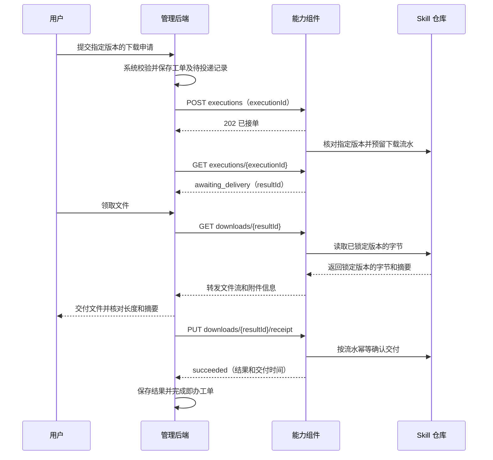

# 总设计

**容器化、MySQL 与子系统连接器（2026-11-21）。** 部署形态调整为6个业务镜像加1个MySQL 8.0：web（Nginx+SPA）、management、repositories（四仓库共用镜像，按REPO_SERVICE启4个容器）、executor、connector-dify、connector-ragflow。存储层ledger切换为MySQL 8.0单实例三逻辑库app_center_mgmt/app_center_exec/app_center_repo，各服务使用独立最小权限账号，零跨库访问；事务、行锁和审计历史不可篡改规则不变，本地测试保留SQLite。Dify、RAGFlow凭据只注入对应连接器容器，executor不持有外部凭据、不出外网，经`/connector/v1`访问产品；同一连接器镜像按`DIFY_ADAPTER_VERSION`/`RAGFLOW_ADAPTER_VERSION`兼容多个产品版本，产品升级只替换连接器容器。四仓库与外部产品版本解耦。部署与升级见[容器部署](../docker/README.md)，架构见[架构总览](../docs/ARCHITECTURE.md)。

**前端URL路由与会话恢复（2026-11-21）。** 每个页面有独立地址（如`/overview`、`/manual/TOL-01`），支持浏览器前进后退与深链直达；`GET /api/demo-session`按HttpOnly会话恢复身份，刷新不丢失登录。角色可见范围仍按附录A：直接输入不可见页面的地址时回落到该角色默认页，不展示该页内容。

**ACC-02语义（2026-11-20确认）。** ACC-02只变更本平台账户名，Dify与RAGFlow保留原登录邮箱，三方通过稳定用户ID关联；ACC-02不向两端发起改名写请求。双端写入、补偿与封存证明适用于ACC-01的开通、停用和角色变更。

**能力组件模块化（2026-11-20）。** 能力侧已按app/platform/modules/repositories分层，11个领域通过public.mjs登记动作、资源、目录和路由；/capabilities与实际执行共用注册索引，核验证据独立按版本/分支/工作区匹配。未完成Dify草稿ready:false不会被证据提升为verified。分工与开发入口见[能力组件结构与分工](能力组件结构与分工.md)，内部契约见[模块登记](../contracts/capability-api/module-registry.md)。结构完成不代表真实产品联调完成。

**安全事件监控实现边界（2026-11-19）。** 六区块已按EVT-01真实台账与状态历史接线，新增/关闭/重开、级别、关闭历时和P95使用明确口径；五块证据白名单读取、人工无指标空态、管理员只读。新增前后状态写入，旧历史不改写。见[事件监控契约](../contracts/management-api/event-monitor.md)。原始产品指标/日志和逐步API证据仍待真实来源；关联执行只显示持久结果摘要，不冒充下游步骤。

**总览实现边界（2026-11-19）。** 管理端总览改读真实工单/事件台账，运维不读取账号工单；资源库存、趋势和健康走独立`/internal/v1/overview-summary`聚合快照，原`/observations`分页事件协议不变。见[管理总览契约](../contracts/management-api/overview.md)及[能力快照契约](../contracts/capability-api/overview-summary.md)。采集范围、完整桶、去重、新鲜度与角色裁剪须遵守契约，未知显示未采集，过期保留来源/时间。管理端消费者已实现，真实聚合采集仍待能力组联调。

AG-04/05影响依据细化（2026-11-19）：Dify原生快照新增按catalogResourceId限定的agentImpact，授权、登记密钥及资源依赖为完整、独立修订清单；调用统计带真实来源与30天UTC窗口，未采集必须null，不能填0。再发布至少完整依赖、下架须三份关键清单，审批重读产品版本和清单，变化拒绝；调用自然增长只更新批准时统计。冻结组前置条件供执行端原子核验。字段和错误见[资源选择契约](../contracts/management-api/resource-selection.md#ag-04ag-05依赖与影响依据目标24)与能力OpenAPI，真实清单/统计与工作流差异适配待联调。

KB-02/AG-05关联细化（2026-11-19）：随应用发布关联Dify原生应用及独立relatedWorkspaceId，允许待发布应用先审知识库以解除首次上架依赖环。scope=app要求调用上下文匹配关联应用/工作区，公开访问需两策略交集，未发布/下架/撤权/过期不放行；KB-03按目标应用重新读取关联库依据。AG-05替代对象为已发布active仓库目录，需原处置资格、范围兼容且非自身/同原生别名，冻结版本/策略及agent_replacement修订，执行不自动授予替代权限。字段/错误见[资源选择契约](../contracts/management-api/resource-selection.md#kb-02随应用发布和ag-05替代目录目标23)，真实关联/替代适配待联调。

KB-03/MCP-02关联应用细化（2026-11-19）：目标智能体字段指同目标工作区的Dify原生应用，由`application-targets`按dataset_binding/mcp_binding用途和配置资格枚举及读取。提交/审批重读映射，冻结application_target登记修订；恢复或换范围后重新核验，允许显式清除。MCP绑定选应用时payload必须带targetAppId和decisionRef，执行回读冻结应用和前置条件后核验配置，不能只绑定工作区便宣称应用成功。字段/迁移/错误见[资源选择契约](../contracts/management-api/resource-selection.md#kb-03mcp-02目标dify应用选择与修订目标22)和能力OpenAPI；真实适配待联调。

KB-05接口细化（2026-11-19）：统一`execution-contexts/KB-05/candidates`按处置申请资格返回纳管/共享目录，不以绑定使用权推断。完整处置上下文明确eligible、名称/源范围、文档ID/指纹和影响数；唯一目录修订和清单哈希前置条件、真实可执行映射必须齐全。公共预览不暴露底层API对象，文档从清单显式多选，无法执行停用的条目不可选；文档ID按数组保存，恢复重选，证据仅违规/越界条件必填。人工与告警暂停/处置仍走原节点。字段/错误见[资源选择契约](../contracts/management-api/resource-selection.md#kb-05处置候选完整文档清单和范围目标21)及能力OpenAPI；真实适配待联调。

KB-03接口细化（2026-11-19）：统一`execution-contexts/KB-03/candidates`只列本人已纳管私有库和当前有申请资格的已发布共享库；sourceScopeId与目标workspaceId分离，不能用普通个人产品库代替共享目录。上下文明确eligible、目录来源、允许申请权限及边界事实，冻结dataset_catalog修订；跨区复制另冻结指定文档清单快照及哈希。管理端核对源/目标关系推导三种实现方式，受理/审批重读，真实执行前原子复核。完整字段和错误见[资源选择契约](../contracts/management-api/resource-selection.md#kb-03知识库使用绑定候选与来源依据目标20)和能力OpenAPI。真实目录/资格与产品适配待联调。

PLG-03接口细化（2026-11-19）：统一`execution-contexts/PLG-03/candidates`按安装/升级/卸载分别过滤，候选增加installationId，三元组resourceId/workspaceId/installationId标识具体操作对象。同一插件多个实例不能合并。升级/卸载上下文必须精确回显选中实例、eligible、原安装版本/哈希；升级还冻结目标批准版本哈希，卸载只依赖原实例，允许清理失效工作区或已下架目录的旧安装。受理/审批复核，真实执行必须原子比较实例修订并限定目标。完整契约见[资源选择](../contracts/management-api/resource-selection.md#plg-03插件操作候选与实例依据目标19)和能力OpenAPI。

TOL-01接口细化（2026-11-19）：工具候选复用统一`execution-contexts/TOL-01/candidates`，强制operation区分首次/变更/撤销；resourceId为工作区/提供者/原生工具的稳定映射，原生工具ID在上下文单独读取。撤销可从有资格的批准登记发现失效工作区中的旧工具，配置来源必须明示。上下文与执行前置条件同时绑定tool_configuration哈希和tool_approval登记修订，首次为0、其余为正；变更必带原版本/指纹/脱敏差异，审批再次比较，执行端原子核验。字段及错误规则见[资源选择契约](../contracts/management-api/resource-selection.md#tol-01工具审批候选与配置依据目标18)和能力OpenAPI。真实适配待联调，不以模拟验收代替。

本次交付由同一目录的三份文件组成。本文件正文规定服务契约，[附录 A](#business-baseline)收录角色、页面、27 种工单字段、状态、告警及验收规则。在管理组发放[管理系统开发](管理系统开发.md)，在能力组发放[能力组件开发](能力组件开发.md)，每组均可查阅同一套三份文件。涉及双方的样例和验收编号见正文 §5–6。附录 §5.1 的业务指纹用于工单查重提示，执行去重使用 `executionId`。

本文规定目标架构与业务契约。当前代码采用单仓分目录开发，目录均相对于 `app-center/`。页面调用管理后端，管理后端通过 HTTP 向能力编排下发执行，能力编排再调用四个仓库或两个独立连接器。用户域和数据域各部署同一套 6 个业务镜像加 MySQL 8.0。服务关系见[架构总览](../docs/ARCHITECTURE.md)。

## 1. 三层边界和数据归属

| 代码目录 | 维护方 | 交付内容 |
| --- | --- | --- |
| `management/` | 管理系统组 | 页面、工单流程、冻结下发输入、结果回写。浏览器只访问这一层。 |
| `capability/` | 能力组件组 | 执行接单、幂等、结果查证。经连接器访问 Dify 与 RAGFlow，不持有这两套凭据。 |
| `capability/repositories/` | 能力组件组 | `skill/`、`plugin/`、`mcp/`、`agent/`。生产共用镜像 `app-center-repositories`，四个容器各写自己的对象卷。 |
| `connectors/dify/`、`connectors/ragflow/` | 能力组件组 | 两个无状态连接器。各自是对应产品凭据的唯一持有者，可随产品版本单独升级。 |
| `server/`、`docker/`、`runtime/` | 公共维护 | 生产启动入口、6 个业务镜像与 MySQL 8.0 编排、MySQL/SQLite 存储。 |
| `contracts/`、`tests/integration/` | 接口提供方与调用方 | 按提供方归档 OpenAPI、维护动作登记和跨服务验收。修改字段、错误码或成功判据时，同时更新契约、受影响的两端实现和测试。 |

**当前实现（2026-11-21）。** 生产拓扑是 6 个业务镜像加 MySQL 8.0，共 10 个容器。三个逻辑库为 `app_center_mgmt`、`app_center_exec`、`app_center_repo`。本地 `npm run dev` 仍可使用 SQLite。连接器、三库和离线导出见[容器部署](../docker/README.md)。正式部署的服务身份和双向 TLS 要求见 §2。整单验收口径仍以进度文档为准，容器健康不等于 27 张工单完成。

| 层 | 负责的数据及行为 |
| --- | --- |
| 管理系统 | 登录身份、组织和角色，工单版本、草稿、审批、状态、审计和结果确认；生成执行记录和待发送任务；为页面提供经鉴权的仓库、文件、运行和监控入口。 |
| 能力编排 | 接收已允许执行的动作，保存执行状态和下游任务 ID；维护产品账户及 workspace 映射、凭证引用、产品资源快照、绑定关系及采集进度；合成目录视图和监控数据。不持有 Dify 或 RAGFlow 凭据。 |
| 子系统连接器 | `connector-dify` 与 `connector-ragflow` 各自无状态。它们是对应产品凭据和协议版本的唯一适配层，对能力编排暴露内网 `/connector/v1`。 |
| 自建子系统 | Skill 仓库保存对象、版本和交付流水；插件仓库保存内网包、扫描和批准版本；MCP 仓库保存使用目录、技术注册引用、URL 指纹及目录状态；智能体仓库保存生效发布和使用范围。四者共用一个镜像、四个容器，目录元数据写入 `app_center_repo`。 |
| 已有子系统 | Dify、RAGFlow 仍是其运行、应用和知识库等真实状态的来源；模型中心提供 MCP 技术注册和模型目录；实际 MCP 进程另行部署。 |

Dify 与 RAGFlow 的现有 API 只由对应连接器调用。能力编排经内网访问连接器。管理系统只向能力编排提交执行、读取显式的数据视图，或转发文件和运行流。用户通过详细设计允许的 Dify API 地址访问已登记的 API，是独立的外部 API 通路。四个仓库不重复审批，不建立 Skill、插件或智能体运行时，也不调用 Dify 或 RAGFlow。隔离内网、不访问公网插件市场、不改 Dify/RAGFlow 源码或直接操作其数据库。不增加角色、工单类型或知识库仓库。个人身份、工单跟踪 ID 不流向模型中心。

## 2. 管理系统到能力组件的接口

本节默认由能力组件提供接口，明确标注的管理端回调由管理后端提供；服务均以各自内网地址上的 `/internal/v1` 为前缀。JSON 用 UTF-8；ID 是非空、大小写敏感的字符串，组件生成的 ID 不依赖名称或时间戳；日期用 UTC RFC 3339；摘要为 64 位小写十六进制 SHA-256。服务间使用 HTTPS 和双向 TLS，按服务身份限制路由；业务账户、组织、角色由管理后端依据会话和审批记录生成，浏览器不得直接调用内网接口或代写身份。Dify 与 RAGFlow 凭据只放在对应连接器中。连接器对能力编排暴露 `/connector/v1`，不向前端或管理系统开放。

HTTP 错误通用结构为 `{"error":{"code":"INVALID_REQUEST","message":"可展示信息"}}`。400 为缺字段、未知枚举或非法组合；401/403 为服务身份无效或权限不足；404 为记录不存在或当前对象不可见；409 为同一标识收到不同请求，或状态/版本冲突；501 为查询/运行能力暂未接入；503 为暂不可用。已接单后的业务失败通过执行资源返回，HTTP 查询仍为 200。错误信息不能带凭证、私有 URL 或下游未经处理的响应。

### 2.1 写入、查询和终止执行

| 接口 | 约定 |
| --- | --- |
| `POST /internal/v1/executions` | 首次持久化并接单返回 202，正文为当前执行资源；同一 ID 和语义一致的请求重发返回 200 及当前执行资源；同 ID 内容不同返回 409 `EXECUTION_CONFLICT`。 |
| `GET /internal/v1/executions/{executionId}` | 200 返回当前状态和结果；404 表示能力组件未查到该 ID。管理系统只用原请求、原 ID 补投。 |
| `POST /internal/v1/executions/{executionId}/cancel` | 能力组件在确认当前执行不会再产生未确认副作用时才返回 200 并终止；已有不可逆副作用、不能确定结果或已结束返回 409，继续按查询结果处理。只允许管理后端在验证经办权限后调用。 |

**失败后终止工单。** 经办人放弃重试时，管理后端以当前工单版本、当前 `executionId`、工单状态“执行失败”和已确认的 `failed` 结果为条件，在一个事务中写入“已终止”、终止人、理由及时间，保留原失败结果。本操作不发送 `/cancel`。与重试同时发生时仅允许一项提交，重复终止返回已终止状态。活动执行的取消走上表接口；`409` 或响应丢失后查询状态，再决定能否终止。处于 `reconciling` 且仍有不明副作用时保持查证。

**账号失败查证与解锁。** ACC-01/02管理员可只读查询原executionId，已接单后原执行丢失须停止自动补投并保留目标限制。账号终止不等于产品恢复：只有原执行failed、无本地commit、两端实际状态完全匹配审批前产品基线且能力端证明原执行及下游任务已封存，才在同一事务释放目标锁和新名预约、保存证明并置已终止，原失败结果不改写。冻结基线、只读 `GET /executions/{executionId}/account-consistency` 和权限/错误约定见[账号恢复契约](../contracts/capability-api/account-recovery.md)。管理端入口已实现，真实产品补偿、查证及封存仍待能力端实现；缺失/部分/未知证明均不解锁。

**业务原执行查证。** 运维在待办详情用当前revision办理“查证原执行”，只GET原executionId，保留审批冻结和每节点成功判据；已接单后404停止自动重建。已接单读取不因申请人改名而停止，新下发仍校验身份和交付条件。确认过的终态不覆盖，新的节点/尝试独立执行。权限、错误、字段与审计见[业务查证契约](../contracts/management-api/reconciliation.md)。此入口不包含ACC恢复或SKL-03交付取消；真实产品查证来源仍待能力端联调。

执行输入固定如下；每种 `payload` 的字段见能力组件开发 §2 和 §7。请求体字段之外的信息不传，申请说明、密级、业务线及原始审批意见留在管理系统；现场权限判断读取能力组件的可信资料或已核验的资源快照。

```json
{
  "executionId": "exe-skl-001",
  "ticketNo": "SKL-03-001",
  "ticketType": "SKL-03",
  "ticketTypeVersion": "1",
  "action": "download",
  "resourceId": "skl_doc",
  "account": "chen.yu",
  "org": "业务一部",
  "payload": {"version": "v2.1.0", "sha256": "656085df494bea2c4bec3c08e164ff66927cd3373abbc3b6e1e5451ffcf0a1e1"}
}
```

| 执行资源字段 | 约定 |
| --- | --- |
| `executionId, ticketNo, status, updatedAt` | 均必填。状态为 `queued/running/awaiting_delivery/reconciling/succeeded/failed/cancelled`。前三项和 `reconciling` 都是非终态。 |
| `delivery` | Skill 在 `awaiting_delivery` 时为 `{resultId,version,sha256,filename,contentType,sizeBytes}`，其余状态为 null。 |
| `result` | 非终态为 null。终态为 `{ok,failureCode,failureReason,retryable,resultId,version,sha256,details}`，均必填。成功时失败字段为空字符串，`retryable=false`；失败、终止时 `ok=false`，通用结果标识、版本、摘要用空字符串，详情仍可带不敏感的下游引用。 |
| `result.details` | 对象，各动作详情见能力组件开发。类型与动作不匹配在受理前返回 HTTP 400 `UNSUPPORTED_ACTION`；已登记动作的适配能力不足时记 `UPSTREAM_UNSUPPORTED`；规则拒绝用 `ACCESS_DENIED`；审批快照失效用 `STALE_SNAPSHOT`；确认失败且可重试才用 `retryable=true`。 |

终态不可回退。管理系统负责决定是否发起新的业务尝试；能力组件负责同一次执行的恢复、有限重试和查证。管理系统每次获准执行生成并保存一个新 ID；网络重发保留原 ID、请求正文和快照。能力组件以唯一键和持久化任务接单，在串行化同一工单同一动作的同时校验请求一致性。向下游发出请求前记录阶段和目标，外部响应无法确定时保留 `reconciling`，通过下游任务 ID 或资源状态查证；不得仅凭超时重做。只有已确认失败、满足重试条件且无未确认副作用时，管理系统才可在原工单下创建新执行。有已知部分副作用时先修复或补偿，再确定可否重试。

### 2.2 审批前取数和已生效目录

账号、业务、文件三台账的接单/查询，以及回执/取消响应已统一严格校验，字段、状态组合、时间、冻结交付元数据和错误码见[执行响应校验契约](../contracts/capability-api/execution-response.md)。缺执行ID或工单号不再补猜，错误结果不进入终态；下载成功还必须有管理端完整发送事实，不能仅采信组件成功标识。旧历史不回填，KEY依旧脱敏。公共协议通过不等于真实产品副作用已验收。

查询身份使用管理后端写入的 `X-Account`、`X-Org`、`X-Role`；角色值为 `user/operator/admin`。能力组件按身份对条目、计数、搜索和详情过滤后再分页。用户只能看到已生效、可用且本人有权使用的条目，运维及管理员可查已生效的下架或暂不可用条目。查询成功均为 200；列表响应为 `{items,nextCursor}`，无下一页时 `nextCursor=null`。列表支持 `cursor`、`limit`（默认 20，最大 100），空列表是合法响应。

| 接口 | 用途和结构 |
| --- | --- |
| `GET /internal/v1/catalog?kind=skill\|plugin\|mcp\|agent` | 仓库列表，支持 `q,cursor,limit,workspaceId`；返回字段见能力组件开发 §3。agent支持action=republish/withdraw_app，skill支持withdraw_skill，mcp支持unbind_mcp/isolate_mcp/withdraw_mcp；actions须明确包含对应动作，普通可见、使用、下载或绑定权不等于处置资格。 |
| `GET /internal/v1/catalog/{kind}/{resourceId}` | 同权限的目录详情。Skill/插件可加version查询候选版本，项目结构与列表一致。管理action实时重读资格：republish可含已下架/不可用应用，withdraw_app只接受active/unavailable；withdraw_skill只接受可用Skill。MCP解绑可清理active/isolated/withdrawn旧绑定，隔离仅active，下架active/isolated。其他组合400，不支持适配501，不回退普通目录。 |
| `GET /internal/v1/catalog/skill/{resourceId}/versions` | 生效版本历史，沿用 `cursor,limit`。每项为 `{version,sha256,sizeBytes,publishedAt,changedAt,changeNote,downloadable}`。时间为 UTC，文件长度为非负整数。按 `changedAt` 降序、`version` 升序稳定分页。`downloadable` 是对当前账户的实时权限判断，版本选择器只用 true 项；用户看到的历史限其有权查看的已生效条目。整体下架时普通用户得 404，运维和管理员仍可见历史，全部标为 false。 |
| `GET /internal/v1/resources?kind=dify_app\|ragflow_dataset\|dify_dataset\|mcp_registration\|model\|skill\|plugin` | 审批前资源选择，支持 `q`、`workspaceId`（Dify 对象使用）、`cursor/limit`（1–100）；返回 `{items:[{resourceId,name,source,workspaceId}],nextCursor}`，无 workspace 时为 null。按调用人对候选资源的实际权限筛选，完整旧列表可省略 nextCursor。 |
| `GET /internal/v1/resources/{kind}/{resourceId}?workspaceId=...` | 读取审批前快照，返回 `{snapshotId,resourceId,source,workspaceId,capturedAt,data}`；在能力组件内保存不可变快照，内容结构见能力组件开发。未接入的资源来源返回 501 `UPSTREAM_UNSUPPORTED`。 |
| `GET /internal/v1/workspaces?product=dify` | 为当前账户列出可选的目标 workspace，返回分页列表 `{items:[{workspaceId,name}],nextCursor}`。由账户映射和现有产品权限共同决定。 |
| `GET /internal/v1/binding-contexts/{resourceId}?workspaceId=...` | 管理后端预检 MCP-02。校验当前人对条目及目标 workspace 的权限后返回 `{resourceId,workspaceId,expectedUrlFingerprint,bindingAccess}`。指纹由后端保存为工单快照，普通用户页面只用 `bindingAccess`。 |
| `GET /internal/v1/key-registrations?action=rotate_key\|revoke_key` | KEY-02登记候选，支持q/cursor/limit，按当前身份动作资格过滤。返回registrationId/appId/workspaceId/lastFour/status/revision/actions及可选显示元数据，不含明文或凭证。active/expired且有对应动作才可选；其他登记状态不成为新操作候选。 |
| `GET /internal/v1/key-registrations/{registrationId}?action=...` | 当前动作的登记详情，另含keyId（产品对象ID，不是明文）。KEY-02上下文前后重读，核对应用/工作区/密钥ID/后四位/修订；上下文key_registration修订唯一且一致。不支持登记适配501，不用应用目录代替。一次性明文仍仅走获批创建/轮换后的POST reveal。 |
| `POST /internal/v1/intake/{kind}` | 仅 `skill/plugin`；管理后端流式转发文件，`multipart/form-data` 字段 `file`，带经鉴权身份头和 `Idempotency-Key`。返回 202 `{intakeId,status}`；同键同文件重复返回原记录。 |
| `GET /internal/v1/intake/{kind}/{intakeId}` | 200 返回 `{intakeId,status,sha256,sizeBytes,filename,scan}`，状态 `received/scanning/ready/rejected/failed`，未完成字段为 null。`scan={checkedAt,verdict,findings}`，仅上传人及有该单办理或查询权限的后端可读，用户侧不展示敏感证据。 |

插件和 MCP 的目录列表及详情可带 `workspaceId`。提供时先核验当前账户对该 workspace 的权限，无权访问返回 404；`workspaceInstalled/workspaceBound` 仅表示该 workspace 的状态。省略时这两个字段均为 null，目录仍可浏览；影响 workspace 的动作需先选择目标再预检。管理后端和能力组件的缓存、游标都应区分身份与 workspace，跨上下文复用游标返回 400 `INVALID_CURSOR`。

版本历史中的 `ticketNo` 为条件字段，仅有权查看该工单的运维或管理员可见。示例为普通用户在有权查看的 Skill 上读取迭代记录，日期按 UTC 表示，结果中只有 v2 可供新下载。

```json
{"items":[{"version":"v2","sha256":"2222222222222222222222222222222222222222222222222222222222222222","sizeBytes":99,"publishedAt":"2026-11-18T00:00:00Z","changedAt":"2026-11-18T00:00:00Z","changeNote":"更新摘要规则","downloadable":true},{"version":"v1","sha256":"1111111111111111111111111111111111111111111111111111111111111111","sizeBytes":85,"publishedAt":"2026-10-01T00:00:00Z","changedAt":"2026-11-17T00:00:00Z","changeNote":"停止新增下载","downloadable":false}],"nextCursor":null}
```

AG-02 的 `dify_app` 快照包含 `data.catalogRevision`，由能力组件读取本平台目录得到。管理后端冻结该整数并映射为 `payload.expectedRevision`。`publicationVersionId` 标识 Dify 发布版本，`expectedRevision` 约束平台授权目录写入，两者分别校验；旧审批不可覆盖已生效的新授权。

### 2.3 Skill 文件交付

| 接口 | 约定 |
| --- | --- |
| `GET /internal/v1/downloads/{resultId}` | 管理后端用当前登录账户、组织和角色头取文件。能力组件校验流水归属、版本与当前可交付性。200 返回完整文件字节、`Content-Type`、`Content-Length`、`Content-Disposition`、`X-Content-SHA256`。不可见统一 404，文件不可用返回 409。 |
| `PUT /internal/v1/downloads/{resultId}/receipt` | 管理后端在完整响应已向用户发送并校验长度及摘要后，提交 `{sha256,bytesSent}`，身份头与取文件一致。返回 200 和终态执行资源，按 `resultId` 幂等记交付一次。接口超时重发原回执。 |

永久失效或取消前需要核实发送记录时，由**能力组件调用管理后端**的 `POST /internal/v1/delivery-checks/{resultId}/close`（双向 TLS，仅能力组件可用，按流水幂等）。管理后端锁定流水，封住新领取请求，检查已持久化的发送记录。200 `{state:"closed_unserved"}` 表示没有已发、在发或不明记录，可据此终结；200 `{state:"receipt_pending"}` 表示已完整交付并将补发回执；409 `DELIVERY_UNCERTAIN` 表示仍在传输或证据不足，能力组件继续查证。已开始的发送可继续提交回执。暂时断线或一次技术重试无需发起此检查。

管理端现已实现关闭回调、运维取消与同机共享SQLite的事务互斥。发送阶段先记录fetching，首字节前记录emitting，完整发送保存回执；未知发送及旧证据不按未发送关闭。实际能力组件cancel、仓库终结与取消计数、跨主机协调、未知证据恢复领取仍待实现，详见[交付关闭与取消契约](../contracts/management-api/delivery-close.md)。

下载资格通过时仅预留流水，工单保持执行中。**文件交付确认后才记下载成功、计入排行，并完成即办工单。** 响应中断可重取同一文件，已持久保存的回执持续重试。进程在交付与登记之间中断、没有可靠记录时，由用户用原流水再次下载并确认，不能推定成功。重复取文件或回执不重复计数，重取时仍校验本人权限。预约不按时间自动置为失败，以免丢弃重启后补交的成功回执；下架后停止新交付，已实际完成的交付仍可补回执。对长期未领取的流水，按工单权限在查清无已完成或进行中交付后取消。

**下载结果的结算单位。** 一次获准执行以 `executionId` 标识，成功后与一个 `resultId` 对应。监控每次执行最多结算一条成功或失败记录。下表把“尚未交付”和“已确认最终未交付”分开，供工单、仓库排行和监控共用。

| 证据 | 工单 / 执行 | 下载监控的变化 |
| --- | --- | --- |
| 仅预留流水，用户关闭页面或尚未领取 | 执行中 / `awaiting_delivery` | 成功 0，失败 0。 |
| 传输中断、摘要不符、回执响应丢失 | 记录本次传输诊断；仍可用原流水重取或补回执。未确定结果时不得结算 | 成功 0，失败 0，不新增下载明细序号。 |
| 有完整交付回执，首次确认成功 | 已完成 / `succeeded` | 按 `executionId` 成功 +1；重复取文件、回执或轮询均 +0。 |
| 已接单，执行前确认无权、版本不可交付，或预约后永久失效且已查清没有进行中交付和待回执 | 执行失败 / `failed`。仓库下架本身只禁止新交付，由能力组件查证后结束执行 | 失败 +1，记录安全原因。之前从未进入执行的表单驳回不计。 |
| 经办人主动取消已经受理而最终未交付的下载，已排除待确认交付 | 已终止 / `cancelled`；如果此前已经 `failed`，仅管理系统终止工单 | 前者作为最终未交付，失败 +1，原因 `CANCELLED_BEFORE_DELIVERY`；后者沿用原失败，新增 0。 |

### 2.4 运行和监控读取

| 接口 | 约定 |
| --- | --- |
| `POST /internal/v1/agents/{resourceId}/runs` | 运行或嵌入页面经管理后端调用。身份头、来源 IP 和入参映射见能力组件开发；能力组件再校验生效范围及使用方式。未核验的应用模式返回 501 `UPSTREAM_UNSUPPORTED`。 |
| `GET /internal/v1/observations?view=...&source=...&from=...&to=...&limit=...&cursor=...` | `view` 必填，值为 `audit/monitor/integration`，允许的数据源见能力组件开发 §5。仅运维和管理员经管理后端查询。返回 `{availability,items,nextCursor,asOf}`，`availability=collected/not_collected/stale`。 |

**行级权限。** 管理后端从当前会话生成身份头和页面对应的 `view`。能力组件在本网络分区内，先按角色、视图、来源、组织和工单类型筛选或裁剪关联，再聚合、排序和分页。用户请求观测返回 403。运维在审计视图只见本组织的非账号类记录，监督业务运行按对应监控页范围；账号集成页允许看健康和映射，只返回可见的 EVT-01 工单关联。系统管理员可看本分区包括 ACC 在内的数据。管理库的待办、工单、审计、导出用同样规则；合并数据时以 `(source,eventId)` 去重。范围不明的受限记录对运维隐藏。

## 3. 端到端数据流

| 阶段 | 数据怎样走，谁写状态 |
| --- | --- |
| 申请及预检 | 管理系统按登录身份查询资源快照，附件涉及 Skill/插件时经能力组件流式送仓库待审区；工单只存引用、扫描结论和业务字段。管理系统锁定资源 ID、版本、摘要/快照和目标账户，按既定路由系统校验或审批。审批后改变关键字段必须按流程重新核验和授权。 |
| 下发 | 管理系统在同一事务保存工单动作、执行 ID、请求快照及待发记录，由后端投递；能力组件持久接单，再用 ID、版本和目标核验资源及权限。拒绝、撤回、尚未完成审批的工单不得触发写入动作。 |
| 子系统执行 | 能力组件路由指定适配器；四个自建仓库只处理资源和状态，不承接工单。Dify 安装任务等先记录下游 ID，再核对实际结果；对并发变化用版本条件拒绝旧快照。 |
| 结果回写 | 管理后端轮询执行资源，持久化结果及审计；人工单按状态机进入待结果确认，即办单成功才完成。批准的目录更新由对应仓库写入，页面按权限重新查询，不能靠页面临时状态当作已生效。 |
| 监控和告警 | 执行流水、交付事件、Dify/RAGFlow 现有 API 或受支持日志、仓库健康汇集到能力组件，管理系统读取并结合自身工单和审批审计显示。可采到且无事件返回空记录；来源不可采显示「未采集」；不把安装数当作插件调用数、不把绑定数当作 MCP 调用数。告警转单由管理系统按原设计去重入库。 |

以 SKL-03 为例，工单完成依赖文件实际交付。



## 4. 契约冻结、工单扩展与全量验收

人工申请草稿的版本、字段、归属和提交来源约定见[申请草稿契约](../contracts/management-api/application-drafts.md)。草稿与业务库使用持久提交意图和工单内来源证据恢复关联，不宣称跨库原子提交；工单已落库就不能因响应丢失恢复草稿并重复新建。类型与产品事实仍在原提交接口核验，系统转单不进入人工草稿。25种人工类型的页面已接入；上传和证据只保存引用，恢复时重新读取。对话申请已能匹配当前目录并保存草稿，提交仍走原接口。

本次交付包含附录的全部 27 种工单、33 个执行动作、四个仓库和九个监控页。两组以同一 Git 提交中的三份设计、动作登记及接口规范为基线，同步开发全部功能。SKL-03 是已验证的参考实现。每个动作均按自己的成功判据验收。

**接口版本。** 服务协议使用路径版本 `/internal/v1`。已发布工单的路由键为 `(ticketType,ticketTypeVersion,action)`。流程模板按节点和表单分支将业务操作映射为该键，并冻结目标资源、输入和相应前置条件。执行信封、查询、取消、回执、结果和错误沿用正文 §2。跨系统节点和仓库读写见能力组件开发 §7–8。允许新增可选字段；必填字段、类型、枚举语义、授权范围或成功判据发生不兼容变化时，发布新模板和对应契约版本，保留旧路由直到在途工单及其重试结束。

| 新工单怎样办理 | 发布时如何检查 | 执行时怎样处理 |
| --- | --- | --- |
| 全部节点只流转、审批或复核 | 类型版本标为管理端流程，执行动作列表为空，校验每个终态可达 | 管理端完成流转。需要处置资源时关联另一个具有执行节点的工单，如 EVT-01。 |
| 新工单复用已有能力 | 为新类型版本显式登记允许的动作，映射输入、执行对象、审批依据及结果字段；核对原动作的权限与成功判据均适用 | 新类型绑定已有处理器，使用统一执行接口；保留新工单自身的类型、版本和审计身份。 |
| 新工单需要新能力 | 两组先增加动作定义、输入和结果 Schema、错误与重试规则、反向取数及下游验收样例。能力组登记处理器并提供部署核验结果 | 使用已有执行协议下发，能力组负责产品适配。需要新交互形式时先共同修订接口契约。 |
| 一个工单含多个动作或实现方式 | 遍历每条可达执行分支和目标部署，逐项检查，例如 PLG-03 的安装、升级和卸载，KB-03 的三种实现方式 | 每个节点实例有独立执行 ID。已经成功的节点不得因后续节点失败而重放。 |

**发布与运行。** 模板测试逐个核对路由、必填输入来源、结果字段、权限、错误及补偿分支。目标部署通过 §6 的能力查询返回该路由的核验状态。缺少路由或状态为 unverified、unsupported 时，保留草稿并列出具体节点、动作和原因。仅对能力已验证的目标范围启用自动执行模板。目标 workspace 在申请时才确定的，模板发布时验证已配置的启用范围，提交时再核验实际 workspace。发布后能力退化，已有记录保留原版本与审批证据，阻止不具备条件的新下发，已经接单的执行继续按原 ID 查证。服务端独立校验已登记的类型和动作，不接受表单传入的 URL、脚本或处理器名。

**扩展示例。** 假设新增一种部门 Skill 领取单。其人工审批可由管理端新增节点，下载仍绑定 download。发布前登记新类型版本，映射获批 Skill ID、版本、摘要及领取人，并验证该分支仍以完整交付回执为成功。若新需求还包含部署 Skill 到目标机器，则需另行定义部署能力；已有 download 只证明文件交付。

### 4.1 分给开发人员时怎样交接

分工时给两组同一个仓库提交号。业务字段、角色和办理节点查附录 A；管理端下发与回写查《管理系统开发》§3–4、§7；每种工单的动作、下游和成功判据查《能力组件开发》§7；HTTP 报文查该提交的 `contracts/`。计划中的接口若只有业务描述，提供方与调用方先补齐对应报文、错误和示例，再将该接口标为已冻结。发现两处定义冲突时，由双方在同一次契约变更中写明最终取值及受影响分支。

派工可直接使用下表。每项填入两侧实际负责人。一个人承担多个模块时仍按交付物验收。

| 派工单位 | 管理组交付 | 能力组交付 | 联合验收依据 |
| --- | --- | --- | --- |
| 工单类型、版本、动作及条件分支 | 触发节点、审批输入、下发、回写、办理人可见结果 | 执行校验、产品或仓库操作、结果查证、失败恢复 | 用同一工单号与执行 ID 对齐批准输入、实际资源变化和工单终态。《能力组件开发》§7 的每一行及行内分支均须有归属。 |
| 仓库页或监控页的一个区块 | 角色、筛选、页面状态、按钮去向 | 数据来源、作用域、读取接口、采集时间和可用性 | 用同一身份、工作区和时间窗核对统计与明细。覆盖附录 A §7–8 的全部区块。 |
| 管理端本地流程与反向回调 | EVT-01 的研判、关联、复核；提供冻结输入、策略等回调 | 从关联业务单执行资源动作；按权限调用管理端回调 | 对本地流转核对零次资源下发，对关联处置核对唯一执行及结果。 |

**一条任务的写法。** 例如“PLG-03／安装／受限插件”：管理负责人实现审批通过后向获批 workspace 投递；能力负责人核对包摘要、安装任务及目标 workspace 的实际版本。双方共用固定输入，验证审批前下发零次、受理后工单保持执行中、重复投递只安装一次、查到批准版本后回写。升级和卸载分别按各自的成功判据派工。此例与其他任务同时开发。

**待决事项与交付记录。** 涉及免审范围、可见范围或谁可办理的缺项，由业务负责人定规则；涉及产品版本、权限或 API 支持情况的缺项，由能力负责人记录目标环境及实测结果；涉及字段、状态或错误语义的缺项，由双方确认契约。每个缺项注明影响的分支、负责人和待确认结论，其他已明确分支继续开发。交付时记录契约提交号、双方自测结果、联合用例、实际环境结果和剩余缺口。涉及真实产品的分支须有可核对的下游结果才计完成。

## 5. 跨组验收用例

管理组用模拟能力组件核对投递、权限和工单状态，能力组用相同输入核对持久化和下游调用次数，联调时检查两侧记录。以下用例均可在内网产品接入前执行。

| 编号 | 固定输入及操作 | 两侧共同判据 |
| --- | --- | --- |
| C01 | E1 已 `failed`，经办人同时点击终止和重试 | 只有一个事务成功。如果终止先完成，工单已终止、E1 仍失败、下游取消调用 0 次。如果重试先完成，E2 成为当前执行，旧终止请求不能关闭 E2。 |
| C02 | D1 已预约后用户离开；同一流水先中断，后完整下载，管理后端重启并重复回执 | 离开及中断时均为 0 成功、0 失败；最终 1 成功、0 失败。另用 D2 在无任何进行中交付时取消，得到 0 成功、1 失败。 |
| C03 | 同一 Skill 有 v1、v2 两个已生效版本，v1 停止新增下载、v2 可下载；测试整体下架 | 轮询历史页不增加下载数；v1 不进入选择器，v2 可选。整体下架后普通用户得 404，运维历史版本全部 `downloadable=false`。 |
| C04 | 同一用户有 A、B 两个 workspace，插件只安装在 A | 无 workspace 查询为 null；A 为 true，B 为 false。无权限的 C 得 404，来自 A 的分页游标不能用于 B。 |
| C05 | 对同一应用各发一张 AG-02，两个审批快照均锁定目录修订号 7，不同工单授权范围不同 | 先完成的写入产生修订号 8；后完成的旧审批返回 `STALE_SNAPSHOT`，目录保持修订号 8；同一次已成功执行重发得到原结果。 |
| C06 | 本分区放入本组织业务事件、他组织业务事件、本组织 ACC 事件；另一分区也有一条。审计视图取 `limit=1` | 本组织运维只得到第一条且没有下一页；本分区管理员共得三条；普通用户得 403。换角色或组织复用游标失败，计数及导出与明细同范围。 |

## 6. 模块之间的交接与验收

[全部工单的执行路由](能力组件开发.md#7-全部工单的执行路由)逐种列出 27 种工单。26 种涉及资源执行，按业务分支共登记 33 个可下发的动作名；EVT-01 在管理系统内研判、关联处置并复核。Skill 下载、插件安装、MCP 绑定、智能体发布分别验证文件交付、异步产品任务、用户身份、条件写入，是四条联调样例。其它动作按同一套服务边界并行设计开发，是否可以操作真实资源须按目标环境逐项验证。

| 模块连接 | 数据怎样交接 | 必须成立的条件 |
| --- | --- | --- |
| 对话、手工、仓库、系统事件 → 工单 | 共用管理后端的类型版本、权限和字段校验；对话生成草稿，仓库预填稳定资源 ID，规则事件带证据键。 | 同一提交键和内容只产生一张单；无审批、草稿或驳回不能触发受限写入。 |
| 工单 → 执行 → 子系统 | 持久关联工单号、流程节点实例、执行 ID、下游任务或资源 ID。应用执行结果时校验当前节点及尝试。 | 多次网络投递不重复执行。PLG-04 同一工单恢复后再次禁用是新的流程节点，不能复用第一次禁用的结果。 |
| 个人目录 → 共享发布 → 授权 | KB-01、AG-01 产生私有资源；KB-02、TOL/PLG/MCP 批准记录供 AG-02/04 依赖检查；AG-03 的授权取已发布的使用方式。 | 同名资源按来源、workspace/tenant 和稳定 ID 区分。发布审批只对锁定快照生效，审批中确认的既有风险与审批后新出现的风险分开处理。 |
| 上传 / 技术注册 → 四个仓库 | 上传件绑定所有者、种类和摘要；发布、安装只读已批准版本。MCP 地址来自模型中心技术注册，仓库发布后再接受绑定。 | 待审包不得入公开目录，替换文件或地址指纹须重新审批。四库分别保管资源，只有能力组件适配产品。 |
| 身份 / 组织 → 权限检查 | 人员以稳定 ID 关联当前平台账户名，原名和当时组织用作审计。Dify 与 RAGFlow 登录邮箱不随 ACC-02 改变。登录人、审批人、执行目标、服务调用身份分别保存。 | 账号停用、改名未完成、撤权或授权到期时，即使缓存中有旧结果也要阻止新的受限操作。 |
| 技术事件 → 告警 → 处置工单 | 附录 A §9 的规则键为对象类型、对象 ID、规则编码、5 分钟窗口。重复证据更新原告警。 | 同目标插件的超时率和失败率同时越线可保留两份证据；同一 workspace、插件、禁用周期只触发一次实际禁用。缺少可信采样不触发自动处置。 |
| 下架 → 入口、授权、产品 → 工单回写 | 目录可见性、已有授权、运行实例和真实产品密钥分别记处置结果。 | 可先阻断平台新访问。AG-05 撤销密钥失败时，目录变灰不能证明密钥已失效，更不能把整单标为成功。 |

**按部署核验动作。** 能力组件提供 `GET /internal/v1/capabilities?workspaceId=...`，返回 `{items:[{ticketType,ticketTypeVersion,action,variant,state,reasonCode,checkedAt}],asOf}`。状态为 `verified/unverified/unsupported`，时间为 UTC，尚未检查的 checkedAt 为 null。variant 为该动作需分别验收的实现方式（例如 KB-03 取附录“实现方式”的枚举原值），无分支填 null。省略 workspace 只能查询通用适配信息；目标权限仍在执行前核验。已登记动作缺少适配器或上游能力时接单后写 `failed/UPSTREAM_UNSUPPORTED`；类型与动作不匹配返回 HTTP 400 `UNSUPPORTED_ACTION`，未知类型版本返回 400 `UNKNOWN_TYPE_VERSION`。其它动作的开发和模拟测试可继续。

**规则引用。** 管理系统为批准的资源范围保存不可变 `policyRef`，当前角色、密级、业务线和人员归属仍由管理系统掌握。能力组件通过管理后端的 `POST /internal/v1/policy-decisions` 复核，输入 `{policyRef,account,resourceId,action,workspaceId}`（无 workspace 传 null），响应 `{allowed,reasonCode,policyRevision}`。按分区和服务身份限制调用。能力组件将规则引用随批准目录修订存储；AG-02 等专用动作通过已批准输入查询取得规则引用。策略暂不可用时返回 503，不能放行受限读取或产生外部副作用。操作者为 `system_event` 的规则动作按目标资源和已配置服务授权执行，不用该名称冒充产品登录人。

**其它跨组接口。** 审批前执行快照、仓库汇总/历史、盘点和一次性密钥领取的请求与响应见[能力组件开发 §8](能力组件开发.md#8-跨模块读写接口)。反向读取获准输入、三方账号变更最终提交的提供方和事务边界见[管理系统开发 §7](管理系统开发.md#7-从办理节点到执行结果)。工单轮询对每个执行单独返回终态；能否结束整张工单由当前流程节点决定。

**执行次数。** 附录 A §9 的 10/30/60 秒适用于已确认可安全重发的下游动作，最多三次重试。不明副作用按原任务查证，不盲目重发。运维对确定失败的工单重试才新建尝试。入口 Web 站点异常开放时先登记 EVT-01 和证据，再由已授权的入口代理落实站点路径规则；缺少入口管理能力保留告警及处置失败记录。

| 编号 | 场景 | 联合验收判据 |
| --- | --- | --- |
| C07 | KB-03 跨 workspace 复制三份文档，第二份响应丢失 | 重启按源/目标文档映射查证，不重复建库；有一份未确认就不能报绑定成功。 |
| C08 | AG-02 依赖的工具指纹不同于 TOL-01 的批准指纹 | 出现该工具的发布告警，沿附录的运维决定流转；批准后再次变化则重新审核。 |
| C09 | KEY-02 新钥已创建、旧钥撤销未确认 | 恢复同一份新钥登记并查证旧钥；查询工单和执行记录均无明文。 |
| C10 | PLG-04 禁用、恢复、观察失败后再次禁用 | 两次禁用各有节点和结果；同一节点重投只执行一次。 |
| C11 | MCP-03 解绑一人，同 workspace/provider 尚有另一人有效授权 | 核对剩余绑定；若产品无法单独撤权，记录实际限制，不误删共享 provider。 |
| C12 | ACC-02 只改平台账户名，两端登录邮箱必须保持不变 | 执行前只读核对稳定人员 ID 与两端账户。任一端缺失或冻结基线变化时，不提交新的平台账户名。本单不向 Dify 或 RAGFlow 发送改名写请求。 |
| C13 | Dify 中未发布的应用产生一次失败调用 | 出现在监控树和明细，不进仓库，不增加成功排行，不从外部 API 密钥推断登录人。 |
| C14 | 账号换组织且监控采集中断 | 新权限立即参与校验；陈旧或未采集与实测零区分，缺少数据不自动禁用。 |

<a id="business-baseline"></a>

## 附录 A　业务设计基线

本附录收录本轮交付采用的业务详细设计第 0–12 节。以下编号和文中“第几节”均指附录内部章节。本轮对下载最终未交付、工单终止的判据已经并入对应业务条款。具体服务请求、并发写入和跨组验收以本文正文 §2–6 为准。全部工单的动作及回写见能力组件开发 §7。

| 查找内容 | 入口 |
| --- | --- |
| 部署、角色与可见范围 | [业务范围](#business-scope)、[角色](#business-roles)、[页面权限](#business-pages) |
| 类型、办理和审批 | [工单类型](#business-types)、[申请入口](#business-apply)、[字段与状态机](#business-states)、[27 种工单业务字段](#business-tickets) |
| 仓库、监控及治理 | [四个仓库页](#business-catalog)、[九个监控页](#business-monitor)、[告警与处置](#business-alerts) |
| 数据与验收 | [核心数据与产品边界](#business-data)、[范围限制](#business-limits)、[业务验收标准](#business-acceptance) |

<a id="business-scope"></a>

### 0. 设计结论

本平台是部署在单一网络分区内的旁路治理平台。用户域和数据域网络不通，因此两个网段各部署一套相同的镜像；单套页面只展示本网络分区的数据，不做跨网段切换、汇总或灰度发布。两套部署复用同一套镜像，各自使用独立的环境配置和数据卷，不共享数据库、对象文件或外部产品凭据。

每一套由 6 个业务镜像和 1 个 MySQL 8.0 组成，共 10 个容器。镜像为页面入口 `app-center-web`、管理系统 `app-center-management`、四大仓库共用镜像 `app-center-repositories`（同时运行 Skill、插件、MCP、智能体四个容器）、能力编排 `app-center-executor`、Dify 连接器 `app-center-connector-dify`、RAGFlow 连接器 `app-center-connector-ragflow`。MySQL 8.0 在同一实例中分开三个逻辑库：`app_center_mgmt` 保存身份、工单和审计，`app_center_exec` 保存执行与幂等，`app_center_repo` 保存四个仓库的目录和元数据。三个库使用各自的最小权限账号。Skill 文件和插件包放在四个仓库各自的对象卷。两个连接器无状态、无库。本地开发和自动化测试仍可使用 SQLite；生产容器使用 MySQL。

本平台不修改 RAGFlow、Dify 源码和数据库，只经对应连接器调用两者现有 API。外部产品凭据只放在各自连接器里，编排服务不持有这些凭据。Dify 或 RAGFlow 升级时，只滚动替换对应连接器镜像，管理系统、四个仓库、编排服务和另一个连接器保持运行。连接器按产品版本切换适配分支，例如 Dify 1.7.1 与 1.14.0、RAGFlow 0.22.1 与后续版本。本平台自己的工单、目录、安全审查结论、告警、审计、下载记录、凭证登记和账号映射写入上述三个逻辑库。

Dify部署网址保持不变。网络入口按路径执行规则：Dify控制台只对开发人员管理网开放，Dify应用Web站点路径对他人关闭，Dify API路径保持开放。开发人员管理网是网络范围，不是登录角色。外部API调用仍使用原Dify网址和Dify密钥；入口代理仅记录时间、来源IP、API路径、密钥登记ID和响应状态，不改Dify请求正文，也不把人员身份或traceId发送给模型中心。已开通的运行和嵌入由本平台后端调用Dify API，因此本平台记录登录账户和来源IP；审计里这两种调用仍记为广场Web，用来和外部API调用区分。访问API仍使用Dify网址和已登记密钥。通过工单申请并且已经生效的智能体在「智能体仓库」展示，Dify上的全部应用在「智能体监控」按账户归集。插件、MCP、Skill 同样分成仓库和监控。该入口代理是本平台部署配套，不修改Dify源码。

左侧分为仓库、监控、工单三类。四个仓库对三种角色开放。用户只看到自己当前可用且有权使用的条目，以及这些条目的成功使用排行。调用明细、失败记录、自动禁用日志和他人下载记录只在监控页，运维人员和管理员可见。

所有会改变资源、授权、目录状态或凭证状态的管理操作都由工单驱动。个人创建、个人使用、公开资源的免审使用和 Skill 下载仍生成“即办工单”，系统校验后自动通过并执行，以保证所有操作有单号和审计记录，但不增加人工审批。运行时对智能体的每次调用、对知识库的每次检索不生成工单，而是生成访问日志；否则工单量会与调用量相等，无法办理。发布、分享、受限资源使用、上架、变更、下架和处置由运维人员在工单中办理。账号开通、停用、组织变更、角色变更和账户名变更由系统管理员在账号类配置工单中办理。

登录后能看到页面的只有三种人：系统管理员、用户、运维人员。三套界面各自渲染自己的导航、仓库页、监控页、工单入口、顶栏和工单详情，不是同一套页面按权限把按钮藏起来或画成禁用。用户和运维人员只能选择已有工单类型，做申请、填写和处理，不能定义工单类型。系统管理员配置并创建工单类型，并在运维人员看得到的范围之外办理账号类配置工单。三种人的页面都没有「设置」入口，也没有齿轮；用户不点设置项。

运维人员在工单中选择动作并填写意见后，由系统执行节点调用现有 API。运维人员没有独立的 API 执行按钮。系统管理员办理账号类配置工单时也只在工单里提交，不另开执行按钮。

<a id="business-roles"></a>

### 1. 角色、权限与职责

登录后能看到页面的只有系统管理员、用户、运维人员。角色选择、流程节点的办理角色、通知里的可见角色，都只有这三项。后台任务可以生成工单和调用已获批的现有 API，但不能登录，也不出现在角色选择里。

值来源写成「用户」时，表示这个值由人填写，用来区分人和系统。填写人仍是系统管理员、用户、运维人员之一。RAGFlow 的个人/团队成员/管理员，以及 Dify workspace 的成员/编辑/管理员，是两套产品自己的权限值，不是本平台的角色。

| 角色 | 左侧能看见 | 可以执行 | 不可以执行 |
| --- | --- | --- | --- |
| 用户 | 「仓库」四页：智能体仓库、插件仓库、MCP仓库、Skill仓库；「工单」里的对话申请、手工申请、我的申请 | 为自己申请、填写、保存草稿、补正、撤回尚未受理的工单、确认自己的结果；在仓库查看自己可用的条目和成功使用排行，使用已开通的智能体方式，并对可用插件、MCP、Skill 发起安装、绑定或下载申请 | 看监控、看待办、打开工单查询、定义工单类型、看见或办理账号类配置工单、审批或处置别人的工单、看见暂不可用条目和调用明细、点设置 |
| 运维人员 | 「仓库」四页；「监控」九页；「工单」里的对话申请、手工申请、我的申请、我的待办、工单查询 | 申请并填写自己的工单；受理、退回补正、审核、做安全复核、处置、研判告警、确认系统事件、重试或取消业务工单的执行、按当前筛选导出 | 定义工单类型、看见或办理账号类配置工单、直接调用产品 API、绕过工单改资源、修改系统生成的来源字段、点设置 |
| 系统管理员 | 运维人员的全部页面，再加「工单类型」。申请目录、待办和查询里还包括账号类配置工单 | 定义、测试、发布、停用工单类型；申请、填写、办理账号类配置工单；提交自己的业务工单；查看监控、运维待办和本网络分区的全部查询；导出当前筛选 | 办理别人的业务工单和系统事件、代替申请人填写业务理由、绕过工单改资源、点设置 |

三种人的「处理」不一样。用户处理自己的工单，只做补正、撤回和结果确认。运维人员处理业务工单和系统事件，做受理、审核、安全复核、处置和确认关闭。系统管理员只处理账号类配置工单；他自己提交的业务工单，只按申请人补正、撤回和确认结果，审核仍由运维人员做。系统管理员打开别人的业务工单和系统事件时，看到的是只读详情。运维人员查看本组织、且不含账号类配置工单的审计；全分区审计由系统管理员查看。账号开通、停用、组织变更、角色变更和账户名变更不做设置页，只走 ACC-01、ACC-02。

本平台后台任务同步目录、读取现有 API、用获批者已经登记的 Dify 调用身份执行已通过的操作、按规则自动禁用插件，并生成系统事件工单。任务写入的申请人账户名是 `system_event`，见第 5.1 节。这个账户名不能登录，也不能打开页面。

组织、密级和业务线只作为本平台工单中的审批边界、目录可见边界和审计字段。实际检索继续执行 RAGFlow 或 Dify 原有权限，不在检索请求或检索结果上新增密级过滤。

三套产品的登录会话各自保留，本平台登录不等于已经登录 RAGFlow 或 Dify 页面，本期不建设 SSO。系统执行节点使用本平台安全登记的目标用户 API 调用身份完成获批操作，不把平台登录会话冒充成产品登录会话。已授权资源在「仓库」分组里查看和使用。左侧有仓库、监控、工单三类。用户没有监控。

<a id="business-pages"></a>

### 2. 左侧导航、页面可见性与顶栏

#### 2.1 三套界面

三种人各自有一套界面。某页不在该角色的可见范围里时，左侧不放这个入口，页面里也不留空位，不画禁用按钮。

登录后的页面用浏览器地址区分，支持前进、后退、复制链接和刷新。主要地址是 `/login`、`/agents`、`/plugin-warehouse`、`/mcp-warehouse`、`/skill-warehouse`、`/overview`、`/knowledge`、`/agent-monitor`、`/plugins`、`/mcp`、`/skills`、`/security`、`/accounts`、`/audit`、`/chat`、`/manual`、`/manual/工单编码`、`/mine`、`/todo`、`/query`、`/types`。刷新或新开标签时，页面用 `GET /api/demo-session` 读取 HttpOnly 会话并恢复当前身份，再按地址打开对应页；退出后回到 `/login`。普通用户打开监控、待办或类型管理时回到 `/agents`；运维人员打开 `/types` 时回到 `/overview`。这些回落不展示越权页面，也不留下禁用入口。容器入口由页面容器把未知前端路径交回单页，并把 `/api/` 转到管理系统。

左侧有三类，顺序固定：第一类「仓库」，第二类「监控」，第三类「工单」。用户没有任何监控页，所以用户的左侧不出现「监控」。不出现「设置」「配置中心」或齿轮。仓库是导航分组，不是新的角色，也不是工单类型。

申请目录按角色各渲染一份，不先画出全部类型再隐藏：

- 用户目录：已发布、申请人角色包含用户的类型。不含账号类配置工单，不含只由后台创建的类型。
- 运维人员目录：已发布、申请人角色包含运维人员的类型。不含账号类配置工单，不含只由后台创建的类型。
- 系统管理员目录：运维人员目录中的类型，再加上账号类配置工单 ACC-01、ACC-02。

预置类型里，ACC-01 和 ACC-02 的申请人角色只有系统管理员。PLG-04 不设申请人角色，只由后台创建。其余预置类型的申请人角色是用户和运维人员。人可以另选类型新建的，才出现在对应目录。KB-04 由系统起草给所有者，不出现在新建目录里。

#### 2.2 左侧能看见的页面

| 左侧入口 | 用户 | 运维人员 | 系统管理员 |
| --- | --- | --- | --- |
| 仓库 / 智能体仓库 | 出现 | 出现 | 出现 |
| 仓库 / 插件仓库 | 出现 | 出现 | 出现 |
| 仓库 / MCP仓库 | 出现 | 出现 | 出现 |
| 仓库 / Skill仓库 | 出现 | 出现 | 出现 |
| 监控 / 统一概览 | 不出现 | 出现 | 出现 |
| 监控 / 知识库 | 不出现 | 出现 | 出现 |
| 监控 / 智能体监控 | 不出现 | 出现 | 出现 |
| 监控 / 插件监控 | 不出现 | 出现 | 出现 |
| 监控 / MCP监控 | 不出现 | 出现 | 出现 |
| 监控 / Skill监控 | 不出现 | 出现 | 出现 |
| 监控 / 安全事件 | 不出现 | 出现 | 出现 |
| 监控 / 账号与集成 | 不出现 | 出现 | 出现 |
| 监控 / 审计追踪 | 不出现 | 出现 | 出现 |
| 工单 / 对话申请 | 出现 | 出现 | 出现 |
| 工单 / 手工申请 | 出现 | 出现 | 出现 |
| 工单 / 我的申请 | 出现 | 出现 | 出现 |
| 工单 / 我的待办 | 不出现 | 出现 | 出现 |
| 工单 / 工单查询 | 不出现 | 出现 | 出现 |
| 工单 / 工单类型 | 不出现 | 不出现 | 出现 |

用户的左侧，仓库在上、工单在下。仓库是：智能体仓库、插件仓库、MCP仓库、Skill仓库。工单是：对话申请、手工申请、我的申请。

运维人员的左侧，仓库在上，监控在中，工单在下。仓库是：智能体仓库、插件仓库、MCP仓库、Skill仓库。监控是：统一概览、知识库、智能体监控、插件监控、MCP监控、Skill监控、安全事件、账号与集成、审计追踪。工单是：对话申请、手工申请、我的申请、我的待办、工单查询。

系统管理员的左侧在运维人员这份名单之外，工单分组再增加工单类型。申请、待办和查询的内容比运维人员多出账号类配置工单。

#### 2.3 仓库页谁看得到

四个仓库页的区块在第 7 节。三种角色都有入口。用户只看到已经生效、当前可用、且自己有权使用的条目。运维人员和管理员看到全部已经生效的条目，包括下架和暂不可用。待审批和被驳回的申请不进入仓库。

| 仓库页 | 用户 | 运维人员 | 系统管理员 |
| --- | --- | --- | --- |
| 智能体仓库 | 看得到自己可用的智能体、三种使用方式和成功调用排行。看不到工单号、待审批版本、暂不可用条目和调用明细 | 看得到全部已生效智能体，含暂不可用。可从迭代记录的工单号办理 | 看得到与运维人员相同的条目。打开的业务工单为只读详情 |
| 插件仓库 | 看得到自己可直接安装或可申请安装的插件，以及成功调用排行。看不到自动禁用规则、阈值和日志 | 看得到全部已生效插件。自动禁用的显示暂不可用，并给出 PLG-04 工单号 | 看得到与运维人员相同的条目。打开的业务工单为只读详情 |
| MCP仓库 | 看得到自己可直接绑定或可申请绑定的 MCP，以及成功调用排行。看不到隔离、下架和调用明细 | 看得到全部已生效目录，含隔离和下架。可从变更记录的工单号办理 | 看得到与运维人员相同的条目。打开的业务工单为只读详情 |
| Skill仓库 | 看得到自己可下载的 Skill 和成功下载排行。看不到他人的下载记录 | 看得到全部已生效 Skill，含已下架。下架后不能下载 | 看得到与运维人员相同的条目。打开的业务工单为只读详情 |

仓库上的安装、绑定、下载只生成 PLG-03、MCP-02、MCP-03 或 SKL-03，不直接执行。仓库页不提供导出。

#### 2.4 监控页谁看得到

九个监控页的区块、图表和表格列在第 8 节。本节规定谁进得去。

| 监控页 | 用户 | 运维人员 | 系统管理员 |
| --- | --- | --- | --- |
| 统一概览 | 看不到 | 看得到。工单待办图不含「账号」序列，最近事件不含账号类配置工单 | 看得到，含「账号」序列和账号类配置工单 |
| 知识库 | 看不到 | 看得到，可从关联工单进入办理 | 看得到，打开的业务工单为只读详情 |
| 智能体监控 | 看不到 | 看得到。调用记录可筛选，并可逐条溯源 | 看得到，内容与运维人员相同 |
| 插件监控 | 看不到 | 看得到，可从关联工单进入办理 | 看得到，打开的业务工单为只读详情 |
| MCP监控 | 看不到 | 看得到，可从关联工单进入办理 | 看得到，打开的业务工单为只读详情 |
| Skill监控 | 看不到 | 看得到。本页没有运行告警 | 看得到。本页没有运行告警 |
| 安全事件 | 看不到 | 看得到，可办理 EVT-01 | 看得到，EVT-01 为只读详情 |
| 账号与集成 | 看不到 | 看得到健康、差异、接口、同步和映射一致性。关联工单只连到 EVT-01 | 看得到运维人员的内容，并多出 ACC 工单号。本页不能新建账号类配置工单 |
| 审计追踪 | 看不到 | 看得到本组织审计，不含账号类配置工单，可导出当前筛选 | 看得到本网络分区全部审计，含账号类配置工单，可导出当前筛选 |

监控页上的资源操作只打开对应工单并预填资源，不直接执行。运维人员打开后进入办理详情。系统管理员打开业务工单或系统事件时进入只读详情。账号类配置工单只从系统管理员的工单分组进入，不在监控页上新建。

#### 2.5 工单入口谁看得到

1. **对话申请**。三种人都看得到。左栏和聊天可提交的类型等于第 2.1 节里当前角色的申请目录。用户看不到账号类配置工单和只由后台创建的类型。运维人员同样看不到这两类。系统管理员在运维人员目录之外还能提交 ACC-01、ACC-02。
2. **手工申请**。三种人都看得到。目录规则与对话申请相同。右栏没有「直接执行」。
3. **我的申请**。三种人都看得到，但每人只看到自己提交的单。状态页签为草稿、办理中、待补正、已完成、已驳回、执行失败、已终止、已撤回。系统事件不进入用户的我的申请，也不进入运维人员或系统管理员的我的申请；系统事件在待办和工单查询里。KB-04 的系统草稿进入所有者的我的申请。所有者是拥有该库的人，可以是用户、运维人员或系统管理员。
4. **我的待办**。用户看不到。运维人员看得到，列表是分派给自己的业务工单和系统事件，不含账号类配置工单，可以办理。系统管理员看得到两个列表：账号类待办可以办理；运维待办点进去是只读详情，不在这套详情里办理。
5. **工单查询**。用户看不到，自己的单只在我的申请。运维人员看得到本组织的业务工单、告警工单和系统事件，不含账号类配置工单，可导出当前筛选。系统管理员看得到本网络分区的全部工单，含账号类配置工单和系统事件，可导出当前筛选。
6. **工单类型**。只有系统管理员看得到。用来定义、测试、发布、停用工单类型。它在「工单」分组里，不是设置页。用户和运维人员的左侧没有这一项。

第 6 节每一种工单再写一次谁能从这些入口看见它。

#### 2.6 顶栏谁看得到

网络分区名称在三套顶栏里都显示，而且不能点击、不能切换。三套顶栏都没有设置，没有齿轮。帮助只介绍当前这套界面里有的页面，不列出另外两种人的入口。

| 顶栏元素 | 用户 | 运维人员 | 系统管理员 |
| --- | --- | --- | --- |
| 网络分区名称 | 看得到，不可点击 | 看得到，不可点击 | 看得到，不可点击 |
| 当前账户名 | 看得到 | 看得到 | 看得到 |
| 组织 | 看得到 | 看得到 | 看得到 |
| 未关闭告警数 | 不出现 | 看得到，点击进入安全事件 | 看得到，点击进入安全事件 |
| 待办数 | 不出现 | 看得到，点击进入我的待办 | 拆成两个数：运维待办、账号类待办，分别进入第 2.5 节的两个列表 |
| 消息 | 看得到，只有本人申请的状态 | 看得到，含待办、告警、系统事件和本人申请 | 看得到运维人员的消息，另含工单类型发布结果和账号类配置工单状态 |
| 帮助 | 看得到，只讲用户这套页面 | 看得到，只讲运维人员这套页面 | 看得到，只讲系统管理员这套页面 |
| 退出 | 看得到 | 看得到 | 看得到 |

#### 2.7 工单详情三套

- 用户打开自己的工单：可以改草稿和待补正里允许申请人改的字段，可以在受理前撤回，可以在结果确认节点确认。页面上没有通过、驳回、处置。
- 运维人员打开分派给自己的业务工单或系统事件：可以受理、退回补正、通过、驳回、做安全复核、处置、重试或取消执行。打不开账号类配置工单。
- 系统管理员打开自己提交的工单：可以改草稿和待补正里允许申请人改的字段，可以在受理前撤回，可以在结果确认节点确认。打开账号类配置工单：可以填写和办理。打开别人的业务工单或系统事件：只读，这套详情不放置办理区域。

账号类工单提交后分派给全部系统管理员。任意一名系统管理员办理后，其他人的账号类待办里这张单消失。业务工单和系统事件分派给具体的运维人员；转交只能转给另一名运维人员。

<a id="business-types"></a>

### 3. 工单类型管理

本节页面只属于系统管理员。用户和运维人员的左侧没有「工单类型」，直接输入地址也不展示。申请人角色、办理角色、可见角色、敏感字段可见角色和导出角色都只能选系统管理员、用户、运维人员。

#### 3.1 工单类型列表

列表固定为一张表，列为：类型编码、类型名称、所属对象、审批模式、当前版本、状态、启用范围、最近发布时间、发布人、在途工单数、操作。操作只有“查看”“复制为新版本”“编辑草稿”“测试”“发布”“停用”；已发布版本不可原地修改。

筛选字段为：关键词、所属对象（知识库/智能体/凭证/工具/插件/Skill/MCP/账号/告警）、审批模式（即办/人工审批/运维确认/系统事件）、状态（草稿/测试中/已发布/已停用）、启用组织、发布时间范围。

#### 3.2 类型定义页面的六个区块

1. **基本信息**：类型编码（文本，必填，发布后不可改）、类型名称（文本，必填）、说明（多行文本，必填）、所属对象（单选，必填）、审批模式（单选，必填）、启用组织（组织树多选，必填）、申请人角色（角色多选；允许人新建时必填，只由后台创建的类型不填）、是否允许对话匹配（开关，必填）、匹配意图示例（多行文本，允许多条，启用对话匹配时必填）、同义词（标签，多值，非必填）。
2. **字段设计器**：字段编码、字段名称、组件类型、数据类型、是否必填、是否只读、谁填写、值来源、默认值、枚举值、校验规则、显示条件、脱敏方式、帮助文本、排序号。组件只允许文本、多行文本、数字、日期时间、日期时间范围、单选、多选、组织树、人员选择、资源选择、单文件上传、多文件上传、图片上传、代码查看、键值表和只读 JSON；不允许任意脚本。“文件或文本”实现为“多行文本+多文件上传”两个独立子字段，不使用混合数据类型。
3. **流程设计器**：节点名称、节点类型、办理角色、办理时限（小时）、进入条件、通过去向、退回去向、可编辑字段、必填意见条件。节点类型固定为系统校验、运维办理、安全复核、系统执行、结果确认。人工节点的办理角色只能是系统管理员、用户、运维人员。业务工单的运维办理和安全复核只能选运维人员。账号类配置工单的人工节点只能选系统管理员。结果确认的办理人是该单申请人。系统校验和系统执行不选人。安全复核节点记下的结论称为运维确认，填写人是运维人员。
4. **校验与执行**：前置校验规则、执行适配器、API 操作、幂等键表达式、超时时间、最大重试次数、补偿动作、失败去向。适配器只能从系统管理员预置的 RAGFlow API、Dify API或本平台内部动作中选择，页面不能填写数据库语句。
5. **通知与权限**：提交、补正、通过、驳回、执行失败、完成各状态的站内通知模板；可见角色；敏感字段可见角色；导出角色。这三个角色字段只能选系统管理员、用户、运维人员。通知不包含外部周报或月报。
6. **版本与测试**：版本号、变更说明、测试样例、字段校验结果、流程模拟结果、API 沙箱校验结果、发布检查结果。发布必须满足编码唯一、无空名称、所有必填字段有填写者、所有 API 动作有失败分支、所有人工节点有办理角色，且办理角色只能是系统管理员、用户或运维人员。

#### 3.3 工单类型状态

`草稿 → 测试中 → 已发布 → 已停用`。测试失败回到草稿；已发布类型复制后形成下一草稿版本。停用只阻止新建，不影响在途工单。在途工单始终使用提交时锁定的类型版本。

<a id="business-apply"></a>

### 4. 对话申请与手工申请

#### 4.1 对话申请窗口

页面采用左右双栏。左栏占 44%，是聊天区；右栏占 56%，是实时工单草稿。正在填单的人按第 2.1 节可以是系统管理员、用户或运维人员。下文「填单人」就是这个人。

聊天区包含：会话标题、消息时间线、文本输入框（最多 2000 字）、附件上传（PDF/DOCX/XLSX/PNG/JPG/ZIP，单文件 100 MB，最多 10 个）、发送按钮、清空未提交会话按钮。系统每轮回复固定显示四部分：识别到的目标、匹配工单类型及置信度、已经提取的字段、仍需回答的问题。置信度低于 0.75 时，系统显示最多三个候选类型供填单人单选，不能自行提交错误类型。可匹配和可提交的类型只来自当前角色的申请目录，见第 2.1 节；目录外的类型不推荐、不展示、也不能提交。

右栏顶部字段为：工单类型、审批模式、匹配置信度、类型说明、预计流程节点。中部按类型定义显示全部业务字段；填单人输入的字段可编辑，API 或平台来源字段只读。每个字段显示来源徽标（用户/RAGFlow API/Dify API/本平台）、必填标记、校验状态和帮助文本。底部固定按钮为“保存草稿”“检查”“提交”；不出现“直接执行”。

对话流转状态为：

1. `空会话`：等待填单人描述。
2. `识别意图`：抽取对象、动作、资源和理由。
3. `候选确认`：低置信度时由填单人确认类型。
4. `字段采集`：逐项追问填单人还没写的字段，同时按资源 ID 调用现有 API 读取只读字段。
5. `校验失败`：逐字段显示错误，保留已填内容。
6. `可提交`：全部必填字段齐全、资源存在、来源字段已刷新。
7. `已提交`：返回工单号和当前节点，聊天内容作为申请说明附件固化，不能继续改写该工单。

聊天助手只帮助匹配、解释和填表，不代表办理人作决定，不自动把“不通过”改成“通过”，也不生成 Prompt 模板。

#### 4.2 手工申请面板

手工页面同样左右双栏。左栏为当前角色自己的工单类型目录，含对象分类、类型名称、审批模式、说明、适用场景和关键词搜索。三套目录各自渲染，不共用一份再隐藏。账号类配置工单只出现在系统管理员的目录里。右栏依次显示：

1. 工单抬头：类型名称、版本、审批模式、流程节点。
2. 申请对象：来源系统、资源选择器、资源 ID、资源名称、所有者；选中后刷新 API 字段。智能体的来源系统只有 Dify 和本平台，不含 RAGFlow。RAGFlow 没有智能体。
3. 业务字段：按本设计第 6 节逐项渲染。
4. 附件与说明：附件、申请说明、期望完成时间。
5. 校验结果：必填项、资源状态、重复申请、权限边界、模型目录、文档安全审查结果。
6. 操作区：保存草稿、检查、提交。

面板状态为`未选择类型、填写中、读取来源数据、校验失败、可提交、提交中、已提交`。来源 API 超时时进入“校验失败”，明确显示哪个系统读取失败，不允许以空值提交。

<a id="business-states"></a>

### 5. 通用工单数据与状态

#### 5.1 所有工单共有字段

下表字段存在于每一种工单。第 6 节每个类型的完整字段集合均为“本表全部字段 + 该类型业务字段”，不能删减通用字段。

| 字段名 | 类型 | 必填 | 谁填写 | 值来源 |
| --- | --- | --- | --- | --- |
| 工单号 | 文本，只读 | 是 | 系统生成 | 本平台 |
| 工单类型编码 | 文本，只读 | 是 | 系统按所选类型写入 | 本平台 |
| 工单类型版本 | 文本，只读 | 是 | 系统锁定已发布版本 | 本平台 |
| 工单标题 | 文本 | 是 | 申请人填写；对话可建议 | 用户 |
| 申请人账户名 | 文本，只读 | 是 | 系统取当前登录账号 | 本平台 |
| 申请人姓名 | 文本，只读 | 是 | 系统取账号档案 | 本平台 |
| 申请人组织 | 组织，只读 | 是 | 系统取账号档案 | 本平台 |
| 申请人业务线 | 单选，只读 | 是 | 系统取账号档案 | 本平台 |
| 申请渠道 | 单选，只读：对话/手工/系统 | 是 | 系统记录 | 本平台 |
| 申请说明 | 多行文本 | 是 | 申请人填写 | 用户 |
| 期望完成时间 | 日期时间 | 否 | 申请人填写 | 用户 |
| 附件 | 文件列表 | 否 | 申请人上传 | 用户 |
| 当前状态 | 单选，只读 | 是 | 流程引擎更新 | 本平台 |
| 当前节点 | 文本，只读 | 是 | 流程引擎更新 | 本平台 |
| 当前办理人 | 人员列表，只读 | 否 | 流程引擎分派 | 本平台 |
| 提交时间 | 日期时间，只读 | 提交后是；草稿时否 | 系统记录 | 本平台 |
| 最后更新时间 | 日期时间，只读 | 是 | 系统记录 | 本平台 |
| 审批意见 | 意见列表 | 进入人工节点后是 | 办理人填写 | 用户 |
| 执行结果 | 多行文本，只读 | 执行结束后是 | 系统执行节点写入 | 本平台 |
| 失败代码 | 文本，只读 | 否 | API 适配器或任务写入 | 本平台 |
| 关联工单号 | 文本列表 | 否 | 申请人选择或系统关联 | 用户或本平台 |
| 幂等键 | 文本，只读 | 是 | 类型编码+对象ID+动作+目标账户生成 | 本平台 |
| 网络分区 | 文本，只读 | 是 | 部署时固化 | 本平台 |
| 审计记录ID | 文本列表，只读 | 是 | 每次动作生成 | 本平台 |

值来源写成「用户」表示由人填写，用来区分人和系统。填写人只能是系统管理员、用户或运维人员。系统计算和同步属于本平台。模型中心目录、容器监控和组织目录先同步到本平台再参与工单，因此在本设计的来源分类中记为“本平台”。

系统事件工单对通用字段使用固定覆盖规则：工单标题由本平台按“对象名称+事件名称+发生时间”生成；申请人账户名固定为`system_event`；申请人姓名固定为“平台事件服务”；申请人组织固定为“系统服务”；申请人业务线固定为“平台治理”；申请渠道固定为“系统”；申请说明由本平台写入触发规则、实测值和对象摘要；期望完成时间由告警级别对应SLA计算；附件为空或由本平台附证据快照。上述覆盖字段均为必填、只读、由本平台填写、来源为本平台，不要求当前登录的人来填。其余通用字段不变。`system_event` 和「平台事件服务」不能登录，也不能打开页面。字段里的组织名「系统服务」同样不是登录角色。系统事件进入运维人员的待办和工单查询；系统管理员可以查询；不进入用户的我的申请。

审批意见不是一个无结构文本。每条意见固定含：意见记录ID（文本，只读，必填，本平台）、节点编码（文本，只读，必填，本平台）、节点名称（文本，只读，必填，本平台）、办理人账户名（文本，只读，必填，本平台）、办理人角色（文本，只读，必填，本平台，只能是系统管理员、用户、运维人员）、审批动作（单选：通过/驳回/退回补正/转交，必填，办理人填写，来源记为用户）、意见正文（多行文本，驳回和退回补正时必填，办理人填写，来源记为用户）、意见附件（文件列表，非必填，办理人上传，来源记为用户）、审批时间（日期时间，只读，必填，本平台）。业务工单人工节点的办理人是运维人员；账号类配置工单人工节点的办理人是系统管理员；结果确认的办理人是该单申请人。转交只能转给同一角色的另一人。

每条审计记录固定含：审计记录ID、时间、操作者账户名、操作者角色、来源IP、工单号、节点、动作、对象类型、对象ID、变更前摘要、变更后摘要、结果、错误码。操作者角色只记录系统管理员、用户、运维人员；后台任务记为 `system_event`，不是登录角色。除“意见正文”和“意见附件”外，这些字段均由本平台记录且只读；摘要中敏感值只保存脱敏值和内容指纹。

#### 5.2 通用状态机

人工审批工单：`草稿 → 已提交 → 系统校验 → 待受理 → 审核中 →（待补正 ↔ 审核中）→ 待执行 → 执行中 → 待结果确认 → 已完成`。系统校验不通过进入`校验失败`，申请人修改后回到`草稿`，连续保留原校验错误；任一审核节点可进入`已驳回`；申请人在受理前可进入`已撤回`；执行失败进入`执行失败`。业务工单由运维人员重试后回到`执行中`，账号类配置工单由系统管理员重试后回到`执行中`；对确认失败的工单放弃重试时，经办人在管理系统将工单终止，原执行记录保留失败。对进行中的执行按正文 §2.1 先安全取消。终止人与重试人的角色相同。

即办工单：`草稿 → 已提交 → 系统校验 → 执行中 → 已完成`；校验不通过进入`已驳回`，API 失败进入`执行失败`。

系统事件工单：`系统已创建 → 自动处置中 → 待运维确认 → 已完成`；自动处置失败进入`执行失败`并升级告警。

EVT-01使用扩展状态机：`系统已创建/人工已提交 → 未研判 → 处理中 → 待复核 → 已关闭`；复核选择“继续观察”时进入`观察中`，观察到期回到`待复核`；复核选择“重新处置”时进入`已重开`并回到`处理中`；误报在填写依据后从`未研判`进入`待复核`。复核由另一名运维人员办理。PLG-04使用扩展状态机：`系统已创建 → 自动禁用中 → 已禁用待确认 → 待恢复审核 → 恢复执行中 → 观察中 → 已恢复`；API失败进入`执行失败`，观察失败进入`再次禁用中`并回到`已禁用待确认`。

告警转单型KB-05使用扩展状态机：`系统已创建 → 自动暂停中 → 待运维确认 → 待执行 → 执行中 → 待结果确认 → 已完成`；自动暂停或二次执行失败进入`执行失败`，运维人员重试后回到对应执行节点。自动暂停只改变本平台分享目录状态；停用产品文档、撤销授权或目录下架必须在运维确认后的二次执行节点完成。

<a id="business-tickets"></a>

### 6. 工单类型及完整业务字段

每种工单标题下第一句写明谁看得到。申请入口指对话申请和手工申请里的当前角色目录。每种角色在我的申请里只看到自己提交的单。系统事件不进入我的申请，进入运维人员的待办和工单查询；系统管理员可以查询，打开的是只读详情。账号类配置工单只有系统管理员能申请、办理和查询。

#### 6.1 知识库工单

##### KB-01 个人知识库纳管同步单（即办）

可见：用户、运维人员和系统管理员都可申请。即办，不进待办。系统管理员自己提交的单在我的申请里，别人的单只在工单查询中查看，并且不办理。

个人创建和个人使用不审批。本单把用户已经在 RAGFlow 或 Dify 创建的库同步到本平台个人目录，不公开、不授权他人。

| 字段名 | 类型 | 必填 | 谁填写 | 值来源 |
| --- | --- | --- | --- | --- |
| 来源系统 | 单选：RAGFlow/Dify | 是 | 申请人选择 | 用户 |
| 知识库ID | 资源选择 | 是 | 申请人选择 | 用户 |
| 知识库名称 | 文本，只读 | 是 | 系统读取 | RAGFlow API或Dify API |
| 所有者账户名 | 文本，只读 | 是 | 系统读取并映射 | RAGFlow API或Dify API |
| 所属workspace/tenant ID | 文本，只读 | 是 | 系统读取 | RAGFlow API或Dify API |
| 产品权限值 | 文本，只读 | 是 | 系统读取 me/team 或 only_me/all_team_members/partial_members | RAGFlow API或Dify API |
| 文档数 | 数字，只读 | 是 | 系统读取 | RAGFlow API或Dify API |
| 嵌入模型名称 | 文本，只读 | 是 | 系统读取 | RAGFlow API或Dify API |
| 模型目录核对结果 | 单选，只读：一致/不一致/未收录 | 是 | 系统按模型中心同步目录比对 | 本平台 |
| 可见范围 | 单选，只读：仅本人 | 是 | 系统固定 | 本平台 |
| 同步动作 | 单选，只读：新增/刷新 | 是 | 系统按目录是否存在判断 | 本平台 |

##### KB-02 知识库发布/分享申请单（人工审批）

可见：用户、运维人员和系统管理员都可申请。运维人员在我的待办办理，并填写安全复核。系统管理员自己提交的单在我的申请里，别人的单只在工单查询中查看，并且不办理。

该单覆盖发布到共享知识库目录、指定组织分享和应用上架所需的知识库公开。创建知识库前不审批。

| 字段名 | 类型 | 必填 | 谁填写 | 值来源 |
| --- | --- | --- | --- | --- |
| 来源系统 | 单选：RAGFlow/Dify | 是 | 申请人选择 | 用户 |
| 知识库ID | 资源选择 | 是 | 申请人选择 | 用户 |
| 知识库名称 | 文本，只读 | 是 | 系统读取 | RAGFlow API或Dify API |
| 所有者账户名 | 文本，只读 | 是 | 系统读取并映射 | RAGFlow API或Dify API |
| workspace/tenant ID | 文本，只读 | 是 | 系统读取 | RAGFlow API或Dify API |
| 文档数 | 数字，只读 | 是 | 系统读取 | RAGFlow API或Dify API |
| 文档清单快照ID | 文本，只读 | 是 | 系统保存本次文档列表快照 | 本平台 |
| 分享方式 | 单选：共享目录/指定组织/指定人员/随应用发布 | 是 | 申请人填写 | 用户 |
| 目标组织 | 组织多选 | 条件必填，指定组织时 | 申请人填写 | 用户 |
| 目标人员 | 人员多选 | 条件必填，指定人员时 | 申请人填写 | 用户 |
| 关联智能体ID | Dify原生应用选择 | 条件必填，随应用发布时 | 按dataset_publication资格选择，可为待发布应用 | Dify应用登记 |
| 关联Dify工作区ID | 工作区选择（relatedWorkspaceId） | 条件必填，随应用发布时 | 单独选择，与源tenant/workspace分开 | 本人可配置工作区 |
| 业务用途 | 多行文本 | 是 | 申请人填写 | 用户 |
| 组织边界 | 组织多选 | 是 | 申请人填写 | 用户 |
| 密级 | 单选：公开/内部/敏感/机密 | 是 | 申请人填写 | 用户 |
| 业务线 | 单选 | 是 | 申请人填写 | 用户 |
| 产品权限值 | 文本，只读 | 是 | 系统读取 | RAGFlow API或Dify API |
| 嵌入模型名称 | 文本，只读 | 是 | 系统读取 | RAGFlow API或Dify API |
| 模型目录核对结果 | 单选，只读：一致/不一致/未收录 | 是 | 系统比对 | 本平台 |
| 已审查文档数 | 数字，只读 | 是 | 系统按文档ID统计 | 本平台 |
| 审查通过文档数 | 数字，只读 | 是 | 系统按文档ID统计 | 本平台 |
| 审查不通过文档数 | 数字，只读 | 是 | 系统按文档ID统计 | 本平台 |
| 未确认文档数 | 数字，只读 | 是 | 系统按文档ID统计 | 本平台 |
| 安全审查结论 | 单选，只读：全部通过/存在不通过/存在未确认 | 是 | 系统汇总、运维确认后更新 | 本平台 |
| 运维确认人 | 人员，只读 | 安全复核完成后是 | 审核节点记录 | 本平台 |
| 运维确认时间 | 日期时间，只读 | 安全复核完成后是 | 审核节点记录 | 本平台 |
| 目录展示名称 | 文本 | 是 | 申请人填写 | 用户 |
| 目录简介 | 多行文本 | 是 | 申请人填写 | 用户 |
| 目录标签 | 标签多选 | 是 | 申请人填写 | 用户 |
| 有效期截止时间 | 日期时间 | 否 | 申请人填写；空值表示长期 | 用户 |

安全审查明细作为该单固定子表，字段为：文档ID（API）、文档名称（API）、正文版本指纹（本平台）、自动结论（本平台：通过/不通过）、命中规则（本平台）、证据片段（本平台）、运维确认结论（用户：通过/不通过）、确认意见（用户，结论不通过时必填）、确认人（本平台）、确认时间（本平台）。结论只存在本平台，不写回产品。确认人是办理该节点的运维人员。

##### KB-03 知识库使用/绑定申请单（人工审批；本人库即办）

可见：用户、运维人员和系统管理员都可申请。需要人工审批时由运维人员办理；本人库走即办，不进待办。系统管理员自己提交的单在我的申请里，别人的单只在工单查询中查看，并且不办理。

| 字段名 | 类型 | 必填 | 谁填写 | 值来源 |
| --- | --- | --- | --- | --- |
| 目录知识库ID | 资源选择 | 是 | 申请人选择 | 用户 |
| 目录来源 | 单选，只读：本人纳管/已发布共享 | 是 | 可信候选及上下文核对 | 本平台 |
| 允许申请权限 | 多选，只读：检索使用/编排绑定 | 是 | 当前目录规则及身份范围读取，申请权限必须在其中 | 本平台 |
| 来源系统 | 单选，只读 | 是 | 目录读取 | 本平台 |
| 源知识库ID | 文本，只读 | 是 | 目录读取 | 本平台 |
| 知识库名称 | 文本，只读 | 是 | 系统读取最新值 | RAGFlow API或Dify API |
| 源所有者账户名 | 文本，只读 | 是 | 目录读取 | 本平台 |
| 获批使用者账户名 | 文本，只读 | 是 | 当前申请人 | 本平台 |
| 目标Dify workspace ID | 文本，只读 | 是 | 账号映射读取 | 本平台 |
| 使用目的 | 多行文本 | 是 | 申请人填写 | 用户 |
| 目标智能体ID | Dify资源选择 | 否 | 申请人选择 | 用户 |
| 申请使用期限 | 日期时间范围 | 是 | 申请人填写 | 用户 |
| 申请权限 | 单选：检索使用/编排绑定 | 是 | 申请人填写 | 用户 |
| 组织边界 | 组织列表，只读 | 是 | 发布工单目录记录 | 本平台 |
| 密级 | 单选，只读 | 是 | 发布工单目录记录 | 本平台 |
| 业务线 | 单选，只读 | 是 | 发布工单目录记录 | 本平台 |
| 边界匹配结果 | 单选，只读：符合/不符合 | 是 | 系统比较申请人档案和目录边界 | 本平台 |
| 实现方式 | 单选，只读：RAGFlow外部知识库/Dify同workspace授权/Dify跨workspace复制 | 是 | 系统按来源和workspace关系决定 | 本平台 |
| 外部知识库API地址 | 文本，只读 | 条件必填，RAGFlow时 | 系统按RAGFlow现有接口生成 | 本平台 |
| 目标Dify数据集ID | 文本，只读 | 执行成功后是 | 现有API创建、授权或复制后返回 | Dify API |
| Dify外部知识API ID | 文本，只读 | 条件必填，RAGFlow绑定完成后 | 现有API创建后返回 | Dify API |
| 复制目标数据集ID | 文本，只读 | 条件必填，跨workspace复制完成后 | 系统调用Dify现有API后登记 | Dify API |
| 源文档版本指纹 | 文本，只读 | 条件必填，复制时 | 系统按源文档清单生成 | 本平台 |
| 复制文档映射 | 键值表，只读：源文档ID/源指纹/目标文档ID/复制结果 | 条件必填，复制时 | 系统按逐文档API结果登记 | 本平台和Dify API |
| Dify API任务清单 | 键值表，只读：动作/对象/API结果/错误码 | 执行后是 | 现有API执行并登记 | Dify API和本平台 |
| 绑定结果 | 单选，只读：未执行/成功/失败 | 是 | 执行节点写入 | 本平台 |

跨 workspace 的 Dify 知识库审批通过后必须复制到获批者名下，不建立跨 workspace 直连授权。复制后生成新的 Dify 数据集 ID，并把源库 ID、源文档版本指纹、源文档ID到目标文档ID映射和复制时间登记在本平台。目标文档正文指纹与源文档一致时，安全审查结论引用同一正文指纹；目标正文指纹不同则必须重新审查。

##### KB-04 知识库内容变更再审单（人工审批）

可见：不在新建目录里。系统起草后进入所有者的我的申请。所有者可以是用户、运维人员或系统管理员。所有者补正并提交后，由运维人员办理。系统管理员不是所有者时，只能在工单查询里查看。

系统发现已分享知识库文档新增、删除或正文指纹变化时自动起草，所有者补充说明后提交。

| 字段名 | 类型 | 必填 | 谁填写 | 值来源 |
| --- | --- | --- | --- | --- |
| 目录知识库ID | 文本，只读 | 是 | 系统关联 | 本平台 |
| 来源系统 | 单选，只读 | 是 | 目录读取 | 本平台 |
| 源知识库ID | 文本，只读 | 是 | 目录读取 | 本平台 |
| 知识库名称 | 文本，只读 | 是 | 系统读取 | RAGFlow API或Dify API |
| 上次快照ID | 文本，只读 | 是 | 目录读取 | 本平台 |
| 当前快照ID | 文本，只读 | 是 | 系统生成 | 本平台 |
| 新增文档数 | 数字，只读 | 是 | 系统比对 | 本平台 |
| 变更文档数 | 数字，只读 | 是 | 系统比对 | 本平台 |
| 删除文档数 | 数字，只读 | 是 | 系统比对 | 本平台 |
| 变更明细 | 键值表，只读：文档ID/名称/变更类型/指纹 | 是 | 系统比对 | 本平台 |
| 变更原因 | 多行文本 | 是 | 申请人填写 | 用户 |
| 自动审查结论 | 单选，只读 | 是 | 系统审查新增和变更文档 | 本平台 |
| 运维确认结论 | 单选：通过/不通过 | 运维办理节点是 | 运维人员填写 | 用户 |
| 运维确认意见 | 多行文本 | 条件必填，不通过时 | 运维人员填写 | 用户 |
| 新目录状态 | 单选，只读：保持发布/暂停分享 | 是 | 流程规则决定 | 本平台 |

##### KB-05 知识库下架/违规材料处置单（人工审批或告警转单）

可见：人工申请时，用户、运维人员和系统管理员都可申请，运维人员办理。告警转单不进申请目录，只进运维人员的待办和工单查询。系统管理员自己提交的人工单在我的申请里；后台产生的单只在工单查询中查看，并且不办理。

| 字段名 | 类型 | 必填 | 谁填写 | 值来源 |
| --- | --- | --- | --- | --- |
| 创建方式 | 单选，只读：人工申请/告警转单 | 是 | 系统按入口记录 | 本平台 |
| 目录知识库ID | 资源选择 | 是 | 人工申请由申请人选择；告警转单由系统关联 | 用户或本平台 |
| 来源系统 | 单选，只读 | 是 | 目录读取 | 本平台 |
| 源知识库ID | 文本，只读 | 是 | 目录读取 | 本平台 |
| 处置对象 | 单选：整库/指定文档 | 是 | 人工申请由申请人填写；告警转单由系统按告警对象写入 | 用户或本平台 |
| 文档ID列表 | 文本多选 | 条件必填，指定文档时 | 人工申请由申请人从API清单选择；告警转单由系统写入告警文档ID | 用户或本平台 |
| 处置原因 | 单选：主动下架/内容违规/权限越界/数据过期/其他 | 是 | 人工申请由申请人填写；告警转单由系统取告警类型 | 用户或本平台 |
| 事实说明 | 多行文本 | 是 | 人工申请由申请人填写；告警转单由系统写入证据摘要 | 用户或本平台 |
| 证据附件 | 文件列表 | 条件必填，违规或越界时 | 人工申请由申请人上传；告警转单由系统附证据快照 | 用户或本平台 |
| 影响中的授权数 | 数字，只读 | 是 | 系统统计 | 本平台 |
| 影响中的智能体数 | 数字，只读 | 是 | 系统统计 | 本平台 |
| 处置动作 | 多选：目录下架/暂停分享/停用文档/撤销未到期授权 | 运维办理节点是 | 运维人员填写 | 用户 |
| API执行对象清单 | 键值表，只读：系统/对象ID/动作 | 进入执行节点后是 | 系统按处置动作生成 | 本平台 |
| API执行结果 | 键值表，只读：对象ID/结果/错误码 | 执行后是 | 系统执行 | RAGFlow API或Dify API |
| 恢复条件 | 多行文本 | 否 | 运维人员填写 | 用户 |

#### 6.2 智能体与凭证工单

##### AG-01 个人智能体纳管同步单（即办）

可见：用户、运维人员和系统管理员都可申请。即办，不进待办。系统管理员自己提交的单在我的申请里，别人的单只在工单查询中查看，并且不办理。

| 字段名 | 类型 | 必填 | 谁填写 | 值来源 |
| --- | --- | --- | --- | --- |
| Dify应用ID | 资源选择 | 是 | 申请人选择 | 用户 |
| 应用名称 | 文本，只读 | 是 | 系统读取 | Dify API |
| 应用模式 | 单选，只读 | 是 | 系统读取 | Dify API |
| 所有者账户名 | 文本，只读 | 是 | 系统读取并映射 | Dify API |
| workspace ID | 文本，只读 | 是 | 系统读取 | Dify API |
| 当前发布版本ID | 文本，只读 | 否 | 系统读取 | Dify API |
| 个人目录状态 | 单选，只读：仅本人 | 是 | 系统固定 | 本平台 |
| Web站点状态 | 单选，只读：关闭 | 是 | 系统校验 | Dify API |
| 外部分享状态 | 单选，只读：禁止 | 是 | 系统固定 | 本平台 |

##### AG-02 智能体发布/分享申请单（人工审批）

可见：用户、运维人员和系统管理员都可申请。运维人员在我的待办办理。系统管理员自己提交的单在我的申请里，别人的单只在工单查询中查看，并且不办理。

审批通过即一次性上架，不灰度。Dify Web 站点路径对他人保持关闭。审批通过的应用进入「智能体仓库」，按开通范围展示运行、嵌入网站、访问 API 三种使用方式，名称与 Dify 发布菜单一致。运行和嵌入由本平台登录后调用 Dify API，并记录登录账户和来源 IP。访问 API 使用已登记的 Dify 密钥，API 地址仍是 Dify 部署网址。只有发布已经生效的应用进入仓库。下架后仍留在仓库：运维人员和管理员看到三种方式都不可用，用户看不到下架项。尚未审批通过的首次发布不进入仓库。仓库卡片使用的名称、简介、图标和标签从 Dify 应用读取。

| 字段名 | 类型 | 必填 | 谁填写 | 值来源 |
| --- | --- | --- | --- | --- |
| Dify应用ID | 资源选择 | 是 | 申请人选择 | 用户 |
| 应用名称 | 文本，只读 | 是 | 系统读取 | Dify API |
| 应用模式 | 单选，只读 | 是 | 系统读取 | Dify API |
| workspace ID | 文本，只读 | 是 | 系统读取 | Dify API |
| 发布版本ID | 文本，只读 | 是 | 系统读取 | Dify API |
| 工作流快照ID | 文本，只读 | 是 | 系统保存工作流图快照 | 本平台 |
| 业务场景 | 多行文本 | 是 | 申请人填写 | 用户 |
| 目标用户范围 | 单选：全网段/指定组织/指定人员 | 是 | 申请人填写 | 用户 |
| 目标组织 | 组织多选 | 条件必填，指定组织时 | 申请人填写 | 用户 |
| 目标人员 | 人员多选 | 条件必填，指定人员时 | 申请人填写 | 用户 |
| 组织边界 | 组织多选 | 是 | 申请人填写 | 用户 |
| 密级 | 单选：公开/内部/敏感/机密 | 是 | 申请人填写 | 用户 |
| 业务线 | 单选 | 是 | 申请人填写 | 用户 |
| 仓库展示名称 | 文本，只读 | 是 | 系统读取，与 Dify 应用名称一致 | Dify API |
| 仓库简介 | 多行文本，只读 | 是 | 系统读取 Dify 应用简介 | Dify API |
| 仓库图标 | 图片，只读 | 否 | 系统读取 Dify 应用图标；没有图标时仓库卡片使用默认图标 | Dify API |
| 仓库标签 | 标签多选，只读 | 是 | 系统读取 Dify 应用标签 | Dify API |
| 使用说明 | 多行文本 | 是 | 申请人填写 | 用户 |
| 关联知识库清单 | 键值表，只读：ID/名称/授权状态 | 是，允许空表 | 系统解析工作流并核对目录 | Dify API和本平台 |
| 插件清单 | 键值表，只读：ID/名称/版本/批准状态/对外权限 | 是，允许空表 | 系统解析并核对 | Dify API和本平台 |
| 工具清单 | 键值表，只读：ID/名称/批准状态/对外权限 | 是，允许空表 | 系统解析并核对 | Dify API和本平台 |
| MCP清单 | 键值表，只读：ID/名称/URL指纹/批准状态/对外权限 | 是，允许空表 | 系统解析并核对 | Dify API和本平台 |
| 未批准资源数 | 数字，只读 | 是 | 系统汇总 | 本平台 |
| 发布告警 | 多行文本，只读 | 是 | 未批准插件/工具/MCP逐项列出 | 本平台 |
| 发布资源告警状态 | 单选，只读：无告警/有告警 | 是 | 存在未批准或无对外权限资源时标为有告警 | 本平台 |
| 告警处理决定 | 单选：驳回整改/确认风险并继续审批 | 运维办理节点条件必填，有告警时 | 运维人员填写 | 用户 |
| 告警处理说明 | 多行文本 | 运维办理节点条件必填，有告警时 | 运维人员填写 | 用户 |
| Dify Web站点状态 | 单选，只读：关闭 | 是 | 系统读取并验证 | Dify API |
| 开通使用方式 | 多选，只读：运行/嵌入网站/访问 API | 是 | 系统按审批通过的开通范围写入 | Dify API和本平台 |
| 上架时间 | 日期时间，只读 | 上架成功后是 | 执行完成记录 | 本平台 |

发布时只做资源批准状态和对外权限检查；不做运行中高危工具二次确认，不传人员身份到模型中心，不生成跨中心 traceId。

##### AG-03 智能体受限使用授权单（人工审批；全网段公开应用即办）

可见：用户、运维人员和系统管理员都可申请。受限使用由运维人员办理；全网段公开应用走即办，不进待办。系统管理员自己提交的单在我的申请里，别人的单只在工单查询中查看，并且不办理。申请的使用方式只能是该应用在智能体仓库已经开通的运行、嵌入网站或访问 API。

| 字段名 | 类型 | 必填 | 谁填写 | 值来源 |
| --- | --- | --- | --- | --- |
| 仓库应用ID | 资源选择 | 是 | 申请人选择 | 用户 |
| Dify应用ID | 文本，只读 | 是 | 目录读取 | 本平台 |
| 应用名称 | 文本，只读 | 是 | 目录读取 | 本平台 |
| 使用者账户名 | 文本，只读 | 是 | 当前申请人 | 本平台 |
| 使用目的 | 多行文本 | 是 | 申请人填写 | 用户 |
| 使用期限 | 日期时间范围 | 是 | 申请人填写 | 用户 |
| 申请访问方式 | 多选：运行/嵌入网站/访问 API | 是 | 申请人填写 | 用户 |
| 目标组织边界 | 组织列表，只读 | 是 | 发布工单读取 | 本平台 |
| 目标密级 | 单选，只读 | 是 | 发布工单读取 | 本平台 |
| 目标业务线 | 单选，只读 | 是 | 发布工单读取 | 本平台 |
| 边界匹配结果 | 单选，只读：符合/不符合 | 是 | 系统比较 | 本平台 |
| 授权状态 | 单选，只读：待授权/有效/到期/撤销 | 是 | 系统更新 | 本平台 |

##### AG-04 智能体变更再发布单（人工审批）

可见：用户、运维人员和系统管理员都可申请。运维人员在我的待办办理。系统管理员自己提交的单在我的申请里，别人的单只在工单查询中查看，并且不办理。

| 字段名 | 类型 | 必填 | 谁填写 | 值来源 |
| --- | --- | --- | --- | --- |
| 仓库应用ID | 资源选择 | 是 | 申请人选择 | 用户 |
| Dify应用ID | 文本，只读 | 是 | 目录读取 | 本平台 |
| 原发布版本ID | 文本，只读 | 是 | 目录读取 | 本平台 |
| 新发布版本ID | 文本，只读 | 是 | 系统读取 | Dify API |
| 原工作流快照ID | 文本，只读 | 是 | 目录读取 | 本平台 |
| 新工作流快照ID | 文本，只读 | 是 | 系统生成 | 本平台 |
| 变更说明 | 多行文本 | 是 | 申请人填写 | 用户 |
| 资源差异 | 键值表，只读：类型/资源ID/资源名称/新增或删除/批准状态/对外使用权限 | 是 | 系统比较工作流并核对批准目录 | Dify API和本平台 |
| 新插件清单 | 键值表，只读 | 是，允许空表 | 系统解析 | Dify API和本平台 |
| 新工具清单 | 键值表，只读：工具ID/名称/配置指纹/批准状态/对外使用权限 | 是，允许空表 | 系统解析并核对工具批准目录 | Dify API和本平台 |
| 新MCP清单 | 键值表，只读 | 是，允许空表 | 系统解析 | Dify API和本平台 |
| 未批准资源数 | 数字，只读 | 是 | 系统汇总 | 本平台 |
| 发布告警 | 多行文本，只读 | 是 | 系统列出 | 本平台 |
| 发布资源告警状态 | 单选，只读：无告警/有告警 | 是 | 系统判断 | 本平台 |
| 告警处理决定 | 单选：驳回整改/确认风险并继续审批 | 运维办理节点条件必填，有告警时 | 运维人员填写 | 用户 |
| 告警处理说明 | 多行文本 | 运维办理节点条件必填，有告警时 | 运维人员填写 | 用户 |
| 切换方式 | 单选，只读：审批通过后全量切换 | 是 | 系统固定 | 本平台 |

##### AG-05 智能体下架单（人工审批）

可见：用户、运维人员和系统管理员都可申请。运维人员在我的待办办理。系统管理员自己提交的单在我的申请里，别人的单只在工单查询中查看，并且不办理。

| 字段名 | 类型 | 必填 | 谁填写 | 值来源 |
| --- | --- | --- | --- | --- |
| 仓库应用ID | 资源选择 | 是 | 申请人选择 | 用户 |
| Dify应用ID | 文本，只读 | 是 | 目录读取 | 本平台 |
| 应用名称 | 文本，只读 | 是 | 目录读取 | 本平台 |
| 下架原因 | 单选：主动下架/版本替换/安全事件/长期故障/其他 | 是 | 申请人填写 | 用户 |
| 原因说明 | 多行文本 | 是 | 申请人填写 | 用户 |
| 生效时间 | 日期时间 | 是 | 申请人填写 | 用户 |
| 当前有效授权数 | 数字，只读 | 是 | 系统统计 | 本平台 |
| 当前有效密钥数 | 数字，只读 | 是 | 系统登记统计 | 本平台 |
| 处置范围 | 多选：仓库下架/撤销访问授权/撤销登记密钥 | 运维办理节点是 | 运维人员填写 | 用户 |
| 替代应用ID | 资源选择 | 否 | 申请人选择 | 用户 |
| 下架动作明细 | 键值表，只读：动作/对象/结果 | 执行后是 | 系统执行 | 本平台和Dify API |

##### KEY-01 Dify API密钥创建登记单（人工审批；仅本人调试即办）

可见：用户、运维人员和系统管理员都可申请。仅本人调试走即办；其余由运维人员办理。系统管理员自己提交的单在我的申请里，别人的单只在工单查询中查看，并且不办理。

密钥本体由 Dify 生成，API 地址保持 Dify URL。本平台代为调用现有 Dify API并登记元数据；页面只在创建成功时向申请人显示一次明文，之后仅显示后四位。

| 字段名 | 类型 | 必填 | 谁填写 | 值来源 |
| --- | --- | --- | --- | --- |
| Dify应用ID | 资源选择 | 是 | 申请人选择 | 用户 |
| 应用名称 | 文本，只读 | 是 | 系统读取 | Dify API |
| 密钥用途 | 单选：本人调试/已发布应用API调用/系统集成 | 是 | 申请人填写 | 用户 |
| 调用方名称 | 文本 | 是 | 申请人填写 | 用户 |
| 调用方组织 | 组织 | 是 | 申请人填写 | 用户 |
| 调用环境 | 单选：开发/测试/生产 | 是 | 申请人填写 | 用户 |
| 允许来源CIDR | 文本列表 | 是 | 申请人填写 | 用户 |
| 预计峰值QPS | 数字 | 是 | 申请人填写 | 用户 |
| 有效期截止时间 | 日期时间 | 是 | 申请人填写 | 用户 |
| 关联发布工单号 | 文本 | 条件必填，非本人调试时 | 申请人选择 | 用户 |
| Dify API地址 | 文本，只读 | 是 | 部署登记读取 | 本平台 |
| Dify密钥ID | 文本，只读 | 创建成功后是 | 创建后读取 | Dify API |
| 密钥后四位 | 文本，只读 | 创建成功后是 | 创建后提取 | 本平台 |
| 明文展示状态 | 单选，只读：未展示/已展示一次 | 是 | 系统记录 | 本平台 |
| 登记状态 | 单选，只读：有效/到期/撤销 | 是 | 系统记录 | 本平台 |

##### KEY-02 Dify API密钥轮换/撤销单（人工审批；到期自动撤销为系统事件）

可见：人工申请时，用户、运维人员和系统管理员都可申请，运维人员办理。到期撤销由后台创建，只进运维人员的待办和工单查询。系统管理员自己提交的人工单在我的申请里；后台产生的单只在工单查询中查看，并且不办理。

| 字段名 | 类型 | 必填 | 谁填写 | 值来源 |
| --- | --- | --- | --- | --- |
| 密钥登记ID | 资源选择 | 是 | 人工申请由申请人选择；到期事件由系统关联到期登记 | 用户或本平台 |
| Dify应用ID | 文本，只读 | 是 | 登记读取 | 本平台 |
| Dify密钥ID | 文本，只读 | 是 | 登记读取 | 本平台 |
| 密钥后四位 | 文本，只读 | 是 | 登记读取 | 本平台 |
| 创建方式 | 单选，只读：人工申请/到期系统事件 | 是 | 系统按入口记录 | 本平台 |
| 操作类型 | 单选：轮换/撤销 | 是 | 人工申请由申请人填写；到期事件固定为撤销 | 用户或本平台 |
| 操作原因 | 多行文本 | 是 | 人工申请由申请人填写；到期事件固定为“密钥到期” | 用户或本平台 |
| 生效时间 | 日期时间 | 是 | 人工申请由申请人填写；到期事件取登记的截止时间 | 用户或本平台 |
| 新有效期截止时间 | 日期时间 | 条件必填，轮换时 | 申请人填写 | 用户 |
| 新Dify密钥ID | 文本，只读 | 条件必填，轮换成功后 | 系统读取 | Dify API |
| 新密钥后四位 | 文本，只读 | 条件必填，轮换成功后 | 系统提取 | 本平台 |
| 旧密钥撤销结果 | 单选，只读：成功/失败 | 执行后是 | 系统执行 | Dify API |

#### 6.3 工具工单

##### TOL-01 Dify工具对外使用审批/变更单（人工审批）

可见：用户、运维人员和系统管理员都可申请。安全审查结果、审查意见和对外使用权限由运维人员填写。系统管理员自己提交的单在我的申请里，别人的单只在工单查询中查看，并且不办理。

该单为智能体发布校验中的“工具”提供唯一批准来源。插件和MCP分别使用PLG、MCP工单，不进入本单。

| 字段名 | 类型 | 必填 | 谁填写 | 值来源 |
| --- | --- | --- | --- | --- |
| 操作类型 | 单选：首次批准/变更再审/撤销批准 | 是 | 申请人填写 | 用户 |
| Dify workspace ID | 文本，只读 | 是 | 账号映射读取 | 本平台 |
| 工具候选ID（resourceId） | 工具候选选择 | 是 | 申请人选择当前操作有资格的工具 | 统一动作候选接口 |
| Dify工具提供者ID | 文本，只读 | 是 | 按所选候选读取，不能由浏览器伪造 | Dify API或批准登记 |
| Dify工具ID | 文本，只读 | 是 | 系统读取 | Dify API |
| 工具名称 | 文本，只读 | 是 | 系统读取 | Dify API |
| 工具提供者名称 | 文本，只读 | 是 | 系统读取 | Dify API |
| 配置来源 | 单选，只读：产品现状/批准登记 | 是 | 首次/变更为产品现状；撤销允许批准登记 | 能力组件 |
| 工具版本 | 文本，只读 | 是 | 系统读取；无显式版本时写配置指纹前12位 | Dify API或本平台 |
| 输入参数schema | 只读JSON | 是 | 系统读取 | Dify API |
| 输出说明 | 多行文本，只读 | 是 | 系统读取 | Dify API |
| 工具配置指纹 | 文本，只读 | 是 | 系统对提供者、工具、版本和schema计算 | 本平台 |
| 功能说明 | 多行文本 | 是 | 申请人填写 | 用户 |
| 业务用途 | 多行文本 | 是 | 申请人填写 | 用户 |
| 权限需求 | 多选 | 是 | 申请人填写 | 用户 |
| 目标组织 | 组织多选 | 是 | 申请人填写 | 用户 |
| 密级 | 单选：公开/内部/敏感/机密 | 是 | 申请人填写 | 用户 |
| 业务线 | 单选 | 是 | 申请人填写 | 用户 |
| 安全审查结果 | 单选：通过/不通过 | 安全审核节点是 | 运维人员填写 | 用户 |
| 安全审查意见 | 多行文本 | 安全审核节点是 | 运维人员填写 | 用户 |
| 对外使用权限 | 单选：允许/禁止 | 安全审核节点是 | 运维人员填写 | 用户 |
| 工具批准状态 | 单选，只读：待审/已批准/已驳回/已撤销 | 审批结束后是 | 系统按审批结果更新 | 本平台 |
| 原批准工单号 | 文本，只读 | 条件必填，变更再审或撤销时 | 系统关联 | 本平台 |
| 原工具版本 | 文本，只读 | 条件必填，变更再审时 | 原批准记录读取 | 本平台 |
| 原工具配置指纹 | 文本，只读 | 条件必填，变更再审时 | 原批准记录读取 | 本平台 |
| 配置差异 | 键值表，只读：差异项/原值摘要/新值摘要 | 条件必填，变更再审时 | 系统比较版本、schema和权限 | 本平台 |

智能体发布和再发布均以“Dify工具ID+工具配置指纹”查询本平台工具批准目录。查不到已批准记录、指纹已变化或对外使用权限为禁止时，必须写入发布告警。

#### 6.4 插件工单

已经生效的上架、变更和下架进入第 7.2 节插件仓库。daemon 健康、自动禁用和调用明细在第 8.4 节，只有运维人员和管理员能看。

##### PLG-01 插件上架申请单（人工审批）

可见：用户、运维人员和系统管理员都可申请。对外使用权限由运维人员填写。系统管理员自己提交的单在我的申请里，别人的单只在工单查询中查看，并且不办理。

| 字段名 | 类型 | 必填 | 谁填写 | 值来源 |
| --- | --- | --- | --- | --- |
| 插件包 | 文件 | 是 | 申请人上传 | 用户 |
| 插件唯一标识 | 文本，只读 | 是 | 系统解析 | 本平台 |
| 插件名称 | 文本，只读 | 是 | 系统解析 | 本平台 |
| 版本号 | 文本，只读 | 是 | 系统解析 | 本平台 |
| 发布者账户名 | 文本，只读 | 是 | 当前申请人 | 本平台 |
| 功能说明 | 多行文本 | 是 | 申请人填写 | 用户 |
| 使用说明 | 多行文本 | 是 | 申请人填写 | 用户 |
| 权限声明 | 多选 | 是 | 申请人填写 | 用户 |
| 外部网络访问清单 | 键值表：域名/端口/用途 | 是，允许空表 | 申请人填写 | 用户 |
| 依赖清单 | 键值表：名称/版本/许可证 | 是 | 系统解析 | 本平台 |
| 代码扫描结果 | 键值表，只读：规则/级别/文件/位置 | 是 | 系统扫描 | 本平台 |
| 依赖漏洞结果 | 键值表，只读：依赖/CVE/级别/修复版本 | 是 | 系统扫描 | 本平台 |
| 公开方式 | 单选：公开免审安装/受限安装 | 是 | 申请人填写 | 用户 |
| 可见组织 | 组织多选 | 条件必填，受限安装时 | 申请人填写 | 用户 |
| 对外使用权限 | 单选：允许/禁止 | 安全审核节点是 | 运维人员填写 | 用户 |
| 审批版本指纹 | 文本，只读 | 是 | 系统计算插件包哈希 | 本平台 |
| Dify安装方式 | 单选：本地包/GitHub/市场 | 是 | 申请人填写 | 用户 |

##### PLG-02 插件版本变更再审单（人工审批）

可见：用户、运维人员和系统管理员都可申请。对外使用权限由运维人员填写。系统管理员自己提交的单在我的申请里，别人的单只在工单查询中查看，并且不办理。

| 字段名 | 类型 | 必填 | 谁填写 | 值来源 |
| --- | --- | --- | --- | --- |
| 目录插件ID | 资源选择 | 是 | 申请人选择 | 用户 |
| 安装实例ID | 具体安装实例选择 | 升级/卸载时是，安装为空 | 与插件和工作区共同选择，不可任取同插件实例 | 操作候选接口 |
| 原安装版本号 | 文本，只读 | 升级/卸载时是 | 所选实例读取 | Dify安装登记 |
| 原安装指纹 | 文本，只读 | 升级/卸载时是 | 所选实例读取，卸载版本取此事实 | Dify安装登记 |
| 原版本号 | 文本，只读 | 是 | 目录读取 | 本平台 |
| 新插件包 | 文件 | 是 | 申请人上传 | 用户 |
| 新版本号 | 文本，只读 | 是 | 系统解析 | 本平台 |
| 原版本指纹 | 文本，只读 | 是 | 目录读取 | 本平台 |
| 新版本指纹 | 文本，只读 | 是 | 系统计算 | 本平台 |
| 变更说明 | 多行文本 | 是 | 申请人填写 | 用户 |
| 依赖差异 | 键值表，只读 | 是 | 系统比较 | 本平台 |
| 权限差异 | 键值表，只读 | 是 | 系统比较 | 本平台 |
| 代码扫描结果 | 键值表，只读 | 是 | 系统扫描 | 本平台 |
| 依赖漏洞结果 | 键值表，只读 | 是 | 系统扫描 | 本平台 |
| 已安装workspace数 | 数字，只读 | 是 | 本平台安装台账统计 | 本平台 |
| 升级策略 | 单选：逐个工单升级/仅新安装使用新版本 | 是 | 申请人填写 | 用户 |
| 对外使用权限 | 单选：允许/禁止 | 安全审核节点是 | 运维人员填写 | 用户 |

##### PLG-03 插件安装/卸载单（公开安装即办；受限安装人工审批）

可见：用户、运维人员和系统管理员都可申请。公开安装走即办；受限安装由运维人员办理。系统管理员自己提交的单在我的申请里，别人的单只在工单查询中查看，并且不办理。

| 字段名 | 类型 | 必填 | 谁填写 | 值来源 |
| --- | --- | --- | --- | --- |
| 目录插件ID | 资源选择 | 是 | 申请人选择 | 用户 |
| 插件名称 | 文本，只读 | 是 | 目录读取 | 本平台 |
| 批准版本号 | 文本，只读 | 是 | 目录读取 | 本平台 |
| 版本指纹 | 文本，只读 | 是 | 目录读取 | 本平台 |
| 操作类型 | 单选：安装/升级/卸载 | 是 | 申请人填写 | 用户 |
| 目标账户名 | 文本，只读 | 是 | 当前申请人 | 本平台 |
| 目标Dify workspace ID | 文本，只读 | 是 | 账号映射读取 | 本平台 |
| 使用目的 | 多行文本 | 条件必填，受限安装时 | 申请人填写 | 用户 |
| 公开方式 | 单选，只读 | 是 | 目录读取 | 本平台 |
| 权限匹配结果 | 单选，只读：免审/需审批/不允许 | 是 | 系统判断 | 本平台 |
| Dify安装任务ID | 文本，只读 | 执行后是 | API执行返回 | Dify API |
| Dify安装结果 | 单选，只读：成功/失败 | 执行后是 | API执行返回 | Dify API |

##### PLG-04 插件自动禁用/恢复单（系统事件；恢复需运维确认）

可见：没有申请入口。后台创建后只出现在运维人员的待办和工单查询。恢复由运维人员填写。系统管理员只查看。用户看不到。

| 字段名 | 类型 | 必填 | 谁填写 | 值来源 |
| --- | --- | --- | --- | --- |
| 插件ID | 文本，只读 | 是 | 告警关联 | 本平台 |
| 插件名称 | 文本，只读 | 是 | 目录读取 | 本平台 |
| 版本号 | 文本，只读 | 是 | 目录读取 | 本平台 |
| workspace ID | 文本，只读 | 是 | 告警关联 | 本平台 |
| 当前操作 | 单选，只读：自动禁用/申请恢复/观察失败再次禁用 | 是 | 系统按状态机写入 | 本平台 |
| 触发规则 | 单选：失败率/超时率 | 是 | 告警规则写入 | 本平台 |
| 统计窗口 | 文本，只读 | 是 | 告警规则写入 | 本平台 |
| 阈值 | 数字，只读 | 是 | 告警规则写入 | 本平台 |
| 实测值 | 数字，只读 | 是 | 指标计算 | 本平台 |
| 证据日志 | 键值表：时间/级别/插件/消息 | 是 | 日志采集 | 本平台 |
| 自动动作 | 单选，只读：禁用 | 是 | 系统固定 | 本平台 |
| Dify API执行结果 | 单选，只读：成功/失败 | 执行后是 | 调用现有API | Dify API |
| 禁用时间 | 日期时间，只读 | 禁用成功后是 | 系统记录 | 本平台 |
| 恢复申请原因 | 多行文本 | 进入待恢复审核节点时是 | 运维人员填写 | 用户 |
| 修复说明 | 多行文本 | 进入待恢复审核节点时是 | 运维人员填写 | 用户 |
| 修复附件 | 多文件上传 | 否 | 运维人员上传 | 用户 |
| 恢复观察时长 | 数字，分钟 | 进入待恢复审核节点时是 | 运维人员填写 | 用户 |
| 恢复结果 | 单选，只读：未恢复/成功/失败/观察失败再禁用 | 是 | 系统执行和观察 | 本平台 |

#### 6.5 Skill 工单

Skill 是本平台自己的独立网盘仓库，使用本平台对象存储和数据库，不接入 RAGFlow 或 Dify 运行，不产生运行告警。已经生效的 Skill 在第 7.4 节按可下载范围展示。下载明细、趋势和组织分布在第 8.6 节。

##### SKL-01 Skill 上架申请单（人工审批）

可见：用户、运维人员和系统管理员都可申请。运维人员在我的待办办理。系统管理员自己提交的单在我的申请里，别人的单只在工单查询中查看，并且不办理。

| 字段名 | 类型 | 必填 | 谁填写 | 值来源 |
| --- | --- | --- | --- | --- |
| Skill文件包 | 文件 | 是 | 申请人上传 | 用户 |
| Skill唯一标识 | 文本 | 是 | 申请人填写 | 用户 |
| Skill名称 | 文本 | 是 | 申请人填写 | 用户 |
| 版本号 | 文本 | 是 | 申请人填写 | 用户 |
| 功能说明 | 多行文本 | 是 | 申请人填写 | 用户 |
| 使用说明 | 多行文本 | 是 | 申请人填写 | 用户 |
| 作者账户名 | 文本，只读 | 是 | 当前申请人 | 本平台 |
| 文件大小 | 数字，只读，字节 | 是 | 上传后计算 | 本平台 |
| 文件SHA-256 | 文本，只读 | 是 | 上传后计算 | 本平台 |
| 文件类型 | 文本，只读 | 是 | 上传后识别 | 本平台 |
| 病毒扫描结果 | 单选，只读：通过/不通过 | 是 | 系统扫描 | 本平台 |
| 敏感内容扫描结果 | 键值表，只读 | 是 | 系统扫描 | 本平台 |
| 许可证 | 单选 | 是 | 申请人填写 | 用户 |
| 公开方式 | 单选：全网段公开/指定组织/指定人员 | 是 | 申请人填写 | 用户 |
| 目标组织 | 组织多选 | 条件必填，指定组织时 | 申请人填写 | 用户 |
| 目标人员 | 人员多选 | 条件必填，指定人员时 | 申请人填写 | 用户 |
| 目录标签 | 标签多选 | 是 | 申请人填写 | 用户 |
| 审批文件指纹 | 文本，只读 | 是 | 系统固化 | 本平台 |

##### SKL-02 Skill 版本变更再审单（人工审批）

可见：用户、运维人员和系统管理员都可申请。历史版本下载策略由运维人员填写。系统管理员自己提交的单在我的申请里，别人的单只在工单查询中查看，并且不办理。

| 字段名 | 类型 | 必填 | 谁填写 | 值来源 |
| --- | --- | --- | --- | --- |
| Skill目录ID | 资源选择 | 是 | 申请人选择 | 用户 |
| 原版本号 | 文本，只读 | 是 | 目录读取 | 本平台 |
| 新文件包 | 文件 | 是 | 申请人上传 | 用户 |
| 新版本号 | 文本 | 是 | 申请人填写 | 用户 |
| 原文件SHA-256 | 文本，只读 | 是 | 目录读取 | 本平台 |
| 新文件SHA-256 | 文本，只读 | 是 | 上传后计算 | 本平台 |
| 变更说明 | 多行文本 | 是 | 申请人填写 | 用户 |
| 病毒扫描结果 | 单选，只读 | 是 | 系统扫描 | 本平台 |
| 敏感内容扫描结果 | 键值表，只读 | 是 | 系统扫描 | 本平台 |
| 兼容性说明 | 多行文本 | 是 | 申请人填写 | 用户 |
| 历史版本下载策略 | 单选：保留且不可新增下载/继续可下载 | 审批节点是 | 运维人员填写 | 用户 |

##### SKL-03 Skill 下载单（即办）

可见：用户、运维人员和系统管理员都可申请。即办，不进待办。系统管理员自己提交的单在我的申请里，别人的单只在工单查询中查看，并且不办理。

| 字段名 | 类型 | 必填 | 谁填写 | 值来源 |
| --- | --- | --- | --- | --- |
| Skill目录ID | 资源选择 | 是 | 申请人选择 | 用户 |
| Skill名称 | 文本，只读 | 是 | 目录读取 | 本平台 |
| 版本号 | 文本，只读 | 是 | 申请人选择版本后读取 | 本平台 |
| 文件SHA-256 | 文本，只读 | 是 | 目录读取 | 本平台 |
| 下载人账户名 | 文本，只读 | 是 | 当前账号 | 本平台 |
| 下载人组织 | 文本，只读 | 是 | 当前账号档案 | 本平台 |
| 权限核对结果 | 单选，只读：允许/拒绝 | 是 | 系统按公开范围判断 | 本平台 |
| 下载时间 | 日期时间，只读 | 执行后是 | 系统记录 | 本平台 |
| 下载流水号 | 文本，只读 | 执行后是 | 系统生成 | 本平台 |
| 下载结果 | 单选，只读：成功/失败 | 执行后是 | 文件服务记录 | 本平台 |

每次成功下载计数加一；下载人按流水记录。Skill 不统计运行引用量，不生成引用异常告警。

##### SKL-04 Skill 下架单（人工审批）

可见：用户、运维人员和系统管理员都可申请。运维人员在我的待办办理。系统管理员自己提交的单在我的申请里，别人的单只在工单查询中查看，并且不办理。

| 字段名 | 类型 | 必填 | 谁填写 | 值来源 |
| --- | --- | --- | --- | --- |
| Skill目录ID | 资源选择 | 是 | 申请人选择 | 用户 |
| Skill名称 | 文本，只读 | 是 | 目录读取 | 本平台 |
| 当前版本号 | 文本，只读 | 是 | 目录读取 | 本平台 |
| 下架原因 | 单选：主动下架/安全问题/授权问题/过期/其他 | 是 | 申请人填写 | 用户 |
| 原因说明 | 多行文本 | 是 | 申请人填写 | 用户 |
| 生效时间 | 日期时间 | 是 | 申请人填写 | 用户 |
| 历史下载次数 | 数字，只读 | 是 | 系统统计 | 本平台 |
| 历史下载人数 | 数字，只读 | 是 | 系统去重统计 | 本平台 |
| 文件处置 | 单选：保留审计副本并禁止下载 | 是 | 系统固定 | 本平台 |

#### 6.6 MCP 工单

已经生效的 MCP 目录在第 7.3 节展示。绑定和调用明细在第 8.5 节，只有运维人员和管理员能看。

##### MCP-01 MCP 上架登记申请单（人工审批）

可见：用户、运维人员和系统管理员都可申请。安全审查结果、审查意见和对外使用权限由运维人员填写。系统管理员自己提交的单在我的申请里，别人的单只在工单查询中查看，并且不办理。

模型中心负责技术注册并产生统一 URL；本平台保存使用目录和审批记录。若技术注册未完成，本单不能通过系统校验。

| 字段名 | 类型 | 必填 | 谁填写 | 值来源 |
| --- | --- | --- | --- | --- |
| MCP名称 | 文本 | 是 | 申请人填写 | 用户 |
| MCP用途 | 多行文本 | 是 | 申请人填写 | 用户 |
| 技术注册ID | 文本 | 是 | 申请人从同步目录选择 | 用户 |
| 统一URL | 文本，只读 | 是 | 模型中心目录同步后读取 | 本平台 |
| URL指纹 | 文本，只读 | 是 | 系统计算 | 本平台 |
| 传输方式 | 单选，只读 | 是 | 技术目录读取 | 本平台 |
| 工具清单 | 键值表，只读：工具名/说明/输入schema | 是 | 技术目录读取 | 本平台 |
| 鉴权方式 | 单选，只读 | 是 | 技术目录读取 | 本平台 |
| 组织边界 | 组织多选 | 是 | 申请人填写 | 用户 |
| 密级 | 单选 | 是 | 申请人填写 | 用户 |
| 业务线 | 单选 | 是 | 申请人填写 | 用户 |
| 对外使用权限 | 单选：允许/禁止 | 安全审核节点是 | 运维人员填写 | 用户 |
| 安全审查结果 | 单选：通过/不通过 | 安全审核节点是 | 运维人员填写 | 用户 |
| 安全审查意见 | 多行文本 | 安全审核节点是 | 运维人员填写 | 用户 |

##### MCP-02 MCP 使用/绑定申请单（人工审批；本人私有MCP即办）

可见：用户、运维人员和系统管理员都可申请。人工审批时由运维人员办理；本人私有 MCP 走即办，不进待办。系统管理员自己提交的单在我的申请里，别人的单只在工单查询中查看，并且不办理。

批准后，系统使用获批者已经存在并登记在本平台的 Dify API 调用身份，调用 `POST /workspaces/current/tool-provider/mcp` 等现有接口，把 MCP 写入获批者可用目录；不改表，不增加管理端批量接口。

| 字段名 | 类型 | 必填 | 谁填写 | 值来源 |
| --- | --- | --- | --- | --- |
| MCP目录ID | 资源选择 | 是 | 申请人选择 | 用户 |
| MCP名称 | 文本，只读 | 是 | 目录读取 | 本平台 |
| 统一URL | 文本，只读 | 是 | 目录读取 | 本平台 |
| URL指纹 | 文本，只读 | 是 | 目录读取 | 本平台 |
| 使用者账户名 | 文本，只读 | 是 | 当前申请人 | 本平台 |
| 目标Dify workspace ID | 文本，只读 | 是 | 账号映射读取 | 本平台 |
| Dify调用身份登记ID | 文本，只读 | 是 | 凭证登记读取 | 本平台 |
| 使用目的 | 多行文本 | 是 | 申请人填写 | 用户 |
| 目标智能体ID | Dify资源选择 | 否 | 申请人选择 | 用户 |
| 使用期限 | 日期时间范围 | 是 | 申请人填写 | 用户 |
| 组织边界 | 组织列表，只读 | 是 | 目录读取 | 本平台 |
| 密级 | 单选，只读 | 是 | 目录读取 | 本平台 |
| 业务线 | 单选，只读 | 是 | 目录读取 | 本平台 |
| 边界匹配结果 | 单选，只读：符合/不符合 | 是 | 系统比较 | 本平台 |
| Dify MCP provider ID | 文本，只读 | 绑定成功后是 | 绑定成功后返回 | Dify API |
| Dify绑定结果 | 单选，只读：成功/失败 | 执行后是 | 现有API返回 | Dify API |

##### MCP-03 MCP 解绑/隔离单（人工审批或告警转单）

可见：人工申请时，用户、运维人员和系统管理员都可申请，运维人员办理。告警转单不进申请目录，只进运维人员的待办和工单查询。系统管理员自己提交的人工单在我的申请里；后台产生的单只在工单查询中查看，并且不办理。

| 字段名 | 类型 | 必填 | 谁填写 | 值来源 |
| --- | --- | --- | --- | --- |
| 创建方式 | 单选，只读：人工申请/告警转单 | 是 | 系统按入口记录 | 本平台 |
| MCP目录ID | 资源选择 | 是 | 人工申请由申请人选择；告警转单由系统关联 | 用户或本平台 |
| MCP名称 | 文本，只读 | 是 | 目录读取 | 本平台 |
| 处置类型 | 单选：单用户解绑/目录隔离/目录下架 | 人工提交或告警处置节点是 | 人工申请由申请人填写；告警转单由运维人员在处置节点填写 | 用户 |
| 目标账户名 | 人员 | 处置类型为单用户解绑时是 | 人工申请由申请人选择；告警转单由运维人员在处置节点选择 | 用户 |
| 目标workspace ID | 文本，只读 | 条件必填，单用户解绑时 | 账号映射读取 | 本平台 |
| 处置原因 | 单选：主动解绑/授权到期/异常调用/安全问题/其他 | 是 | 人工申请由申请人填写；告警转单由系统取告警类型 | 用户或本平台 |
| 事实说明 | 多行文本 | 是 | 人工申请由申请人填写；告警转单由系统复制告警证据摘要 | 用户或本平台 |
| 影响绑定数 | 数字，只读 | 是 | 系统统计 | 本平台 |
| 影响智能体数 | 数字，只读 | 是 | 系统统计 | 本平台 |
| Dify provider ID清单 | 文本列表，只读 | 是 | 绑定登记读取 | 本平台 |
| Dify API执行结果 | 键值表，只读：workspace/provider/result/error | 执行后是 | 现有API执行 | Dify API |
| 目录状态 | 单选，只读：正常/隔离/下架 | 是 | 系统更新 | 本平台 |

#### 6.7 账号与安全事件工单

##### ACC-01 跨平台账号开通/权限变更单（人工审批）

可见：只有系统管理员能申请、填写和办理，并在自己的待办和工单查询里看到。用户和运维人员的导航、目录、待办、查询和监控链接里都没有这张单。本平台目标角色只能选系统管理员、用户、运维人员。RAGFlow 目标权限和 Dify 目标 workspace 角色是产品权限值，不是本平台角色。

| 字段名 | 类型 | 必填 | 谁填写 | 值来源 |
| --- | --- | --- | --- | --- |
| 目标人员 | 人员选择 | 是 | 系统管理员填写 | 用户 |
| 唯一账户名 | 文本，只读 | 是 | 组织账号目录读取 | 本平台 |
| 操作类型 | 单选：开通/停用/组织变更/角色变更 | 是 | 系统管理员填写 | 用户 |
| 本平台目标角色 | 角色多选 | 开通或角色变更时是；停用或组织变更时只读当前值 | 开通或角色变更由系统管理员填写；其他操作由系统读取 | 用户或本平台 |
| RAGFlow目标权限 | 单选：个人/团队成员/管理员 | 开通或角色变更时是；停用或组织变更时只读当前值 | 开通或角色变更由系统管理员填写；其他操作由系统读取 | 用户或本平台 |
| Dify目标workspace角色 | 单选：成员/编辑/管理员 | 开通或角色变更时是；停用或组织变更时只读当前值 | 开通或角色变更由系统管理员填写；其他操作由系统读取 | 用户或本平台 |
| 目标组织 | 组织 | 开通或组织变更时是；停用或角色变更时只读当前值 | 开通或组织变更由系统管理员填写；其他操作由系统读取 | 用户或本平台 |
| 目标业务线 | 单选 | 开通或组织变更时是；停用或角色变更时只读当前值 | 开通或组织变更由系统管理员填写；其他操作由系统读取 | 用户或本平台 |
| 生效时间 | 日期时间 | 是 | 系统管理员填写 | 用户 |
| 失效时间 | 日期时间 | 否 | 系统管理员填写 | 用户 |
| 申请依据 | 多行文本 | 是 | 系统管理员填写 | 用户 |
| 本平台执行结果 | 单选，只读 | 执行后是 | 系统执行 | 本平台 |
| RAGFlow账户ID | 文本，只读 | 查询或创建成功后是 | API查询或创建返回 | RAGFlow API |
| RAGFlow执行结果 | 单选，只读 | 执行后是 | API返回 | RAGFlow API |
| Dify账户ID | 文本，只读 | 查询或创建成功后是 | API查询或创建返回 | Dify API |
| Dify workspace ID | 文本，只读 | 查询或创建成功后是 | API查询返回 | Dify API |
| Dify调用身份登记ID | 文本，只读 | 开通成功后是 | 开通成功后由本平台安全登记 | 本平台 |
| Dify执行结果 | 单选，只读 | 执行后是 | API返回 | Dify API |
| 一致性核对结果 | 单选，只读：一致/不一致 | 执行后是 | 系统按稳定人员 ID 和两端账户 ID 核对；平台账户名不必等于产品登录邮箱 | 本平台 |

##### ACC-02 平台账户名变更单（人工审批）

可见：只有系统管理员能申请、填写和办理。用户和运维人员看不到这张单。

本单只修改本平台账户名。Dify 与 RAGFlow 保留各自原登录邮箱，本单不向这两端发送改名写请求。三方关联使用稳定人员 ID 和两端已有账户 ID，不要求平台账户名等于产品登录邮箱。执行前只读确认两端账户仍在，且与审批时冻结的基线一致；任一端缺失或基线已变，则不提交新的平台账户名。新账户名在本平台内必须唯一。后续 ACC-01 按同一稳定人员 ID 和保留的登录邮箱继续办理开通、停用、组织和角色变更。

| 字段名 | 类型 | 必填 | 谁填写 | 值来源 |
| --- | --- | --- | --- | --- |
| 目标人员 | 人员选择 | 是 | 系统管理员填写 | 用户 |
| 原账户名 | 文本，只读 | 是 | 账号映射读取 | 本平台 |
| 新账户名 | 文本 | 是 | 系统管理员填写 | 用户 |
| 变更原因 | 多行文本 | 是 | 系统管理员填写 | 用户 |
| 生效时间 | 日期时间 | 是 | 系统管理员填写 | 用户 |
| 本平台唯一性校验 | 单选，只读：通过/冲突 | 是 | 系统校验 | 本平台 |
| RAGFlow账户存在性 | 单选，只读：通过/缺失 | 是 | 只读查询 | RAGFlow API |
| Dify账户存在性 | 单选，只读：通过/缺失 | 是 | 只读查询 | Dify API |
| RAGFlow账户ID | 文本，只读 | 是 | 系统查询 | RAGFlow API |
| RAGFlow登录邮箱 | 文本，只读 | 是 | 只读查询，执行后保持原值 | RAGFlow API |
| Dify账户ID | 文本，只读 | 是 | 系统查询 | Dify API |
| Dify登录邮箱 | 文本，只读 | 是 | 只读查询，执行后保持原值 | Dify API |
| Dify workspace ID | 文本，只读 | 是 | 系统查询 | Dify API |
| 执行顺序 | 文本，只读 | 是 | 固定为只读核对两端账户与冻结基线，再提交本平台账户名 | 本平台 |
| 本平台提交结果 | 单选，只读：已提交/未提交/失败 | 执行后是 | 系统执行 | 本平台 |
| 最终一致性 | 单选，只读：平台新名已提交且两端登录邮箱未改/未提交/需人工修复 | 执行后是 | 系统核对 | 本平台 |

##### EVT-01 告警研判与处置单（系统事件或人工创建）

可见：人工报告时，用户、运维人员和系统管理员都可申请，运维人员研判、处置和复核。复核办理人是另一名运维人员。规则告警由后台创建，只进运维人员的待办和工单查询，不进用户的我的申请。系统管理员自己提交的人工报告在我的申请里；规则告警只在工单查询中查看，并且不办理。处置若要改账号，转出的 ACC 工单只进入系统管理员的待办。

本单覆盖知识库、智能体、插件、MCP、智能体仓库和集成告警。Skill 没有运行告警。

| 字段名 | 类型 | 必填 | 谁填写 | 值来源 |
| --- | --- | --- | --- | --- |
| 创建方式 | 单选，只读：规则告警/人工报告 | 是 | 系统按入口记录 | 本平台 |
| 人工报告对象类型 | 单选：知识库/智能体/插件/MCP/智能体仓库/账号与集成 | 条件必填，人工报告时 | 申请人填写 | 用户 |
| 人工报告对象ID | 资源选择 | 条件必填，人工报告时 | 申请人选择 | 用户 |
| 人工事实说明 | 多行文本 | 条件必填，人工报告时 | 申请人填写 | 用户 |
| 人工证据附件 | 多文件上传 | 否 | 申请人上传 | 用户 |
| 告警ID | 文本，只读 | 是 | 规则告警关联已有ID；人工报告由系统生成ID | 本平台 |
| 告警对象类型 | 单选，只读 | 是 | 规则告警读取；人工报告取所选类型 | 本平台 |
| 告警对象ID | 文本，只读 | 是 | 规则告警读取；人工报告取所选资源 | 本平台 |
| 告警对象名称 | 文本，只读 | 是 | 系统按对象ID读取目录 | 本平台 |
| 告警规则编码 | 文本，只读 | 是 | 规则告警取规则编码；人工报告固定为MANUAL_REPORT | 本平台 |
| 原始告警级别 | 单选，只读：提示/一般/严重/紧急 | 是 | 规则告警按规则计算；人工报告固定为一般 | 本平台 |
| 研判后级别 | 单选：提示/一般/严重/紧急 | 研判节点是 | 运维人员确认或调整 | 用户 |
| 首次发生时间 | 日期时间，只读 | 是 | 规则告警取首次时间；人工报告取提交时间 | 本平台 |
| 最近发生时间 | 日期时间，只读 | 是 | 系统聚合更新 | 本平台 |
| 统计窗口 | 文本，只读 | 是 | 规则告警取规则窗口；人工报告固定为“单次报告” | 本平台 |
| 阈值 | 文本，只读 | 是 | 规则告警取规则阈值；人工报告固定为“不适用” | 本平台 |
| 实测值 | 文本，只读 | 是 | 规则告警取指标值；人工报告固定为“人工报告” | 本平台 |
| 证据快照 | 只读JSON | 是 | 规则告警固化指标日志；人工报告固化事实说明和附件指纹 | 本平台 |
| 研判结论 | 单选：真实故障/安全事件/误报/重复告警 | 研判节点是 | 运维人员填写 | 用户 |
| 影响范围 | 多行文本 | 研判节点是 | 运维人员填写 | 用户 |
| 根因分类 | 单选：资源/网络/产品服务/插件代码/权限/数据/未知 | 研判节点是 | 运维人员填写 | 用户 |
| 处置动作 | 多选：观察/重试/禁用插件/停用文档/隔离MCP/下架应用/撤销密钥/转其他工单 | 处置节点是 | 运维人员填写 | 用户 |
| 关联执行工单号 | 文本列表，只读 | 否 | 系统按处置动作创建 | 本平台 |
| 处置结果 | 多行文本 | 处置完成节点是 | 运维人员确认 | 用户 |
| 恢复时间 | 日期时间 | 条件必填，已恢复时 | 运维人员填写 | 用户 |
| 复核办理人 | 人员，只读 | 进入复核节点后是 | 流程分派 | 本平台 |
| 复核结论 | 单选：关闭/继续观察/重新处置 | 复核节点是 | 运维人员填写 | 用户 |

<a id="business-catalog"></a>

### 7. 仓库页面

本节四页对用户、运维人员、系统管理员都出现。入口相同，数据范围不同。用户只看到已经生效、当前可用、且自己有权使用的条目；数字卡、筛选、搜索和排行都只统计这个范围，不能靠总量、搜索或详情看出范围外的条目。运维人员和管理员看到全部已经生效的条目，包括下架和暂不可用。提交过但被驳回、以及尚未生效的申请不进入仓库，只留在申请和工单里。

仓库页不提供导出，不展示调用人、来源 IP、失败明细、他人下载记录、自动禁用规则和日志。这些在第 8 节，只有运维人员和管理员能看。安装、绑定和下载都不直接改 Dify 或对象存储，只生成对应工单。公开免审或本人私有的走即办；受限的进入我的申请。展示形式与第 8 节开头相同：数字卡表示总量，带横条的排行列表表示排名，表格表示逐条版本或变更。排行只计成功次数。现有接口和日志给不出次数时，排行显示「未采集」，不用另一类次数代替，也不为此改 Dify。

#### 7.1 智能体仓库：6 个区块

本页只收录发布已经生效的智能体，包括后来下架的。只存在于 Dify、没有生效发布工单的应用不出现，改到第 8.3 节。

1. **仓库总量**：4 张数字卡。用户看到的是自己可见范围内的可用应用数、三种方式齐全数、可运行数、可访问 API 数。运维人员和管理员看到的是已生效应用数、可直接使用数、三种方式齐全数、暂不可用数。可直接使用指运行、嵌入网站、访问 API 至少开通一种。暂不可用指已下架，或三种方式都未开通。
2. **使用排行**：按成功调用次数从高到低排列。用户的榜只含自己可见的可用应用，标题为「可用条目使用排行」。运维人员和管理员的榜含全部已生效应用，包括暂不可用。每一行显示名次、名称、开发人员、组织、横条和次数。点击一行后清除筛选并定位到该应用。失败和超时不计入。
3. **筛选**：关键字只匹配当前角色看得到的名称、开发人员、账户、组织、简介、标签和当前版本号。用户的状态只有全部可用、三种方式齐全。运维人员和管理员的状态为全部、可直接使用、暂不可用。使用方式为全部方式、运行、嵌入网站、访问 API。标签点选后只保留带该标签的可见应用。当前应用被筛掉时，详情改为当前结果的第一个；结果为空时不显示详情。
4. **应用卡片**：参照 Dify 应用卡片。显示图标、名称、应用模式、简介、标签、开发人员姓名、账户、组织、三种使用方式、当前版本号、该版本发布时间、该版本更改时间、成功调用次数。名称、简介、标签、图标和应用模式取 Dify 应用，与 AG-02 写入仓库的展示字段一致。开发人员取该应用的 Dify 所有者账户，并显示本平台映射的姓名和组织。应用模式显示为聊天助手、Agent、工作流、Chatflow；若存在文本生成，显示为文本生成。用户看不到暂不可用卡片。
5. **使用方式**：固定三种，名称和含义与 Dify 发布菜单一致。运行是把应用作为 Web 应用打开。嵌入网站是把应用嵌进已有页面。访问 API 使用已登记的 Dify 密钥，聊天和 Agent 类为 POST /v1/chat-messages，工作流类为 POST /v1/workflows/run。已开通且用户有权使用的方式给出地址并可复制。未开通的方式不提供复制。运维人员和管理员能看到未开通原因。演示环境中的地址是占位，接入真实 Dify 基址前不表示已经打开 Dify 站点。
6. **迭代记录**：表格，列为基础的版本号、发布时间、更改时间、变更说明。运维人员和管理员另有工单列，运维人员可办理，系统管理员只读。只列出已经生效的版本。待审批版本不出现在本表。当前生效版本标出「当前」。

#### 7.2 插件仓库：6 个区块

本页只收录 PLG-01、PLG-02、PLG-03 所对应、并且已经生效的插件，包括后来下架或被自动禁用的。只安装在 Dify、没有生效上架记录的插件不出现，改到第 8.4 节并标为仅 Dify。

1. **仓库总量**：4 张数字卡。用户看到可直接安装数、需申请安装数、本人 workspace 的当前安装实例数、可见插件的成功调用次数。运维人员和管理员看到已生效数、可安装数、暂不可用数、已下架数。
2. **使用排行**：按能够归属到该插件的成功工具调用次数排列。标题在用户侧为「可用条目使用排行」，只含用户可见插件。安装次数不参与排行。不能从现有运行记录归属到插件时，本区块显示「未采集」，不用智能体运行次数代替。
3. **筛选**：关键字匹配名称、标识、发布者、功能说明和权限声明，且只命中可见条目。用户可按全部、可直接安装、需申请安装筛选。运维人员和管理员可按全部、可安装、暂不可用、已下架筛选。
4. **插件卡片**：显示名称、唯一标识、当前版本、发布者、功能说明、权限声明、公开方式、当前安装实例数、成功调用次数。可直接安装指已上架、对外使用权限允许、未被自动禁用、未下架，且对该用户为公开免审。需申请安装指同一可用条件成立，但公开方式为受限，且用户落在可见组织内。自动禁用、对外禁止和下架对用户整条隐藏。运维人员和管理员看到这些条目，标记为暂不可用；自动禁用的原因只写「已自动禁用」，并给出 PLG-04 工单号。规则、阈值、实测值和日志不在本页。
5. **安装**：唯一主操作。未安装且可直接安装时，按钮为「安装」，生成即办 PLG-03。未安装且需申请时，按钮为「申请安装」，生成人工审批的 PLG-03。已安装时显示「已安装」，并提供「卸载」，卸载同样生成 PLG-03。不设「调用」按钮。卡片说明调用发生在已经获批的智能体里。安装目标是本人有权安装的 Dify workspace。
6. **迭代记录**：表格列为版本号、发布时间、更改时间、变更说明。发布时间是该版本生效的时间，不是审批点击时间。运维人员和管理员另有工单列。只列出已经生效的版本。

#### 7.3 MCP仓库：6 个区块

本页只收录 MCP-01 已经生效的目录，包括后来隔离或下架的。只存在于 Dify、没有生效上架登记的 MCP 不出现，改到第 8.5 节并标为仅 Dify。本页不编造版本号。

1. **仓库总量**：4 张数字卡。用户看到可直接绑定数、需申请绑定数、本人已绑定数、可见 MCP 的成功调用次数。运维人员和管理员看到已生效数、正常数、隔离数、下架数。
2. **使用排行**：按能够归属到该 MCP 的成功工具调用次数排列。一次工具调用计一次。绑定次数和智能体运行次数都不能代替。不能归属时显示「未采集」。用户的榜只含自己可见的 MCP。
3. **筛选**：关键字匹配名称、用途、传输方式和工具名，且只命中可见条目。用户可按全部、可直接绑定、需申请绑定筛选。运维人员和管理员可按全部、正常、隔离、下架筛选。
4. **MCP卡片**：显示名称、用途、传输方式、工具名、组织边界、对外使用权限、目录状态、登记时间、成功调用次数。不展示带凭据的统一 URL 原文。URL 指纹只出现在运维人员和管理员的变更记录里，使用本平台计算的摘要。工具名和边界按当前角色的授权范围显示。可直接绑定指目录正常、对外允许、用户的组织密级和业务线匹配，且按 MCP-02 属于本人私有即办。需申请绑定指基础条件成立，但须人工审批。隔离和下架对用户整条隐藏。
5. **绑定**：唯一主操作。可直接绑定的按钮为「绑定」，生成即办 MCP-02。需申请的按钮为「申请绑定」，生成人工审批的 MCP-02。已绑定显示「已绑定」，并提供「解绑」，解绑生成 MCP-03。绑定目标是本人有权配置的 workspace。不设「调用」按钮。已有智能体授权不能代替 MCP 本身的绑定和边界检查。
6. **变更记录**：表格列为更改时间、变更说明、目录状态。运维人员和管理员另有 URL 指纹和工单列。登记时间放在卡片上，不假装成版本号。只列出已经生效的变更。URL 指纹变化不能单独证明工具清单或权限没变，所以变更说明必须写明实际变化项。

#### 7.4 Skill仓库：6 个区块

Skill 的使用只等于下载。本页不统计运行或引用，不产生运行告警。只收录 SKL-01、SKL-02 已经生效的 Skill，包括后来经 SKL-04 下架的。

1. **仓库总量**：4 张数字卡。用户看到可下载的 Skill 数、可下载版本数、本人成功下载次数、可见 Skill 的成功下载次数。运维人员和管理员看到已上架数、已下架数、版本总数、存储占用。
2. **使用排行**：按成功下载次数排列。标题在用户侧为「可用条目使用排行」。成功指本平台完成文件交付并记下成功事件。点击下载、生成链接、生成工单都不计成功。同一次下载的技术重试只计一次。用户的榜只含自己可下载的 Skill。
3. **筛选**：关键字匹配名称、标识、作者、功能说明、标签和许可证，且只命中可见条目。用户可按标签筛选。运维人员和管理员可按已上架、已下架筛选。
4. **Skill卡片**：显示名称、唯一标识、作者、功能说明、目录标签、许可证、当前版本、文件大小、成功下载次数。可下载指当前版本或某个仍允许下载的历史版本已经上架、文件可交付，且用户落在全网段公开、指定组织或指定人员的范围内。整体下架对用户整条隐藏。运维人员和管理员看得到下架项，状态为不可下载。
5. **下载**：唯一主操作。用户对仍可下载的版本点击「下载」，生成即办 SKL-03。每次点击都重新校验公开范围和版本策略。仅领取预约和可恢复的传输中断保持执行中，不参与下载统计；确认最终未交付时才结算失败，完整交付且回执确认后结算成功。技术重试沿用原执行，不重复计数；用户在我的申请里看自己这一单的进度。整体下架后，所有历史版本都停止下载。
6. **迭代记录**：表格列为版本号、上架时间、更改时间、变更说明、能否继续下载。能否继续下载取 SKL-02 确定的历史版本策略，并受整体下架约束。运维人员和管理员另有工单列。只列出已经生效的版本。

<a id="business-monitor"></a>

### 8. 监控与告警页面详细设计

本节九页只对运维人员和系统管理员出现。四个仓库页在第 7 节，不在本节。用户左侧没有监控。运维人员从监控页打开业务工单和系统事件后可以办理。系统管理员打开这些工单时是只读详情。监控页不新建账号类配置工单，也不提供设置。

所有时间序列默认显示最近 24 小时、5 分钟粒度，可切换最近 1 小时、24 小时、7 天和自定义不超过 31 天。以下每个区块已经指定唯一主展示形式，不允许实现时替换为未说明的饼图、雷达图或拓扑图。数字卡用于当前时点总量，因为它强调单值而不暗示趋势；柱状图用于比较离散对象或类别，因为共同零基线便于比较数量；折线图用于观察连续时间趋势，因为连续点能显示拐点；横向条形图用于排名，因为长对象名可完整显示；表格用于逐条核查、追踪和证据，因为它能保留ID、状态和时间。各区块采用其标注形式的理由均服从本段对应规则；另有特殊理由时在区块内补充。页面不提供周报、月报生成按钮。

#### 8.1 统一概览：8 个区块

可见：运维人员、系统管理员。用户无此页。运维人员的工单待办图不含「账号」序列，最近事件不含账号类配置工单；系统管理员这两处都含账号类配置工单。

1. **资源总量卡组**：7 张数字卡，分别显示已发布智能体、已分享知识库、已批准工具、已上架插件、已上架Skill、正常MCP、有效Dify密钥；卡片同时显示较前一日净变化。用卡片是因为这些是当前时点总量，不是趋势。
2. **服务健康矩阵**：表格，列为服务、实例、版本、健康状态、最近检查时间、连续失败次数、响应耗时、详情；行覆盖本平台、RAGFlow、Dify API、plugin daemon、对象存储、数据库。表格用于逐实例核查。
3. **调用趋势**：折线图，序列为智能体调用次数、知识库检索次数、MCP调用次数，X轴时间，Y轴次数。折线图用于比较连续时间变化；不含模型中心身份或traceId。
4. **异常趋势**：折线图，序列为智能体失败数、知识库构建失败数、插件失败数、MCP失败数，X轴时间，Y轴事件数。折线图用于识别同一时间段的共振故障。
5. **当前告警级别**：柱状图，X轴为提示/一般/严重/紧急，Y轴为未关闭告警数，按对象类型堆叠为知识库/智能体/插件/MCP/智能体仓库/集成。柱状图用于比较离散级别。
6. **告警对象排行**：横向条形图，Y轴为对象名称，X轴为未关闭告警数，显示前10名，颜色表示最高级别。横向条形图适合长对象名。
7. **工单待办**：柱状图，X轴为待受理/审核中/待补正/待执行/执行失败，Y轴为工单数，运维人员的堆叠序列为知识库、智能体、凭证、工具、插件、Skill、MCP、告警。系统管理员在此之外再增加「账号」序列，只统计账号类配置工单。柱状图用于比较流程积压。
8. **最近事件**：表格，列为时间、对象类型、对象名称、事件、级别、当前状态、关联工单号、办理人。办理人是运维人员。表格用于直接进入证据和工单。运维人员的表不含账号类配置工单；系统管理员的表包含，且账号类工单的办理人是系统管理员。

#### 8.2 知识库监控：8 个区块

可见：运维人员、系统管理员。用户无此页。运维人员可从关联工单办理；系统管理员打开的是只读详情。

1. **知识库状态卡组**：5 张卡，显示已纳管库、已分享库、构建中库、异常库、存在未确认文档的库。
2. **来源与状态分布**：柱状图，X轴为RAGFlow/Dify，Y轴为知识库数，堆叠序列为正常/构建中/失败/暂停分享。用于比较两个来源系统的离散状态。
3. **构建任务趋势**：折线图，序列为解析任务数、切片任务数、索引/向量化任务数、完成数、失败数；X轴时间，Y轴任务数。RAGFlow阶段由任务状态和进度消息归一，Dify的indexing归一为索引/向量化。
4. **构建失败分类**：柱状图，X轴为超长文本/解析错误/切片错误/嵌入错误/存储错误/未知，Y轴为失败文档数，序列按RAGFlow/Dify分组。用于比较错误类别和来源。
5. **嵌入模型目录核对**：表格，列为来源系统、知识库ID、名称、所有者、嵌入模型名称、模型中心目录状态（一致/不一致/未收录）、最近核对时间、关联工单。这里不画链路图，因为只核对模型名称，不改变嵌入请求走向。
6. **文档安全审查**：柱状图，X轴为通过/不通过/未确认，Y轴为文档数，按来源系统堆叠；点击后打开明细表，列为知识库、文档ID、文档名、正文指纹、自动结论、运维确认、命中规则、确认人、确认时间。
7. **构建任务追踪**：表格，列为任务ID、来源系统、知识库ID、知识库名、文档ID、文档名、当前阶段、进度百分比、开始时间、持续时长、状态、错误信息。表格保留单任务追踪，不使用traceId。
8. **知识库告警**：表格，列为告警时间、知识库、来源系统、告警类型、阈值、实测值、级别、状态、关联处置工单。没有召回率、命中率、低效库或检索效果报表。

#### 8.3 智能体监控：4 个区块

可见：运维人员、系统管理员。用户没有此页。本页查看 Dify 上的全部智能体，包括没有走过工单的应用，并按账户到应用的层级归集。

1. **监控总量**：4 张数字卡，分别是有应用的 Dify 账户数、全部应用数、未进仓库的应用数、调用记录条数。未进仓库指该应用没有生效的发布工单，只存在于 Dify。
2. **账户应用树**：第一层是 Dify 账户，显示姓名、账户名、组织、应用数。第二层是该账户下的应用，显示应用名称、工单应用或仅 Dify、调用次数。这里的调用次数含成功和失败，不等于第 7.1 节仓库排行的成功次数。点击账户，调用记录只保留该账户；点击应用，再限定到该应用。另有「全部账户」，显示全部应用。账户行的数量是应用数，应用行的数量是调用次数。账户是应用所有者账户，不是从密钥反推的调用人。
3. **调用记录表**：一行一次调用。列固定为序号、账户、智能体应用、调用 IP、模型、知识库、MCP、插件，操作列为溯源。序号在全量记录上固定，筛选后不重新编号。账户列是该应用所属 Dify 账户的姓名和账户名。模型、知识库、MCP、插件显示本次实际使用项；有多项时显示第一项并注明项数，没有使用时显示「未使用」。筛选条件为关键字、账户、智能体应用、调用 IP、模型、知识库、MCP、插件，同时生效。选定账户后，应用和其余筛选项只保留该账户调用中出现过的值。当前溯源行被筛掉时关闭溯源。失败调用可以标出，但列不因此增减。
4. **调用溯源**：点一行或点溯源后展开。展示时间、账户、组织、智能体应用、应用模式、调用 IP、调用方、应用 ID、耗时、HTTP 状态、错误码，以及本次模型、知识库、MCP、插件的明细。调用方区分本平台登录用户和外部 API 调用方。外部 API 只记录密钥登记对应的调用方名称和组织，不得从密钥推断个人身份。不显示跨中心 traceId，也不向模型中心发送身份。

调用记录的资源明细仍从本平台入口日志和 Dify 运行记录读取。入口日志提供来源 IP、登录账户或密钥登记、组织。Dify 侧按下面规则取值，两版适配器按字段是否存在兼容：

- 工作流类应用以`workflow_app_logs.workflow_run_id`关联`workflow_runs.id`。运行、应用、状态、错误、耗时、总 Token、开始和结束时间取`workflow_runs`对应字段。
- 聊天助手、Agent 和 Chatflow 等消息类运行以`messages.id`关联。模型、Token、耗时、状态、错误取`messages`对应字段。`messages.from_account_id`或`from_end_user_id`不替代本平台记录的调用方。
- 模型明细优先读取 LLM 或 Agent 节点`process_data`中的`model_provider`、`model_name`和`usage`。没有这些键时，按`node_id`回查该次运行锁定的`workflow_runs.graph`，不用当前草稿覆盖历史运行。
- 知识库命中：消息类读`dataset_retriever_resources`；工作流读知识检索节点的`outputs`或`process_data`，并按`node_id`从该次 graph 快照读取`dataset_ids`。`dataset_queries`没有`message_id`或`workflow_run_id`，不能单独据此认定某次运行使用了哪个知识库。
- MCP 与插件：以`workflow_node_executions`的工具或 Agent 节点为执行事实，按`node_id`从该次 graph 快照读取`provider_type`、`provider_id`、`tool_name`、`plugin_unique_identifier`。`provider_type`为 mcp 的归入 MCP；有插件标识的归入插件。非工作流 Agent 再读取`message_agent_thoughts`，并与该次运行锁定的应用配置核对。
- 主表只显示名称摘要。溯源展开上述明细。一次运行的 Token 不在主表单列展示；需要时在溯源中按`workflow_runs.total_tokens`，或`messages`的`message_tokens`与`answer_tokens`说明，不得把不同层级重复累加。

本页不再设置调用趋势、响应时长、调用来源组织柱状图、广场访问告警表和 Dify 站点关闭核对表。这些告警仍按第 9 节产生。

#### 8.4 插件监控：10 个区块

可见：运维人员、系统管理员。用户无此页。运维人员可从关联工单办理；系统管理员打开的是只读详情。

1. **插件状态卡组**：6 张卡，显示已上架、已安装、运行中、已自动禁用、待升级、仅 Dify。仅 Dify 指 Dify 里有安装、但没有生效上架工单的插件。
2. **账户插件树**：第一层是 Dify 账户，显示姓名、账户名、组织、安装数。第二层是该账户下的已安装插件，显示插件名、版本、workspace、工单插件或仅 Dify、成功调用次数。同一 workspace 的同一次安装只计一次，不按账户重复累计。点击账户或插件后，调用明细只保留对应范围。
3. **调用明细**：一行一次已归属的插件调用。列为序号、账户、workspace、插件、版本、调用 IP、智能体应用、耗时、结果、错误，操作列为溯源。序号在全量记录上固定。成功和失败都保留。现有记录给不出的单元格写「未采集」。筛选条件为关键字、账户、workspace、插件、调用 IP、智能体应用、结果，同时生效。
4. **plugin daemon健康**：表格，列为实例、Dify部署、健康状态、最近检查、响应耗时、连续失败、容器重启次数、版本。
5. **容器内存趋势**：折线图，序列为每个 plugin daemon 实例的已用内存 MB 和内存上限 MB；X 轴时间，Y 轴 MB。折线图用于观察持续增长和触顶。
6. **插件错误排行**：横向条形图，Y 轴为插件名称，X 轴为错误日志条数，显示前 15 名，堆叠序列固定为 WARN/ERROR/FATAL。日志必须能解析出插件标识；不能解析的归入「未知插件」。这是错误条数排行，不是仓库里的成功调用排行。
7. **插件失败率趋势**：折线图，按选中插件显示调用失败率和失败率阈值两条序列；X 轴时间，Y 轴百分比。
8. **插件超时率趋势**：折线图，按选中插件显示超时率和超时率阈值两条序列；X 轴时间，Y 轴百分比。
9. **插件日志明细**：表格，列为时间、daemon 实例、workspace ID、插件 ID、插件名、版本、级别、请求 ID、耗时、结果、日志消息。该请求 ID 只用于插件日志关联，不是模型中心 traceId。
10. **自动禁用记录**：表格，列为禁用时间、插件、版本、workspace、触发规则、统计窗口、阈值、实测值、Dify API 结果、恢复状态、关联工单。

默认自动禁用阈值为：最近 5 分钟至少 20 次调用且失败率不低于 30%，或最近 5 分钟至少 20 次调用且超时率不低于 20%。只有这两条规则触发自动禁用；plugin daemon 健康失败和容器内存过高只产生告警和 EVT-01，不触发自动禁用。禁用必须能定位具体插件并调用现有 Dify API；无法定位或现有 API 不支持禁用时，工单记录「自动执行失败」，不能停掉整个 daemon 或修改 Dify。禁用 API 调用失败立即升级为紧急告警。

#### 8.5 MCP监控：7 个区块

可见：运维人员、系统管理员。用户无此页。运维人员可从关联工单办理；系统管理员打开的是只读详情。

1. **MCP状态卡组**：5 张卡，显示目录总数、正常、隔离、仅 Dify、异常。仅 Dify 指 Dify 里有绑定、但没有生效上架登记的 MCP。
2. **账户绑定树**：第一层是 Dify 账户，显示姓名、账户名、组织、绑定数。第二层是已绑定 MCP，显示名称、workspace、工单目录或仅 Dify、成功调用次数。同一 workspace 的同一个绑定只计一次。点击账户或 MCP 后，调用明细只保留对应范围。绑定是否存在由这棵树和明细表核对，本页不再另画绑定状态分布图。
3. **调用趋势**：折线图，序列为调用总数、成功数、失败数、超时数；X 轴时间，Y 轴次数。若现有运行记录无法解析某次 MCP 调用，则计入「未归属工具调用」，不虚构归属。
4. **响应时长趋势**：折线图，序列为 P50、P95、P99 秒数；X 轴时间，Y 轴秒。
5. **异常 MCP 排行**：横向条形图，Y 轴为 MCP 名称，X 轴为失败加超时次数，显示前 10 名。这是异常次数排行，不是仓库里的成功调用排行。
6. **调用明细**：一行一次已归属的 MCP 工具调用。列为序号、账户、workspace、MCP、工具名、调用 IP、智能体应用、耗时、结果、错误，操作列为溯源。不放模型、知识库、插件列，那些留在第 8.3 节。序号在全量记录上固定。广场 Web 与外部 API 的调用方规则与第 8.3 节相同：外部 API 不从密钥推断个人身份。给不出的单元格写「未采集」。不向模型中心发送身份或 traceId。
7. **MCP告警**：表格，列为时间、MCP、告警类型、统计窗口、阈值、实测值、级别、目录状态、关联解绑或隔离工单。

#### 8.6 Skill监控：4 个区块

可见：运维人员、系统管理员。用户无此页。本页没有运行、引用、健康或自动禁用。成功下载排行在第 7.4 节，本页不重复。

1. **Skill目录卡组**：5 张卡，显示已上架、已下架、版本总数、存储占用 GB、下载失败次数。
2. **下载趋势**：折线图，序列为成功下载次数、失败下载次数、下载人数；X 轴时间，Y 轴数量。下载人数按成功交付去重。
3. **下载人组织分布**：柱状图，X 轴为组织，Y 轴为成功下载次数，显示前 15 个组织。
4. **下载明细**：表格，列为序号、时间、账户、组织、Skill、版本、下载 IP、结果、失败原因、工单。成功和失败都保留。同一次下载的技术重试不另起序号。工单列只在本页出现，用户在仓库里看不到别人的工单和下载 IP。

#### 8.7 安全事件监控：6 个区块

可见：运维人员、系统管理员。用户无此页。运维人员办理 EVT-01；系统管理员打开的是只读详情。台账和证据里的办理人是运维人员。

1. **事件卡组**：5 张卡，显示未研判、处理中、待复核、紧急、今日关闭。事件显示级别取“研判后级别”，尚未研判时取“原始告警级别”。
2. **事件趋势**：折线图，序列为新增、关闭、重开；X轴时间，Y轴事件数。
3. **事件级别分布**：柱状图，X轴为提示/一般/严重/紧急，Y轴为事件数，堆叠序列固定为知识库/智能体/插件/MCP/智能体仓库/账号与集成；级别取研判后级别，未研判事件取原始告警级别。
4. **处置时长**：柱状图，X轴为对象类型，Y轴为平均处置分钟数，另以标签显示P95。用于比较离散对象类型。
5. **事件台账**：表格，列为事件ID、首次时间、对象类型、对象名称、规则、原始级别、研判后级别、研判结论、状态、办理人、处置时长、关联工单。
6. **单事件证据抽屉**：固定5块：基本信息表（列为事件ID、创建方式、对象类型、对象ID、对象名称、规则编码、原始级别、研判后级别、首次时间、最近时间、状态、办理人、关联工单）；指标折线图（X轴为时间，Y轴为规则指标原始单位，序列固定为实测值和阈值；没有连续指标的人工报告显示“无时序指标”空态而不伪造曲线）；证据日志表（列为时间、来源、级别、消息）；API动作表（列为时间、适配器、对象、动作、结果、错误码）；状态时间线表（列为时间、操作者、前状态、后状态、意见）。不提供桌面推演入口。

#### 8.8 账号与集成监控：7 个区块

可见：运维人员、系统管理员。用户无此页。运维人员看到健康、差异、接口、同步任务和映射一致性，关联工单只连到 EVT-01。系统管理员在此之外看到 ACC 工单号。本页不能新建账号类配置工单。

1. **账号一致性卡组**：5 张卡，显示映射总数、三方一致、缺RAGFlow账号、缺Dify账号、账户名冲突。
2. **账号差异分布**：柱状图，X轴为缺失/停用不一致/角色不一致/账户名冲突，Y轴为账号数，分组序列固定为本平台/RAGFlow/Dify。
3. **接口健康趋势**：折线图，序列为RAGFlow API成功率、Dify API成功率、各自阈值；X轴时间，Y轴百分比。
4. **接口耗时趋势**：折线图，序列为RAGFlow API P95、Dify API P95；X轴时间，Y轴毫秒。
5. **同步任务表**：列为任务ID、任务类型、对象、目标系统、开始时间、结束时间、状态、重试次数、错误码、关联工单。
6. **账号映射表**：列为本平台账户名、姓名、组织、RAGFlow账户ID、RAGFlow登录邮箱、Dify账户ID、Dify登录邮箱、workspace ID、一致性、最近核对时间、关联工单。RAGFlow 与 Dify 登录邮箱允许和本平台账户名不同；一致性按稳定人员 ID 和两端账户 ID 核对。运维人员的关联工单只指向 EVT-01。系统管理员的表另外给出 ACC 工单号，并且只有系统管理员能打开。
7. **Dify密钥登记表**：列为登记ID、Dify密钥ID、后四位、应用ID、用途、调用方、调用环境、允许来源CIDR、预计峰值QPS、到期时间、状态、创建工单号、轮换/撤销工单号。表格用于核对每把Dify原生密钥的归属和生命周期，不保存或显示完整密钥。

#### 8.9 审计追踪：6 个区块

可见：运维人员、系统管理员。用户无此页。运维人员看到本组织、且对象不是账号类配置工单的审计，可导出当前筛选。系统管理员看到本网络分区全部审计，含账号类配置工单，可导出当前筛选。

1. **审计量卡组**：5 张卡，显示今日工单动作、API执行、目录变更、下载、访问日志。
2. **审计事件趋势**：折线图，序列为工单/API/目录/下载/访问；X轴时间，Y轴事件数。
3. **操作类型分布**：柱状图，X轴为创建/提交/审批/执行/补偿/下载/访问，Y轴为事件数。
4. **操作者排行**：横向条形图，Y轴为账户名，X轴为管理操作数，显示前20名；运行调用不计入管理操作排行。
5. **管理审计表**：列为审计ID、时间、账户名、角色、来源IP、工单号、对象类型、对象ID、动作、变更前摘要、变更后摘要、结果、错误码。角色列只会出现系统管理员、用户、运维人员，或后台任务留下的 `system_event`。运维人员看不到账号类配置工单的行；系统管理员看得到。
6. **访问审计表**：列为平台记录ID、时间、访问方式（广场Web/外部API）、账户名、用户组织、密钥登记ID、调用方名称、调用方组织、来源IP、API路径、应用ID、Dify运行ID、耗时、HTTP响应状态、业务状态、错误码。广场Web行的密钥字段为“—”；外部API行的账户名和用户组织为“—”。没有模型中心身份字段和traceId字段。

<a id="business-alerts"></a>

### 9. 告警规则与处置

| 对象 | 规则 | 默认阈值 | 告警级别 | 自动动作 |
| --- | --- | --- | --- | --- |
| RAGFlow/Dify API | 连续健康检查失败 | 30秒间隔连续3次 | 严重 | 创建EVT-01，不重启产品 |
| 知识库构建 | 单任务失败 | 任一任务失败 | 一般；同库1小时≥5次为严重 | 创建EVT-01，不自动改文档 |
| 知识库构建 | 长时间无进度 | 30分钟进度不变 | 严重 | 创建EVT-01 |
| 知识库文档 | 正文变化后安全审查不通过 | 任一文档不通过 | 严重 | 创建系统事件型KB-05；其首个执行节点暂停本平台分享，再进入运维确认 |
| 嵌入模型 | 名称不在模型中心目录 | 任一库不一致或未收录 | 一般 | 在发布/变更工单标出，交运维人员在工单中决定 |
| 智能体调用 | 调用突增 | 5分钟调用量超过过去7天同时间段均值3倍且≥50次 | 一般 | 创建EVT-01，不自动限流 |
| 智能体质量 | 失败率 | 5分钟至少20次且失败率≥20% | 严重 | 创建EVT-01 |
| 智能体质量 | P95耗时 | 连续10分钟P95≥30秒 | 一般 | 创建EVT-01 |
| 智能体仓库入口 | 入口不可用 | 30秒间隔连续3次 | 紧急 | 创建EVT-01 |
| Dify Web站点 | 对他人开放 | 任一已纳管应用站点路径可访问 | 严重 | 创建EVT-01，入口代理立即关闭站点路径 |
| 插件 | 失败率 | 5分钟至少20次且≥30% | 严重 | 调用现有API自动禁用并创建PLG-04 |
| 插件 | 超时率 | 5分钟至少20次且≥20% | 严重 | 调用现有API自动禁用并创建PLG-04 |
| plugin daemon | 健康失败 | 30秒间隔连续3次 | 紧急 | 创建EVT-01，不自动禁用 |
| plugin daemon容器 | 内存过高 | 连续5分钟≥限制90% | 严重 | 创建EVT-01，不自动禁用 |
| MCP | 失败率 | 5分钟至少20次且≥30% | 严重 | 创建EVT-01，运维人员决定是否MCP-03 |
| MCP | 超时率 | 5分钟至少20次且≥20% | 严重 | 创建EVT-01 |
| 账号映射 | 稳定人员与两端账户 ID 无法对应，或同一产品账户被映射到不同人员 | 任一冲突 | 严重 | 阻断相关绑定并创建EVT-01。平台账户名与产品登录邮箱允许不同，不据此告警 |
| API执行任务 | 重试后仍失败 | 最多3次，间隔10/30/60秒 | 紧急 | 工单转执行失败并创建EVT-01 |

告警去重键为“对象类型+对象ID+规则编码+5分钟窗口”。同一去重键只更新最近发生时间、次数和最大实测值。告警恢复后仍需运维人员在EVT-01确认关闭。

<a id="business-data"></a>

### 10. 数据、接口与执行边界

#### 10.1 本平台核心数据

1. 工单类型、版本、字段、流程、节点和执行定义。
2. 工单实例、字段值、审批意见、状态时间线和附件。
3. RAGFlow/Dify资源目录快照和账户名映射。
4. 按文档ID和正文指纹保存的安全审查结果。
5. 知识库分享、应用发布、工具批准、插件、MCP和Skill目录。
6. Dify密钥元数据、后四位、状态和使用对象；不持久化可回显的密钥明文。
7. Skill文件元数据、版本、下载流水和对象存储地址。
8. 告警、指标、日志索引、自动处置和人工处置记录。
9. API执行任务、幂等键、重试、补偿和结果。
10. 管理审计和入口访问日志。

#### 10.2 产品适配原则

- RAGFlow 连接器只调用现有的账户查询与变更、知识库查询、文档列表与正文读取、任务状态查询、Dify 兼容检索、文档启停 API。ACC-02 不使用其中的改名写接口。
- Dify 连接器只调用现有的账户与 workspace 查询、数据集查询与创建、文档读取与写入、数据集权限变更、应用与工作流读取、运行记录读取、API 密钥创建与撤销、插件安装与禁用、MCP 创建更新与删除 API。ACC-02 不使用其中的改名写接口。
- 跨workspace Dify知识库复制通过现有导出、文档读取、数据集创建和文档写入API编排完成；若某版本缺少其中任一公开API，该工单进入“执行失败”，不得直接写数据库。
- MCP绑定使用获批用户已有并登记的Dify调用身份调用现有API。
- 插件禁用只在该Dify版本存在可用现有API时执行；没有对应API时创建处置工单并明确“无法自动执行”，不能通过改源码或写数据库补齐。
- Dify Web站点对他人关闭，API仍监听Dify部署URL。智能体仓库中的运行和嵌入由本平台登录鉴权并记录账户和来源IP，审计记为广场Web；访问API使用已登记的Dify密钥。入口代理记录来源IP并关联本平台密钥登记ID。
- 本平台暂不向模型中心发送人员身份，也不生成或传递traceId。

<a id="business-limits"></a>

### 11. 明确不建设的功能

1. 不修改RAGFlow或Dify源码、表结构，不直接写两者数据库。
2. 不建设RAGFlow/Dify里的创建前审批闸门；个人创建和个人使用免审批。
3. 不建设检索召回率、命中率、低效知识库报告；保留产品已有命中测试接口，但不作为效果报告。
4. 不改变嵌入请求链路，只比较嵌入模型名称和模型中心目录。
5. 不建设Skill运行、引用统计、引用告警或自动禁用。
6. 不建设灰度、金丝雀发布；审批通过全量上架或下架。
7. 不建设应急桌面推演功能。
8. 不生成周报或月报。
9. 不建设Prompt模板仓库或Prompt模板审批。
10. 不做运行中高危工具二次确认。
11. 不在一个页面展示两个网络分区。
12. 不把人员身份或traceId发送给模型中心。

<a id="business-acceptance"></a>

### 12. 验收标准

1. 登录角色只有系统管理员、用户、运维人员。用户左侧是仓库四页，加上对话申请、手工申请、我的申请，没有监控、我的待办、工单查询、工单类型和账号类配置工单。运维人员左侧是仓库四页、监控九页，加上对话申请、手工申请、我的申请、我的待办、工单查询，没有工单类型，待办和查询里没有账号类配置工单。系统管理员在运维人员这份名单之外再有工单类型，并且申请、待办和查询里有账号类配置工单。可见范围以外的地址不展示页面，也不留禁用入口。三种人的页面都没有设置或齿轮。
2. 左侧只有「仓库」「监控」和「工单」三类，顺序固定。用户没有监控页，左侧不出现「监控」。页面上没有「设置」「配置中心」或齿轮。
3. 第6节所有由人发起的工单均能在该角色的对话申请和手工申请中完整生成；PLG-04及告警转单、到期撤销等纯系统事件型工单只由后台创建，并在工单详情完整展示全部字段。27种工单的每个字段都显示填写者、来源、必填和校验状态。
4. 个人纳管、个人调试、公开免审安装和Skill下载生成即办工单，不进入人工审批。
5. 任一发布、分享、受限使用、上架、变更、下架、账号权限或告警处置均有工单号和审计ID。
6. 知识库安全结论只存本平台，能按文档ID和正文指纹追溯自动结论及运维确认。
7. 跨workspace Dify知识库只走复制；MCP只用获批用户现有Dify API身份绑定；两者都不直接写数据库。
8. 智能体发布发现任一插件、工具或MCP未批准或无对外权限时，页面逐项告警；运维人员必须填写“驳回整改”或“确认风险并继续审批”及说明，系统不静默放行。
9. 插件监控同时显示服务健康、逐插件错误日志、容器内存、失败率、超时率、自动禁用记录，以及按账户归集的调用明细。这些内容不出现在插件仓库。
10. 每个仓库页面的区块数量、图表形式和表格列与第7节一致，每个监控页面与第8节一致，没有“待定”区块。仓库页上，用户与运维人员、系统管理员的差异只限于第7节写明的可见范围、工单号和办理入口。监控页上，运维人员和系统管理员的差异只限于第8节已经写明的账号序列、工单号和审计范围。
11. Skill仓库只有文件、版本和成功下载排行，没有运行告警。Skill监控只有下载明细、下载趋势和下载人组织分布，没有运行、引用或自动禁用。
12. 全平台没有召回率、命中率、桌面推演、周报、月报、Prompt模板、灰度发布、模型中心身份或traceId功能。
13. 系统事件出现在运维人员的待办和工单查询里，系统管理员可以查询；不出现在用户的我的申请。账号类配置工单只出现在系统管理员的申请、待办和查询。业务工单的通过、驳回和处置只出现在运维人员的办理详情里。
14. 四个仓库只列出已经生效的工单资产。用户只看到自己当前可用且有权使用的条目和成功使用排行，看不到暂不可用条目、调用明细、来源 IP 和他人下载记录。运维人员和管理员在仓库看到全部已生效条目；工单由运维人员办理，系统管理员只读。智能体保留运行、嵌入网站、访问 API。插件的仓库动作是安装，MCP 是绑定，Skill 是下载，三者都只生成工单。插件和 MCP 不设调用按钮。
15. 智能体监控、插件监控、MCP监控分别按账户列出 Dify 中的全部应用、安装或绑定，没有生效工单的标为仅 Dify，并提供可筛选的调用明细。Skill监控只提供下载明细、趋势和组织分布。自动禁用规则、daemon 健康和容器内存只出现在插件监控。
